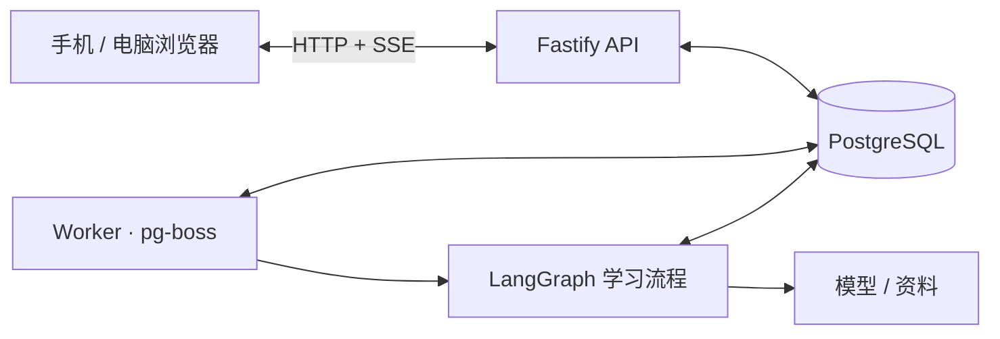

<div align="center">

# yeux-assitant

**个人数字助手 · 生成式软件工程 Lab 1**

围绕学习目标整理资料、记录回答、安排复习，通过手机或电脑浏览器使用。

[快速开始](#快速开始) · [功能](#功能) · [接口](#接口) · [开发说明](docs/development.md) · [实验题面](https://jyywiki.cn/GSE/2026/lab1.md)

</div>

---

这是 jyy《生成式软件工程》第一次实验的个人实现。目前以学习为主线：选资料、定目标、完成一个学习步骤，再根据回答继续。数据保存在自己的电脑上，任务在后台执行，关闭网页后仍可恢复。

## 功能

| 入口 | 可以做什么 |
| --- | --- |
| **今天** | 建立学习目标、提出一次性问题、继续当前任务 |
| **目标** | 查看学习计划、提交回答和自评、安排复习、暂停或确认完成 |
| **资料** | 导入 Markdown/文本、按课程检索、查看引用版本和原件 |
| **记忆与偏好** | 保存、编辑长期偏好与纠正规则，区分本人确认和未确认内容 |
| **更多** | 历史记录、定时计划、通知、模型设置，以及邮件草稿审批 |

学习流程：**关联资料 → 建立目标 → 准备练习 → 作答或自评 → 继续学习 / 复习**。同一目标只保留一个待反馈步骤；生成了学习内容，不代表已经学会。

## 快速开始

需要 **Node.js 24 LTS、pnpm 9 和 Docker Compose**。macOS 可使用 Colima。

```bash
git clone https://github.com/zzzfu411/yeux-assitant.git
cd yeux-assitant
pnpm install --frozen-lockfile
pnpm start
```

打开 **http://127.0.0.1:8765**，使用首次启动生成的 `private/access-token` 登录。在“更多 → 设置”填写兼容 Chat Completions 的模型地址、名称和 API 密钥，保存后测试连接。

第一次使用：在“资料”添加 [示例材料](examples/learning-note.md)，回到“今天”输入目标，展开“补充要求”关联材料，再点击“开始”。

```bash
pnpm status                         # 查看运行状态
pnpm stop                           # 停止服务，保留数据
pnpm backup                         # 备份数据库、配置与课程原件
ASSISTANT_PORT=8766 pnpm start       # 默认端口被占用时
```

同一局域网的手机可访问 `http://电脑局域网IP:8765`，使用相同口令。默认手动启动；电脑休眠或服务停止期间不执行任务。仅限本机访问时，使用 `ASSISTANT_BIND=127.0.0.1 pnpm start`。

## 接口

浏览器与后台使用 `/api/v2`。API 请求携带 `Authorization: Bearer <访问口令>`；写操作另带 `Idempotency-Key`，编辑操作按契约携带版本号。

| 能力 | 主要接口 |
| --- | --- |
| 今日概览 | `GET /api/v2/today` |
| 目标 | `GET /api/v2/goals` · `POST /api/v2/goals` · `PATCH /api/v2/goals/:id` |
| 回答与执行 | `POST /api/v2/sessions/:id/feedback` · `POST /api/v2/runs/:id/cancel` |
| 资料 | `POST /api/v2/sources` · `GET /api/v2/search?q=关键词&course=课程ID` |
| 原文与原件 | `GET /api/v2/sources/:id?version=1` · `GET /api/v2/sources/:id/original?version=1` |
| 实时进度 | `GET /api/v2/events?after=事件ID`，通过认证的 fetch 读取 SSE |

完整请求字段见 [共享契约](packages/contracts/src/index.ts)，路由见 [API 入口](apps/api/src/server.ts)。模型连接、离线资料导入和邮件配置见 [接入说明](docs/integrations.md)。

## 实现

**React + Fastify + LangGraph.js + PostgreSQL**，一个 TypeScript workspace，API 与 Worker 分别运行。



PostgreSQL 保存业务记录、队列和执行检查点。后台限制并发与调用预算，支持取消、重试和重启恢复；原始资料、模型生成内容、自评和模型估计分开记录。

## 当前边界

- 不附带模型或邮箱账号。未配置模型时，只提供原文摘录和自评，不进行自动讲解或评阅。
- 浏览器直接上传支持 Markdown/文本；HTML、PDF、旧 PPT/DOC 通过本机离线脚本导入。图表和复杂公式仍需核对原件。
- 邮件收取、去重和最终草稿审批已有实现；真实 smail 往来关联尚未完整验收，ehall 暂未实现。
- 偏好与纠正规则需要主动保存；没有离线手机推送，也不会修改课程学习清单。

仓库只包含实现、测试和示例。课程原件、学习记录、数据库、口令与密钥均保存在本地，不随代码发布。
