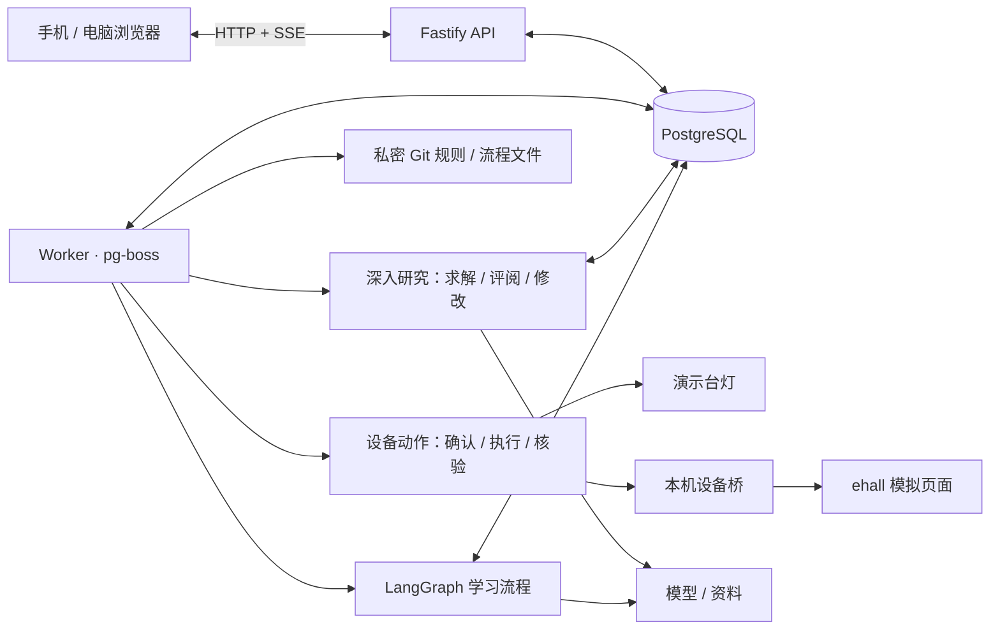

<div align="center">

# yeux-assitant

**个人数字助手 · 生成式软件工程 Lab 1 / Lab 2**

围绕学习目标整理资料、记录回答、安排复习，通过手机或电脑浏览器使用。

[快速开始](#快速开始) · [功能](#功能) · [接口](#接口) · [开发说明](docs/development.md) · [实验题面](https://jyywiki.cn/GSE/2026/lab1.md)

</div>

---

这是 jyy《生成式软件工程》Lab1、Lab2 的个人实现。目前以学习为主线：选资料、定目标、完成一个学习步骤，再根据回答继续。数据保存在自己的电脑上，任务在后台执行，关闭网页后仍可恢复。

## 功能

| 入口 | 可以做什么 |
| --- | --- |
| **今天** | 一个输入框：按写下的内容自动选择学习计划、答疑、整理、复盘、研究或办事（可在页边改）；未发出的输入在手机和电脑间同步，另一台设备的修改不会被静默覆盖；左页最多三件等你处理的事；[深入研究](docs/research.md)支持查证、比较和迭代答案；**办理通知**抽取要素（附原文引句）、对照资料列材料、追问、拟邮件与日历、归档 |
| **目标** | 查看学习计划、提交回答和自评、安排复习、暂停或确认完成 |
| **资料** | 导入、查重、编辑与归档资料，按课程检索正文并定位原文，保留历史引用和原件；邮件与办事记录也进入资料库 |
| **邮件** | 按线程整理往来（含已发送），据个人资料起草回复，缺信息先问你；核对固定内容后才发送，回复保留会话关联；支持模拟邮箱 |
| **记忆、规则与流程** | 保存偏好与纠正，可从你改过的草稿总结规则提议；已确认规则与“保存为流程”的流程写入私密 Git，新会话记录实际采用的版本 |
| **手机** | 经 HTTPS 入口安装到主屏幕，底部导航；新邮件、待确认、需要补充的信息推送到手机 |
| **更多** | 设备控制、历史记录、定时计划、消息、模型与邮箱设置、手机通知 |

学习流程：**关联资料 → 建立目标 → 准备练习 → 作答或自评 → 继续学习 / 复习**。同一目标只保留一个待反馈步骤；生成了学习内容，不代表已经学会。

## 快速开始

需要 **Node.js 24 LTS、pnpm 9 和 Docker Compose**。macOS 可使用 Colima。

```bash
git clone https://github.com/zzzfu411/yeux-assitant.git
cd yeux-assitant
pnpm install --frozen-lockfile
pnpm start
```

首次部署运行 `docker compose --env-file private/runtime.env exec api node dist/scripts/setup-admin.js` 设置管理员（密码输入不回显）。打开 **http://127.0.0.1:8765**，使用账号和密码登录。在“更多 → 设置”填写兼容 Chat Completions 的模型地址、名称和 API 密钥，保存后测试连接。

第一次使用：在“资料”添加 [示例材料](examples/learning-note.md)，回到“今天”在“写下来”输入目标（页边选“计划”），点击“选择资料”关联材料，再点击“创建学习计划”。

逐步操作见 [使用指南](docs/usage.md)。

```bash
pnpm run doctor                     # 只读检查配置、引擎和端口
pnpm status                         # 查看运行状态
pnpm stop                           # 停止服务，保留数据
pnpm backup                         # 暂停写入，备份数据库与运行文件，再恢复服务
pnpm backup:check <备份目录> --docker # 核对文件并完整解码数据库备份
ASSISTANT_PORT=8766 pnpm start       # 默认端口被占用时
```

默认仅本机访问、手动启动；电脑休眠或服务停止期间不执行任务。手机远程入口按自有 VPS 的 HTTPS 部署准备，当前不会自动开放局域网。

## 接口

浏览器与后台使用 `/api/v2`。浏览器登录后使用 HttpOnly Cookie；CLI 集成可继续携带 `Authorization: Bearer <API访问口令>`（来自 `private/access-token`，不是管理员密码）。写操作另带 `Idempotency-Key`，编辑操作按契约携带版本号。

| 能力 | 主要接口 |
| --- | --- |
| 管理员登录 | `POST /api/v2/auth/login` · `GET /api/v2/auth/session` · `POST /api/v2/auth/logout` |
| 今日概览 | `GET /api/v2/today/overview` |
| 目标 | `GET /api/v2/goals/list` · `POST /api/v2/goals` · `PATCH /api/v2/goals/:id` |
| 历史列表 | `GET /api/v2/sessions/list` · `GET /api/v2/goals/:id/attempts/list` |
| 深入研究 | `POST /api/v2/sessions` 携带 `research` · `GET /api/v2/sessions/:id/research/export` |
| 回答与执行 | `POST /api/v2/sessions/:id/feedback` · `POST /api/v2/runs/:id/cancel` |
| 资料 | `GET /api/v2/sources` · `POST /api/v2/sources` · `PATCH /api/v2/sources/:id` |
| 归档与检索 | `PATCH /api/v2/sources/:id/archive` · `GET /api/v2/search?q=关键词&course=课程ID` |
| 原文与原件 | `GET /api/v2/sources/:id?version=1` · `GET /api/v2/sources/:id/original?version=1` |
| 本地执行器 | `POST /api/device/v1/poll` · `POST /api/device/v1/calls/:id/start` · `POST /api/device/v1/calls/:id/result` |
| 设备操作 | `GET /api/v2/devices` · `POST /api/v2/devices/:id/commands` · `POST /api/v2/device-commands/:id/decision` |
| 规则工作区 | `GET /api/v2/workspace` · `POST /api/v2/workspace/scan` · `POST /api/v2/workspace/commit` |
| 运行诊断 | `GET /api/v2/status` · `GET /readyz`（数据库就绪） |
| 实时进度 | `GET /api/v2/events?after=事件ID`，通过认证的 fetch 读取 SSE |

完整请求字段见 [共享契约](packages/contracts/src/index.ts)，路由见 [路由模块](apps/api/src/routes)。模型连接、离线资料导入和邮件配置见 [接入说明](docs/integrations.md)。

## 实现

**React + Fastify + LangGraph.js + PostgreSQL**，一个 TypeScript workspace，API 与 Worker 分别运行。



PostgreSQL 保存业务记录、队列和执行检查点。四类任务共用一个执行内核：每一步的结果与回执同事务提交，重试和“重新准备”只重做输入变了的步骤；每次模型调用记录耗时与 token，任务页“运行记录”可查。后台限制并发与调用、时间、token 预算，支持取消、重试和重启恢复；原始资料、模型生成内容、自评和模型估计分开记录。检索使用索引列与 BM25。

## 当前边界

- 不附带模型或邮箱账号。未配置模型时，只提供原文摘录和自评，不进行自动讲解或评阅。
- 浏览器直接上传支持 Markdown/文本；HTML、PDF、旧 PPT/DOC 通过本机离线脚本导入。图表和复杂公式仍需核对原件。
- 邮件线程、起草、确认发送与去重已在模拟邮箱和真实模型上走通；真实 smail 账号需本人在设置中填写授权码后验收。ehall 只有本机模拟（本轮按要求暂缓），真实账号尚未接入。体验步骤见 [使用指南](docs/usage.md#邮件) 与 [设备与模拟事务](docs/devices.md#ehall-模拟事务)。
- 设备页支持连接配置、操作确认、暂停、撤销和结果核实；外部 Agent 可提出待确认动作。本地执行器与 Mac 音量适配器已实现，实机验收尚未通过，不能据此宣称支持任意硬件。使用方式见 [设备接入](docs/devices.md)，证据见 [SPEC](SPEC.md)。
- 手机访问依赖电脑运行实例并开启隧道（`pnpm tunnel start`）；电脑休眠时手机只看到离线提示。规则提议与流程都需本人确认后才生效，不会修改课程学习清单。

仓库只包含实现、测试和示例。课程原件、学习记录、数据库、口令与密钥均保存在本地，不随代码发布。


服务器版：按 [云电脑部署说明](docs/server.md) 先检查环境，再创建独立实例。面向自有 VPS，使用 HTTPS 反向代理访问。Hermes 等 Agent 通过独立凭据调用 MCP 或 HTTP 工具；本机实例和个人数据不会自动迁移。

在「设置 → 管理连接」创建 Agent 凭据，按需开放资料读取、目标创建和任务准备；作答与外部动作确认由本人完成。详见 [Agent 接入](docs/agents.md)。

架构取舍、当前不足和本轮改进见 [项目审计](docs/audit-2026-10-04.md)。运行异常可从“更多 → 设置 → 运行状态”查看。
