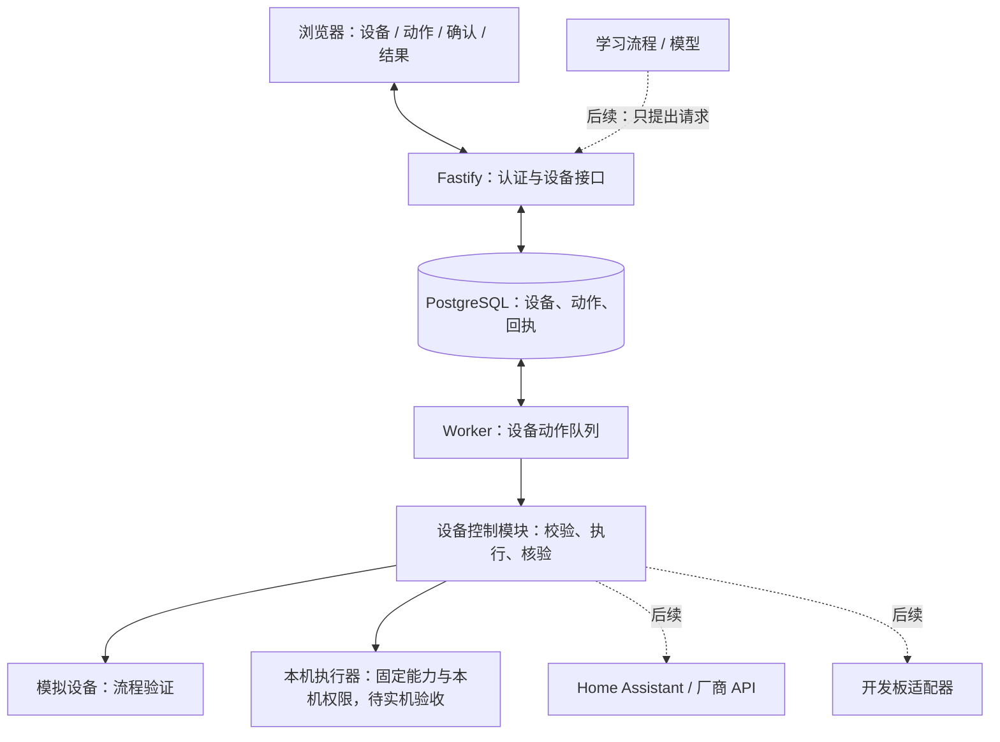
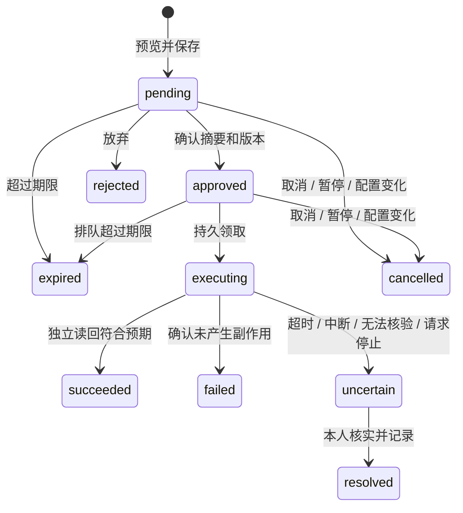

# SPEC · 学习助手

本文记录独立项目 `yeux-assitant` 的持续迭代规格、验收依据与设备控制边界。I2–I5 已完成本机更新与数据核对，模型教学质量仍单独验收；设备 D0–D3 已实施并自检，D4a 已增加本地连接与 Mac 音量代码适配器，并通过隔离软件自检；实机效果尚未通过验收，D5 学习场景联动仍待实机验收。

## 执行内核、检索与深入研究第 2 版（2026-10-16，第五轮）

本节是当前状态。起点是一次自评：按 Lab1/Lab2 题面与工程评审拼出的 100 分制（题面本身不记分）估约 74 分，扣分集中在执行层不统一、性能与成本、Lab2 搜索机制和缺测量。本轮逐项改进，并用测量结果说明改进了多少。开工前把第四轮在本地提交为基线（`922c9fe`、`7c30d9d`），之后每阶段分别提交，均未推送。

| 方面 | 改动 | 提交 |
| --- | --- | --- |
| 执行内核 | 四类任务由 `executors.ts` 选执行器，共用 `step()`：结果、业务写入和 `app.run_steps` 回执同事务提交；同一轮重试重放回执，本人“重新准备”时只沿用输入摘要不变的步骤（办事的 `planRunId`、研究的接续不再各写一套）。学习流程保留 LangGraph（需要中断等待作答），节点回执移出 `app.settings`（迁移 0016） | `aae2930` |
| 模型调用 | 每步声明 profile（抽取 / 计划 / 写信 / 求解 / 另辟方向 / 评阅…），可按步骤换模型、温度、输出上限、推理强度；默认请求结构化输出（`json_schema`），服务拒绝时依次退回；每次调用记录步骤、首字节、耗时、输入 / 输出 / 推理 token 与结果（`app.model_calls`），任务页“运行记录”可查 | `aae2930` |
| 检索 | `app.search_terms` 切词 + 生成列 `lexemes` + GIN 索引（迁移 0017）；按 IDF 选词取代“只留最后 48 个词”，候选经索引筛出后按 BM25 排序；片段批量写入，扫描每个根目录只读一次库 | `3f45468` |
| 深入研究 | 记录第 2 版：深入档两个根方向并行、互不可见；新版本与当前采用版本盲评两两比较（A/B 随机顺序并记录，平局保留原版），不再比较不同调用的绝对分；连续两次修改未胜出提前结束；增加 token 上限 2 万 / 8 万 / 16 万；页面显示搜索树与比较理由 | `f83a489` |
| 实时与草稿 | `pg_notify` 唤醒 SSE，监听断开才每秒轮询；浏览器按事件类型只刷新相关查询，连接正常时页面不再轮询；“今天”的草稿存服务端（迁移 0018），带版本号，另一台设备的修改不会被静默覆盖 | `f2cd4f7` |
| 维护与验证 | 锁编号集中登记、`app.settings` 经 `kv.ts` 按结构读写（架构检查强制）；每日清理 30 天前的已发布事件和 180 天前结束运行的调用记录；API / Worker 结构化日志（不含查询参数、正文和凭据）；今天概览与任务详情的响应结构由数据库测试和浏览器模拟两边核对（当场发现模拟数据缺两个字段）；CI 拆成三个并行任务 | `f2cd4f7` |

**测量（只用合成资料；模型 grok-4.6，本轮授权 ≤ 40 次，实际 31 次，均成功）**

| 项目 | 以前 | 本轮 |
| --- | --- | --- |
| 检索：22 条查询 + 400 份干扰笔记（430 片段） | recall@5 0.955，MRR 0.93–0.96，平均 63 ms | recall@5 1.000，MRR 0.977，平均 5.6 ms |
| 检索：3,000 份干扰笔记（3,030 片段） | 平均 441 ms | 平均 18 ms |
| 办事：收到通知 → 清单与追问 | 第三轮：计划一次调用 158–160 秒、7.7k–8.6k 输出 token（含整封信） | 抽取 29 秒 + 计划 54 秒，合计 84 秒；计划 6.3k 输出 token，其中推理 5.8k |
| 办事：回答 → 清单与邮件 | 同上，每轮重写整封信 | 计划 40 秒 + 写信 38 秒，合计 79 秒；信件 2.4k token |
| 研究·隔离级别：直接 / 标准 / 深入 | 第三轮 9 次运行仅 4 次干净完成 | 15 / 126 / 234 秒；3.5k / 26.5k / 46.0k token；全部完成 |
| 研究·需求规格：直接 / 标准 / 深入 | — | 33 / 324 / 436 秒；4.0k / 34.0k / 59.5k token；全部完成 |

- 31 次调用全部接受了结构化输出，没有一次结构不合格；输出 token 中 75–92% 是推理 token。深入档两个根方向并行，两次调用合计只多花 6–8 秒。
- 办事单次调用从约 160 秒降到 29–54 秒，但不能全部归功于设计：今天服务的输出速度约 115–160 token/秒，第三轮约 50 token/秒。可归因于设计的是每步输出更少（计划不再含信件、追问轮不再写注定作废的信），以及每一步都有耗时与 token 记录可查。
- 第一次办事测量的合成回答漏写了通知要求的摘要，助手正确地再问了一次（该次停在“待补充”，3 次调用）；补上摘要后第二次走完全程（4 次调用），收件人与主题格式正确，日期与截止时间无误。
- 研究的质量只核对了关键词线索（6 份最终答案都含预设线索），这不是语义正确率。去掉档位标签、打乱顺序的答案在 `private/research-eval-CRfJKU/blind.json` 和 `private/research-eval-abntfl/blind.json`，等本人盲评后才能判断投入更多是否更好。
- 测量中发现并修正：落败的原版本会被后一次比较覆盖分数，导致页签上的分数来自不同比较、不可直接对比；现在落败的原版本保留自己被评时的分数。

验证：`pnpm verify`（PostgreSQL 18）44 文件 / 476 项全部通过，数据库测试无跳过；Playwright 桌面 + 手机 226 项通过、2 项需真实实例的 live 用例跳过，全量约 4 分 20 秒；检索基准见 `pnpm retrieval:eval`；办事与研究测量可用 `pnpm errand:eval`、`pnpm research:eval` 重现。顺带修正一项既有的不稳定设备用例（与页面 5 秒轮询竞争）。

未做：正式实例未重建（迁移 0016–0018 尚未应用）；没有推送，CI 尚未在 GitHub 上运行；没有接真实 smail、ehall；研究盲评待本人完成。

## 界面结构与执行逻辑（2026-10-14，第四轮）

本节记录当时状态；执行逻辑、检索与研究以上一节为准。开工前已把第三轮全部改动在本地提交为基线（`188e243` 代码、`eabea08` 文档），未推送。

界面：“研究笔记本”从配色落实到结构。

- **今天是一页手账**：页眉是大号日期与问候，下方一行“进行中的目标 / 新邮件 / 未读消息”。正文是左右两页：左页“等你的事”最多三张索引卡（待核对的邮件、等你练习或补充的任务、失败任务），卡片上有类型标签、状态色边与一二三序号，多出的给“另有 N 项”；右页“写下来”只有一个输入框。原来的四个统计块、六个功能卡和重复的常用入口全部去掉，回到“首页最多三项”。
- **统一入口**：输入后按内容在本机判断功能（`apps/web/src/intent.ts`，纯规则，不调用模型）：通知类信号（日期、截止、发送至、邮箱）足够强时直接判为办事，其余在研究 / 计划 / 复盘 / 整理 / 答疑间取分数最高者，信号不足时按长度回落并标为“不确定”。判断结果以印章显示并附理由；页边竖排的六个分隔页签可以改选，改选后输入不再改变它，可“改回识别”。换页签不清空文字。没有输入时不预选任何页签。
- **保护未发草稿**：“添加目标”“套用流程”等链接只在页面没有未提交内容、或内容本就属于该功能时切换页签。旧版按功能分存的草稿在首次打开时迁移一次（保留文字、功能、预期成果与资料选择）。
- **外框**：侧栏改为布面封皮（织纹、靠书脊的缝线、米色书签式品牌标），当前页是插进纸页的纸质页签；手机仍为底部标签栏。
- **办事单与印章**：通知要素做成带编号的办事单，右上角圆形印章只表示记录已证明的状态（办理中 / 待补充 / 已备妥 / 已归档 / 需处理）。
- **研究记录页签**：候选版本由折叠时间线改为实验记录本的页签（左右方向键切换），默认打开当前采用的版本，页签上标注采用或分数。
- **邮件**：线程行显示为一叠信。
- 代码：1589 行的 `learning.tsx` 拆为 `today.tsx`、`goals.tsx`、`session.tsx`，行为不变；浅色 / 深色 / 高对比 / 减少动态保留。

执行逻辑：

- **办理通知拆分调用**：清单调用不再写邮件正文，只给出是否需要邮件与主题；正文另用一次 `ERRAND_MAIL` 调用，且只在没有待补充问题、本人没有改过或确认过现有草稿时才写。追问那一轮少生成一封注定作废的信；有清单就先保存显示，再写信。同一轮重试复用已保存的清单（`planRunId`），只补写失败的那一步。
- **深入研究按步重试**：某一步遇到服务错误（5xx、流式中断、结构不合格）且剩余调用足以让这一步发挥作用时，在本轮内重做这一步（标准档 1 次、深入档最多 2 次）并在页面注明；剩余调用不够评阅时不再求解新版本，因为未评阅的版本不能被采用。
- **失败后接续**：“重新准备”一项失败的研究时，新一轮从上一轮已保存的候选接续（`resumeFrom`、`offset`）：未评阅的先补评阅，已有求解不重做；新一轮预算单独计算，只计新增候选；模型设置变化时从头开始。

验证：`pnpm verify`（格式、架构、类型、构建、临时 PostgreSQL 18）39 文件 / 444 项全部通过，数据库测试无跳过；新增覆盖：办事“先问后写、只写一次、同轮重试复用清单”，研究“按步重试、预算不足不求解、失败后接续”，入口识别规则 6 项。Playwright 桌面 + 手机 222 项通过、2 项需另起真实实例的 live 用例跳过；改写的界面用例覆盖自动识别与改选、换页签不丢文字、旧草稿迁移、链接不改写未发草稿、最多三件待办。浅色 / 深色对比度检查（≥ 4.5:1）随用例通过；截图已人工检查（合成数据）。

未做：本轮没有真实模型调用，拆分后的办事耗时和研究重试在真实服务上的效果尚未测量；正式实例未重建，仍运行第三轮版本；未推送。

## Lab1 能力补齐与“研究笔记本”界面（2026-10-13，第三轮）

本节记录当时状态；界面与执行逻辑以上一节为准。依据 [lab1-alignment-plan](docs/lab1-alignment-plan.md) 的 P1.6、P1.7、P2、P3、P5 实施；ehall 按本人要求本轮暂缓（只保留原有模拟）。

| 题面能力 | 本轮实现 | 验证 |
| --- | --- | --- |
| 个人数据库 | 邮件（收、发）与办事记录写入资料库；通知原文保存为资料并可跳转定位 | 单元 + PG 集成 |
| smail 邮件 | 迁移 0010：线程与邮件表；收件箱与“已发送”只读同步、HTML 转文本、群发识别、迟到父邮件合并；回复草稿结合线程往来、个人资料与“邮件”规则，缺信息先追问；发送确认绑定 In-Reply-To / References / 抄送；发出邮件即入线程，已发送副本按 Message-ID 去重；模拟邮箱（private/mail-sim）与设置页（模式、授权码只写、测试连接不发信、自动起草策略与每日上限） | 单元 + PG 集成 + 真实模型（模拟邮箱） |
| 手机联动 | PWA（manifest、图标、仅推送的 Service Worker，不缓存私密数据）；Web Push（VAPID 密钥本机生成、订阅仅 HTTPS、通知认领后至多发送一次）；手机底部导航；VPS nginx 只做 HTTPS 入口，经本机手动启动的 SSH 反向隧道（`pnpm tunnel`）访问本机实例；按 Host 区分远程与本机来源，远程 Cookie 为 Secure | 单元 + e2e；`https://assistant.yeux.si` 已上线并从外网实测 |
| 能力组合 | 迁移 0012：“办理通知”流程：抽取要素（每项附原文引句，程序核对引句、日期与截止语义，截止时间不能当作活动开始）→ 检索个人资料（含 profile 与 records）→ 追问 → 邮件草稿（收件人只取通知中的地址或通知发件人，需确认发送）与 .ics 日历 → 归档到私密 Git 并入库 | 单元 + PG 集成 + 真实模型 |
| 纠正与流程进 Git | “从我的修改总结规则”：一次明确触发的模型调用生成未确认提议，本人确认后才写入 Git；“保存为流程”按实际步骤生成流程文件，首页“常用流程”套用，邮件主题命中关键词时自动按流程办理 | PG 集成 + e2e |

界面：整体改为“研究笔记本”风格（纸面、红色页边线、蓝色横线、宋体标题、楷体批注、印章式状态），新增邮件列表 / 线程 / 草稿信纸视图、办事面板、流程编辑器、邮箱与手机通知设置；浅色 / 深色 / 高对比 / 减少动态均保留，主导航仍为“今天 / 目标 / 资料”。

验证：`pnpm verify`（格式、架构、类型、构建、临时 PostgreSQL 18）38 文件 / 435 项全部通过，数据库测试无跳过。Playwright 桌面 + 手机 220 项通过，2 项需要另行启动真实实例的 live 用例跳过。

真实测试（本人授权本轮合计 ≤ 60 次调用，实际 43 次；grok-4.6；邮箱只用模拟邮箱；均在本机真实实例上）：

- 邮件回复 2 次：缺信息先追问 → 补充后重拟 → 确切确认 → 模拟发送 → 回到原线程；重新收取后已发送副本不重复。
- 办理通知（真实格式的研究生学术报告会报名通知）：抽取 → 计划 → 追问 4 题 → 回答后生成草稿（收件人取自通知、主题符合通知格式）→ 确认发送（模拟）→ .ics（开始 + 合并后的截止，提前一天提醒）→ 归档进私密 Git 与资料库 → 保存为流程。单次计划调用 158–160 秒、7.7k–8.6k 输出 token。
- 从修改总结规则 1 次：得到“给老师写报名类邮件”的未确认提议。
- Lab2 三个合成案例 × 三档共 22 次，见 docs/research.md 与课程仓 `lab/lab2/REPORT.md`；9 次运行 4 次干净完成，不能证明高投入提升质量。

真实测试发现并修复（均有回归测试）：流程沿用学习任务 180 秒预算 → 邮件 3 次 / 300 秒、办理 5 次 / 480 秒，单次 180 秒；“10 月 30 日 18:00 前将…”未被认作截止；姓名联系人被丢弃；联系人无邮箱时没有收件人且追问被四题上限截掉；核对规则改进无法作用于已保存结果（现保存原始抽取，每轮重新核对）；Cloudflare 首字节 100 秒 524（所有请求改为流式，拒绝时退回普通请求一次）；服务端错误一律提示“检查连接设置”（现显示脱敏原因）；“从修改总结规则”超过 API 20 秒连接上限（现 15 秒内未完成先回复“正在总结”，完成后通知，同一草稿合并请求）；保存流程从真实标题生成 id `2026` 与关键词“关于”“2026”（现去除套话，无英文词时用摘要 id，再次保存保留原关键词，归档文件名可读）；产出卡片状态印章变形。

事故：Agent 在 VPS 上用不含 `user` 的临时配置运行 `nginx -t`，nginx 把 `/var/lib/nginx/*` 属主改为 nobody，09:20–09:31 经该 nginx 的大请求返回 500（grok 接口 11 次失败，9 次为本轮通知流程、2 次为 Lab2）。已恢复为 www-data 并核实；之后只用正式配置检查。

手机入口：经 Cloudflare 连接器添加 `assistant.yeux.si` A 记录（仅 DNS，不代理），Let's Encrypt 证书至 2027-01-11 并由 certbot 自动续期，启用 HTTPS 站点。外网实测：证书有效、HTTP/2、HSTS 与 CSP、PWA 清单与 Service Worker、远程来源登录进入凭据校验、事件流 1.6 秒收到心跳（无缓冲）；隧道断开时返回 503 离线页。上线时发现：Mac 休眠或换网后 VPS 仍保留旧 SSH 会话并占住转发端口，重连一直报 “remote port forwarding failed”；`pnpm tunnel` 现在遇到该错误会只结束 VPS 上占用本隧道专用端口的 sshd 会话并立即重连。尚未在真机上安装 PWA 和测试推送。真实 smail、ehall 未接入；未提交或推送。

## 界面与研究效果优化（2026-10-13，第二轮）

本节是当前状态；下方 Lab2 首轮记录保留当时事实。

界面：主导航仍为“今天 / 目标 / 资料”。电脑侧栏直接列出次级入口（消息、设备、定时计划、历史、规则与流程、设置）与账号 / 退出；手机改为底部标签栏，“更多”打开次级入口面板，顶部固定栏显示当前位置，滚动定位避开上下栏。首页增加待处理 / 进行中目标 / 未读计数；研究投入改为带调用上限的卡片；未连接模型时不能提交研究。研究结果页：答案上方显示采用版本与停止原因，下方“研究记录”展示调用 / 用时 / token 计量、按实际执行生成的步骤（含未完成的评阅）、候选版本时间线（四维评分条、评阅依据、被移除的引文）与固定资料版本。目标页显示路径进度和“继续练习”。资料页正文检索改为常驻面板。设置页按卡片分组。标题使用宋体衬线，数字使用衬线等宽数字；浅色 / 深色 / 高对比 / 减少动态均保留。

研究效果：引文逐字优先，失败时忽略空白与全 / 半角差异匹配，保存的仍是原文确切片段与范围；找不到的引文从候选中移除并记为 `droppedCitations`，不再让整份候选作废；评阅时告知被移除条数。模型 JSON 可从说明文字或代码块中提取，多余字段丢弃、列表截断、分数规整到 0–4，缺失必填项仍无效。新增可选独立评阅模型 `llm.review`：评阅改由该模型执行，同一服务地址可沿用主密钥，换地址必须重填，旧回执兼容，连接测试依次检查两个模型，研究记录与评测报告记录评阅模型。研究时间上限改为 150 / 420 / 840 秒（迁移 `0015` 放宽约束到 900 秒），调用上限 1 / 4 / 8 不变。

验证：`pnpm verify`（格式、架构、类型、构建、临时 PostgreSQL 18）35 文件 / 411 项全部通过，数据库测试无跳过；新增测试覆盖引文容错与移除、结构规整边界、JSON 提取、评阅角色路由、评阅配置的密钥隔离与旧回执兼容。Playwright 桌面 + 手机 216 项通过、2 项为需要真实实例的 live 用例跳过；一次 4 并发运行出现 12 项手机端超时（页面创建 / 销毁超时），降低并发重跑全部通过，按负载问题处理。测试用 Colima 已关闭。

未做：未用真实模型重新对比，不能宣称质量提升；实际助手未启动、真实数据库未迁移（下次手动 `pnpm start` 时应用 0014、0015）；未提交或推送。

## Lab2 · Deeper Research（2026-10-13）

采用 [研究规格与使用说明](docs/research.md)。新增“深入研究”入口与 direct / low / high 三档；复用现有 API、Worker、资料库、认证和取消机制。普通学习预算不变，研究的调用和时间预算持久化为 1/4/8 次与 90/240/480 秒（时间上限已在上节放宽）。

每步保存候选、固定资料版本、评阅、采用理由和实际消耗。高档先探索另一方向，再深入修改；采用固定维度的模型比较，平分或退步保留旧版；引文逐字校验。版本快照和状态以业务表为准，避免双重进度。用户已授权一组最多 13 次现有模型对比，仅使用合成资料。

状态：首版实现与工程自检通过。完整回归 35 文件 / 402 项通过，数据库测试无跳过；最后增加的时间预留修复另经 4 文件 / 34 项相关复验，最终提示词调整经 11 项策略检查。主流程界面 110 项桌面/手机检查通过，最终研究界面 4 项复测通过；独立服务 2 项闭环、36 张 app 表 / 169 行 / 24 个清单文件的合成备份恢复通过。以上相关复验与全量存在重叠，不把数量相加。

真实对比累计恰好 13 次 `grok-4.7` 请求，仅使用合成事务资料。直接档完成；早期版本遇到单次等待和整轮超时；深入补测收到 HTTP 524 后保留已评阅版本。最终版在剩余 2 次调用内完成求解与评阅（101 秒、9,365 token），按预算结束，尚未走四次修改闭环。整组已报告 58,691 token，3 次请求的用量未知；不能证明高投入稳定提升质量。失败记录、分档结果和去标签答案保存在 `private/lab2-20261013/evaluation/`，不提交 Git。

真实测试促成两项修复：单次研究请求最多等待 180 秒且服从整轮截止；预留最多 5 秒保存已评阅结果，仍由硬超时与取消校验约束。评阅允许有明确前提的推断，不把资料未提及当作反证。模型自评和本人盲评继续分开，未把结果标为学习掌握。

源码经旧文件 SHA-256 核对后应用；应用清单与原件保存在 `private/lab2-20261013/`。本次实际助手保持停止、真实数据库未迁移、测试用 Colima 已关闭。下次由本人手动 `pnpm start` 构建并应用迁移 0014；不提交或推送。

## Lab1 对齐 · 2026-10-05

依据 [lab1-alignment-plan](docs/lab1-alignment-plan.md) 分批实施。本节是当前状态，后面的 I/D/V 记录保留当时事实。已确认：后续部署自有 VPS，当前仅本机；ehall 先做模拟，真实账号验收稍后；保持手动启动。Lab1 优先，D4a.4 实机音量、D5 场景联动、Hermes/Muse 真实接入、实际 VPS 部署及审计 A07–A10 暂停。

| 阶段 | 本批实现与边界 | 自检状态 |
| --- | --- | --- |
| P0 基线与格式 | 已审查现有公开源文件；本地保存实现、文档、纯格式三个提交；课程入口改为跨平台 GitHub 链接；不推送、不改学习勾选 | 基线及格式各 359 项后端检查通过；最新完整回归见下文 |
| P1 规则与流程基础 | 私密独立 Git；已确认规则写文件并提交；旧规则导入保留版本；崩溃后从 Git 回执恢复；手工文件扫描、冲突和停用；模型调用记录实际规则版本；流程严格格式与存储 | 真实 Git、隔离 PG、两次合成通知、手工编辑与手机交互通过；P1.6 自动总结提议、P1.7 保存并再次执行成功流程尚未实现 |
| P4 模拟 ehall | `browser.ehall` 复用设备桥；合成登录、查询入库、iframe 表单准备、字段/后果/截图预览、确切确认、提交后独立状态读回；禁用请求、重复与迟到结果受限 | 本机 Chrome + 合成站点 + 隔离 PG 通过；真实 profile、真实账号、附件上传与个人资料自动填充未验收/未开放 |
| P6 资料生命周期 | 文件删除退出新检索且旧引用保留；恢复同路径沿用 ID；同内容改名提示；notes/profile/records 扫描；profile 隔离；引用字符范围高亮 | 新增/删除/恢复/改名/目录丢失/中文及 Unicode 边界通过；短引文生成与完整读写文件视图仍待实现 |
| P2 / P3 / P5 | 邮件线程与设置完善、PWA/推送、通知办事图及成功流程复用 | 尚待后续阶段；当前未声称 R1–R6 全部通过 |
| P7 真实验收 | 本人 smail、真实 ehall、本人手机与常用跨工具流程 | 待本人账号及独立验收；模拟和浏览器手机尺寸测试不能替代 |

工程决策：工作区使用 `private/workspace/` 独立本地 Git，不设置远程。采用 advisory lock **847392030**，避免计划示例 847392010 与既有学习并发锁冲突。保留 `.git/index.lock` 并由 doctor 报告；仅凭年龄无法证明 Git 进程已退出，因此不自动删锁。新迁移为 0009（规则/流程）、0011（资料缺失状态）、0013（动作截图）；0010 与 0012 仍预留给邮件/办事阶段，按注册清单运行迁移。

自检（冻结源码）：`pnpm verify` 的格式、架构、类型、构建通过，33 个测试文件、385 项全部通过，数据库集成无跳过；Playwright 全集 208 项通过，2 项独立服务用例在 `verify:e2e` 中另验。早期 ehall UI 两项失败是测试夹具定位与空回执读取问题，修复后全量通过；未跳过失败场景。没有调用真实外部模型、邮箱、ehall 或物理设备。

本机应用核对：74 个源码和文档文件通过逐文件旧摘要检查后应用，变更前源码单独保留。2026-10-05 新镜像的 API/Worker 已运行于 `http://127.0.0.1:8766/`；Docker 确认仅回环映射，维持 `restart: no`。31 张原有 app 表共 51 条记录的原字段摘要及 5 个私密配置摘要一致。新增迁移 9、11、13 已应用。工作区已初始化且干净；当前实例原本没有待迁入的确认规则，未凭空创建规则。

已导入 GSE 9、数据库 8、软件工程 9 份资料，连同原有 1 份共 **27 份**。26 份课程正文、标题、来源摘要、版本与原件字节逐条核对；再次导入同包仍只有 26 条课程版本。导入包原有 43 条文本提取提示保留，涉及图表、图片和原字体符号；并不把正文提取等同于完整理解课件。

独立服务自检：`pnpm verify:e2e` 两项桌面/手机学习闭环通过；完整合成恢复核对 35 张 app 表、168 行、24 个清单文件，随后仅启动恢复 API，核对管理员登录、历史引用及原件字节，没有重放待核实审批。该恢复使用合成数据，不是将用户真实库反复覆盖。

更新前备份 `private/backups/postgres-2026-10-05T06-33-50-643Z-3efb0228/`（10 文件）及更新后备份 `private/backups/postgres-2026-10-05T06-45-21-921Z-b7ff2aff/`（49 文件、15,952,836 字节）均通过摘要与 PostgreSQL 18 完整解码；后者包含工作区 Git 并通过 Git 完整性检查。保留回退镜像 `yeux-assitant:before-lab1-20261005`，新版镜像配置摘要 `de1985b6407f9a670053f589c93c7b0bb7279121d06ff67cbf1c05fa51efd8d1`。如需回退，先保留新版数据，在独立库还原旧备份并核对，不将旧备份直接覆盖新记录。

只读 doctor 无阻止启动的问题；“仅本机可访问”提示符合本人选择。Worker、调度、资料、导出、设备五组件均为 ok。新页登录入口已在本机浏览器打开；正式实例的受保护接口另用既有 API 凭据只读核对，未用合成数据冒充实际浏览器登录验收。

P0 本地提交为 `89ba816`（已验证实现基线）、`8636219`（文档）、`c6ac02e`（纯格式）。本批功能改动保存在工作区，**未自动提交或推送**；GitHub Actions 仍未远程运行。课程仓只改实验入口链接，不同步、提交或勾选学习清单。真实模型、smail、ehall、物理设备和手机远程验收保持未完成。

原始验证日志、部署前后摘要、备份检查、课程导入及回放报告保存在忽略目录 `private/lab1-alignment-20261005/`。下一批按 P2 邮件线程/设置、P3 手机入口、P5 通知办事与成功流程复用推进；P1.6 改稿总结和 P6 短引文随对应流程补齐。

## 0. 持续迭代与成熟度验收

2026-10-03 起按“发现具体缺口 → 确定行为与边界 → 小步实现 → 独立环境自检 → 应用并核对 → 复查”循环推进。成熟度针对单用户、手动启动的个人学习助手，不以代码量、Agent 数量或测试总数定义。

| 验收面 | 退出条件 | 当前重点 |
| --- | --- | --- |
| 日常使用 | 材料可整理和更新，历史可访问，失败时知道下一步；手机操作完整 | 资料维护、历史分页 |
| 事实与学习 | 资料版本、作答、自评、模型估计分开；已出题不因资料更新而改变评阅依据 | 版本一致性、固定教学案例 |
| 运行可靠性 | 并发、重连、中断、取消后没有重复结果或静默丢失状态 | 实时事件逆序提交与恢复 |
| 数据可恢复 | 一致备份、损坏阻止使用、独立新库恢复并核对正文/引用/审批 | 完整性检查、恢复工具 |
| 可维护与交付 | 清晰模块边界、可重现验证、首次启动诊断、自动化回归 | 诊断与 CI、开发说明 |
| 真实集成 | 每种模型、邮箱或物理设备有独立真实验收证据 | 模拟验收不替代真实效果 |

工程改进先在隔离副本完成，测试数据库必须是专用测试库。正式实例更新前创建一致备份；迁移核对原有字段，新增字段与修复性变更单独记录。仍不自动同步仓库、发布 Git、导入其他目录或增加设备权限。

### I2 · 资料维护、实时更新与运维诊断

| 子步骤 | 缺口与方案 | 自检 | 状态 |
| --- | --- | --- | --- |
| I2.1 资料生命周期 | 同正文提示而不自动加副本；新版本正文与标题不可变；归档可恢复并退出新检索；Web 文本不被扫描回退 | 并发导入/编辑、版本冲突、原件/原引用、归档与扫描交错、手机交互 | 已应用并核对 |
| I2.2 评阅依据 | 评阅使用已交付练习保存的引用，下一次准备使用当前未归档资料；已有计划不自动清空 | 资料更新/归档后评阅沿用 v1，后续准备改用 v2 或无资料 | 已应用并核对 |
| I2.3 实时事件 | 业务自增 ID 不代表提交顺序；为已提交事件分配独立发布游标，连接立即反馈 | 真实 HTTP SSE、逆序提交、并发读者、断线续读、退出关闭、恢复旧备份游标 | 已应用并核对 |
| I2.4 运维诊断 | 只读 doctor 与 backup:check；明确完整验证、失败、受限验证，给出可执行说明 | 合成异常配置/损坏备份/路径与文件替换；独立真实归档核对 | 已应用并核对 |

资料归档保留原文与旧引用，不自动解绑目标；已有目标仍可暂停、调整。已出题的回答按原资料评阅。新的目标不能关联归档材料，后续练习不从归档材料检索。课程提取文本只允许在页面改标题，正文通过原导入流程更新，以保留原件与提取位置。以前未保存的逐版标题不能逆推出；迁移保存当时已知标题，以后版本精确记录。

I2 自检：`pnpm verify` 的 190 项后端检查通过，数据库集成未跳过；138 项桌面/手机浏览器检查通过；`verify:e2e` 的 2 项真实服务闭环通过。完整合成恢复核对 28 张 app 表、156 行及 10 个备份文件；归档全量解码，待核实邮件审批保留且没有重放。另修复通用“重新载入”按钮误提交表单。2026-10-03 本机服务已更新，21 张业务表原有字段的行数与内容摘要一致，原配置及运行文件未改变。GitHub 工作流已编写，尚未推送或在 Actions 上执行。

后续优先验证模型首请求延迟与稳定性，并对修订后的评阅规则重新做全量教学案例验收；资料服务端分页按实际规模推进。真实设备试点仍沿用下文 D4 的依赖。每轮通过对应验收才更新状态。

### I3 · 历史可访问性与评阅依据

| 子步骤 | 明确行为 | 自检 | 状态 |
| --- | --- | --- | --- |
| I3.1 长期记录 | 新读接口按不可变创建时间与 ID 游标分页，筛选绑定游标；旧接口保留兼容，新界面显示真实计数与翻页；列表只传摘要 | 201 个目标、51 个会话、101 次作答，微秒时间边界、过滤与新插入记录；手机翻页 | 已应用并核对 |
| I3.2 评阅证据 | 模型通过需逐字回答摘录与实际提供的资料锚点，无法核对则不推进；保留完整练习，复习答错回到当前练习状态；保存核对记录 | 本地模型夹具、真实数据库流程、原始返回留存、关闭资料共享、长题与裁剪引用 | 已应用并核对 |
| I3.3 固定案例 | GSE、数据库、软件工程各 5 个合成案例；离线守卫与真实教学质量分开报告 | 离线契约测试；真实模型另行对照 rubric 验收 | 工具已应用，教学验收未完成 |
| I3.4 模型可用性修复 | 单请求最多 90 秒且不超过当前运行剩余时间，保留 5 次 / 180 秒总预算；明确“部分正确但不完整”为 unclear，纯自述不能认定理解；连续 3 次网络或 HTTP 失败停止后续评测，未执行与取消单列 | 慢响应及剩余预算回归、证据守卫与无来源检查、评测停机与固定案例筛选 | 工程已应用，真实稳定性未通过 |
| I3.5 恢复可操作性 | Docker 显式完整解码，正常/截断归档分别判定；新库还原后仅启动 API 验收，提供独立实例操作指南 | 500 行正常恢复、损坏归档及非空目标拒绝；恢复 API 登录/历史/旧引用/原件读取，学习业务表不变 | 已应用并核对 |
| I3.6 练习与回答绑定 | 学习仅在等待作答时接收回答；待评阅回答绑定交付练习的原步骤，重试不随复习索引改题；无法核对时保留回答并停止 | 两步骤完成后拒绝补答、复习索引变化、缺失/错归属/移除步骤、暂停后继续恢复与旧写入拒绝 | 已应用并核对 |

首次真实模型评测实际发出 4 次请求：3 次在约 45 秒超时，1 次返回但将“部分正确、尚不完整”判为 retry；其余 11 项为人工停止后的取消，并非网络失败。上述修复先做离线与隔离 PostgreSQL 验证，再以固定案例子集诊断；子集结果不能代替最终 15 项整体比较。

2026-10-03 全量真实评测使用本机已配置的 grok-4.7，只发送 15 份自行编写的合成题目、回答与材料：实际调用 15 次，14 项返回，1 项约 90 秒超时；原始判定和证据守卫后均为 12/15 与预设结果一致，0 次错误通过。该 80% 是固定样例自动对照，不是教学准确率或真人验收。独立 Agent 逐项复核发现 `se-correct` 过度要求前置条件的固定表达，`se-partial` 的“就行”包含充分性断言，与预设 unclear 存歧义；模型可追溯引用不能消除这些语义问题。原报告及当时案例/提示词保存在私密验收目录，不因后续修复改分。随后通用评阅允许同义表述与操作已建立的场景条件，并澄清 partial 样例；两项真实子集复测均符合预设判定与可核对引用，延时约 58.5 秒、17.8 秒。子集不替代修订后案例集与提示词的全量验收，模型稳定性仍未通过。

游标避免新记录把页边界推移，不承诺多个 HTTP 请求拥有同一个数据库快照；筛选状态变化或晚提交记录需刷新后重新查看。资料锚点存在仅证明可追溯，不证明语义评估正确。本人自评仍独立记录，模型不自动确认整个学习目标完成。

最终集成自检（2026-10-03）：`pnpm verify` 类型检查与生产构建通过，24 个测试文件 / 295 项全部通过，数据库集成未跳过；浏览器按最终有效版本计 174 项（助手 96、设备 38、资料 24、目录 16），重复运行不重复计数。独立 API/Worker 的 2 项真实服务流程通过；完整合成恢复核对 28 张 app 表、158 行及 11 个清单文件，恢复后仅启动 API 再验证管理员登录、2 个目标、3 条历史、旧版本引用与原件字节，26 张非认证表保持一致，待核实审批没有重放。

### I4 · 资料目录与稳定选择

| 子步骤 | 明确行为 | 自检 | 状态 |
| --- | --- | --- | --- |
| I4.1 稳定关联 | 课程和标题筛选只改变列表；勾选与跨页已选集合保持，刷新恢复草稿；归档或不可用项保留，只有本人显式移除 | 跨课程/搜索/分页/刷新、不确定加载状态、归档关联回归 | 已应用并核对 |
| I4.2 有界目录 | 资料选择与资料库每页 30 项；“关联本页”只追加本页，总量最多 100；超限整体拒绝，不替换或截断 | 3,000/10,000 份合成摘要的响应字节、DOM 上界、手机筛选/翻页 | 已应用并核对 |
| I4.3 渐进读取 | 首页和目标页只有打开选择面板才读取资料；资料库使用中和归档均按标题查找，正文片段检索独立 | 初始无资料请求、延迟/失败重试、标题与正文搜索互不误用 | 已应用并核对 |

本轮保留 `/sources` 摘要接口兼容，分页在浏览器处理，不声称网络载荷已按页缩减。只使用合成目录量测；若摘要载荷成为瓶颈，再增加服务端游标与按 ID 解析接口。既有“切换课程自动全选并替换”的测试语义将改为“只筛选，明确点击关联本页才添加”；旧草稿超过 100 份仍保留并要求主动减少。

I4 自检：类型检查与生产构建通过。助手和资料原有 110 项桌面/手机检查通过，新增目录 16 项检查通过（首轮全集 124 项，新增小屏检查后目录 16 项独立冻结验证；重复运行不重复计数）。覆盖 375px、横屏、20px 大字、100 份上限、归档保留与连续 SSE 的按域刷新。资料事件和断线恢复刷新目录，普通学习/设备事件不重新取全部摘要。

3,000 / 10,000 份合成摘要分别为 917,891 / 3,062,213 个 UTF-8 JSON 字节；两种规模选择面板均 30 个复选框、308 个 DOM 节点，资料库 369 个节点。最终本机 Chrome 手机模拟中，10,000 份面板打开约 292ms，定位并勾选约 50ms，翻页约 38ms。以上是一次合成量测，包含测试动作开销，不代表公网网络、真实手机性能或真实课程规模。保留完整响应的成本仍存在，后续服务端分页需同时提供已选 ID 解析，防止将“当前页之外”误判为不可用。

### I3–I4 · 本机交付核对

2026-10-03 已应用 43 个源码与文档文件，保留变更前源码快照。更新前备份为 `private/backups/postgres-2026-10-03T08-58-55-083Z-3104fc5a/`，10 个清单文件完成哈希及 Docker 全量解码核对。启动新版 API 后、恢复 Worker 前，23 张原有业务与执行表（含 runs/settings）的行数和原字段摘要均一致；9 个配置与运行文件摘要未改变。现有独立实例保留 1 个目标、1 条会话、1 份资料，不把课程旧实例的资料数量混入此实例。

API 与 Worker 使用同一个 Node 24 新镜像，维持手动启动与 `restart: no`；当前入口 `http://127.0.0.1:8766/`。健康、Worker 心跳、管理员浏览器登录、受保护读取、分页总数及资料选择面板均已核对，doctor 11 项通过。课程目录的 README、SPEC、AGENTS 只补充维护入口说明，原课程实现、资料及验收记录保留。未提交或推送 Git，GitHub Actions 尚未远程执行。

完整证据保存在本机忽略的 `private/maturity-i3-20261003/`，含 `source-changes.json`、`before-business.json`、`after-business.json`、`installed-checks.json` 与 `tests/`；真实模型原始全量报告位于 `tests/quality-OLBzyX/`，两项诊断为 `tests/quality-Hjv2Pl/`。独立 Agent 逐项语义复核也记录反馈深度与超出引文的解释限制，这不是用户人工验收。

## 1. 目标、范围与待确认项

让学习助手通过明确的设备操作，协助本人完成学习环境准备与日常管理。界面直接展示设备、状态和可点击动作；生成建议、提交指令、核验完成分别记录。

已确认：单用户、管理员登录、手机/电脑浏览器、手动启动、不安装常驻服务。主导航保持“今天 / 目标 / 资料”，设备控制位于次级入口。前端使用功能名和动作按钮，不用问句引导操作。

待确认：第一批设备、型号/系统、连接方式、具体操作。例如本机应用与窗口、智能灯与插座、ESP32/树莓派。尚未指定实际对象时，可开发公共连接流程、协议驱动与明确标记的模拟设备；不扫描局域网、不读取额外个人文件、不申请系统权限、不执行真实写动作，也不把协议验收写成真实设备已接入。

首条验收流程：添加演示台灯 → 选择开/关 → 预览确切设备和动作 → 本人确认 → 后台执行 → 独立读取状态核验 → 查看执行记录。随后使用相同流程接入一台本人指定的真实设备。

## 2. 实施前项目审计

| 现有实现 | 可以复用 | 缺口 |
| --- | --- | --- |
| `apps/api/src/server.ts` | Cookie/Bearer 认证、Zod、SSE | 没有设备接口和设备级授权 |
| `packages/core/src/common.ts` | 事务幂等、版本冲突、持久事件 | 需要设备动作状态机和结果核验 |
| `packages/core/src/mail.ts` | 确切内容确认、不明结果不重发 | 邮件表绑定学习会话，不能直接冒充通用设备审批 |
| `packages/core/src/runtime.ts` | Worker 单实例锁、队列恢复、生命周期 | 学习重试不适用于有现实副作用的动作 |
| PostgreSQL | 事务、迁移、审计记录 | 缺设备、动作、控制开关和观测状态 |
| React 首页 | 明确功能入口、草稿、错误恢复 | 缺设备列表、确认面板、停用和执行回执 |
| Compose | API/Worker 与宿主机隔离 | 需要宿主机操作时，必须另有本机执行器 |

审计依据为以上实际代码；不假设项目已具备电脑控制、Matter、蓝牙或 MQTT 能力。

## 3. 方案比较与选择

| 方案 | 适用场景 | 代价 | 决策 |
| --- | --- | --- | --- |
| 在学习 Worker 中直接执行 Shell/任意工具 | 小型临时脚本 | 推理与宿主权限耦合，无法约束实际动作和重放 | 不采用 |
| 为每类设备建立独立业务系统 | 大规模多人设备平台 | 重复认证、审批、队列和界面，当前维护成本过高 | 不采用 |
| 统一动作流程 + 小型设备适配器 | 单人助手逐步接入多类设备 | 每个适配器都需要参数校验、权限和验收 | 采用 |

保留当前 TypeScript 单体，不引入新的 Agent 框架。API 保存请求与确认，pg-boss 负责派发，设备模块负责动作约束与证据。真实设备协议由适配器承担。

### 协议分支

- **本机电脑**：执行器在宿主机手动运行，以已配对身份拉取本人批准的动作，不开放新的公网监听端口。第一批只实现本人指定的固定操作。涉及 macOS 辅助功能、自动化或屏幕权限时，由本人在系统中授予；不让容器获取 Docker socket、主目录全量写权限或任意 Shell。
- **智能家居**：若已有 Home Assistant，优先使用其服务调用与状态读取；把实体 ID、允许的服务和参数固定到设备登记中。没有现成网关时，再根据设备型号选择厂商本地 API，不先安装一套无关平台。调用服务与写入状态是不同操作；仅更新 HA 的状态对象不能作为真实控制成功。
- **开发板**：根据设备实际固件选择 HTTP、MQTT 或串口。协议必须带命令 ID、期限和回执；不能把 QoS/传输 ACK 当作物理动作已完成。运动、加热、门锁等操作需独立设计现场限位和停机方式，不在通用演示中默认开放。

外部依据：[Docker 隔离与宿主权限](https://docs.docker.com/engine/security/)、[Home Assistant REST API](https://developers.home-assistant.io/docs/api/rest/)、[macOS 辅助功能授权](https://support.apple.com/guide/mac-help/allow-accessibility-apps-to-access-your-mac-mh43185/mac)。这些文档支持连接与权限事实；具体模块设计是本项目的工程取舍。

## 4. 核心约束

1. **登记后操作**：只执行代码注册的适配器和能力。浏览器或模型不得提交任意 URL、脚本、命令或设备路径。
2. **确认确切动作**：审批摘要绑定设备 ID、设备配置版本、能力、解析后的参数、控制开关版本和失效时间。参数或版本变化需重新预览确认。首版所有写动作都需要确认。
3. **分离事实**：请求已保存、已批准、正在执行、核验完成、结果待核实是不同状态。只有独立读回符合预期，才标记核验完成；模拟设备始终标记“演示”。
4. **最多一次派发意图**：幂等请求与业务写入同事务；同一设备只保留一个未解决动作。重复队列交付不能再次执行已领取动作。不能承诺跨物理设备的全局 exactly-once。
5. **不盲目重放**：执行前持久记录 `executing`。执行进程重启、超时、发送后连接断开或回执丢失，进入 `uncertain`；不自动重发。本人核实后单独记录结论，不伪造成自动核验证据。
6. **暂停与取消**：未执行动作可以取消；执行中只能请求停止并标为待核实，不能宣称已撤回现实动作。全局暂停或停用设备使待执行动作失效，阻止后续派发。软件暂停不等于设备的现场急停。
7. **有界运行**：设备执行独立队列、首版全局并发 1、单设备串行、单动作默认 20 秒；不挤占学习流程的模型调用预算。真实适配器必须支持取消/超时，进程型操作需要进程级终止。
8. **事务不包网络**：领取与回执分别短事务；实际设备调用在事务外。提交回执需核对当前命令状态与执行令牌，取消后的迟到结果不能写成成功。
9. **最少暴露**：设备凭据保存在私密配置或执行器本机，数据库保存引用。UI/SSE 只返回必要状态与摘要，不打印凭据或任意适配器错误。
10. **授权与自主程度分开**：登录不是无限设备授权。未来自动化只在本人设置的设备、动作、参数范围和有效期内运行；自然语言先生成待确认请求。

## 5. 数据与接口

新增迁移 `0004.sql`，只增加表，不改学习记录：

- `devices`：设备身份、适配器类型、启用状态、配置版本、最近观测及时间。
- `device_commands`：不可变请求快照、摘要、审批/执行状态、版本、期限、执行令牌和核验回执。
- `device_control`：全局暂停开关与版本。
- `device_simulation_state`：演示设备自身的状态，与业务观测分开，支持独立读回测试。

`DeviceAdapter` 在 `packages/core/src/devices/` 注册：声明能力、解析参数、生成动作摘要、执行、读取状态、判断后置条件。新增真实适配器时必须完成该设备的独立故障测试。模拟适配器只改变模拟状态，不操作宿主机。

| 接口 | 用途 |
| --- | --- |
| `GET /api/v2/devices` | 设备、允许的动作、最近状态和全局开关 |
| `POST /api/v2/devices/simulated` | 本人主动添加演示台灯 |
| `PATCH /api/v2/devices/:id` | 按版本启用/停用设备 |
| `PATCH /api/v2/device-control` | 按版本暂停/恢复全部设备 |
| `GET /api/v2/device-commands` | 全部未解决动作及最近 50 条已结束记录 |
| `GET /api/v2/device-commands/:id` | 按 ID 打开完整历史动作，供消息与深链定位 |
| `POST /api/v2/devices/:id/commands` | 创建不可变待确认动作 |
| `POST /api/v2/device-commands/:id/decision` | 按摘要与版本确认或拒绝 |
| `POST /api/v2/device-commands/:id/cancel` | 取消待执行 / 请求停止执行中动作 |
| `POST /api/v2/device-commands/:id/resolve` | 本人核实不明结果并留下记录 |

写接口沿用 `Idempotency-Key`，所有接口沿用管理员认证；设备请求与确认都带版本。设备事件复用既有 SSE。

首版审批有效期 5 分钟。暂停或停用会推进版本；恢复不重新执行旧请求。

## 6. 分阶段计划与验收

每一步均遵循：实现 → 自检 → 记录证据 → 才声明完成。测试失败先修复；模拟、真实协议、真实设备的结果分别记录。

| 阶段 | 交付 | 自检与退出标准 | 状态 |
| --- | --- | --- | --- |
| D0 分析与规格 | 审计、架构取舍、边界、验收表 | 逐项核对实际代码、运行配置和官方协议文档；未确认项明确列出 | 已完成并自检 |
| D1 契约与数据 | Zod、版本迁移、能力接口、演示适配器 | 非法参数被拒；迁移可重复；数据约束有效；演示不调用宿主系统 | 已完成并自检 |
| D2 后端闭环 | 请求、确认、队列、核验、取消、暂停、恢复 | 真实独立 PostgreSQL：幂等/并发/过期/旧版本/重复交付/中断恢复/迟到回执测试 | 已完成并自检 |
| D3 可用界面 | 设备入口、明确按钮、确认摘要、结果记录 | 桌面/手机点击闭环；不确认不执行；错误和待核实可见；无横向溢出 | 已完成并自检 |
| D4 真实设备试点 | 本人指定的一台设备和一个低风险动作 | 独立检查设备身份、参数范围、权限；实机前后状态和故障恢复证据 | 待设备信息 |
| D5 学习流程联动 | 按学习场景提出设备请求、有限授权 | 模型只能提出注册动作；提示注入不能绕过确认；规则范围外拒绝；保留按钮操作 | 待 D4 验收 |

D4 需要：设备名称/型号/系统、本人希望执行的动作、现有连接方式。账号/令牌放本机私密配置，不在聊天或 SPEC 中保存。

D5 示例：开始学习时提出“打开指定资料应用 / 开学习灯”；到休息时间提出相应提示或设备动作。每个场景只增加必要能力，不为“可扩展”提前引入多层代理和消息中间件。

### D4a · 通用本地连接与首个物理适配器（2026-10-04）

验收目标是“已登记真实设备 → Agent 提出确切动作 → 本人确认 → 本地执行 → 独立读回 → 可追溯结果”，不限定打印机，也不声称任意硬件无需适配即可操作。

本轮先实现独立设备凭据、由本地主动发起的 HTTPS 拉取、持久指令与执行期限、受限 Agent 设备工具。首个代码适配器为 `macos.audio`：控制该 Mac 当前默认音频输出的系统音量，参数限制为 0–50；不切换输出设备、不播放声音、不改变静音状态。音量读回只证明系统设置生效，不能证明扬声器实际发声。连接凭据与 Agent 凭据互不通用，Agent 无确认权限；保持手动启动。

| 子步骤 | 自检与退出条件 | 状态 |
| --- | --- | --- |
| D4a.1 设备桥与权限 | 配对、撤销、设备身份、严格能力、有效期、重复投递、旧回执及恢复测试 | 隔离自检通过 |
| D4a.2 Agent 与界面 | 只读/提出请求分别授权；不能自行批准；手机可连接、确认、撤销 | 隔离自检通过 |
| D4a.3 本机执行器 | 单进程、持久防重放、固定程序和参数、超时停止、手动启停 | 软件自检与脚本编译通过，未执行实机动作 |
| D4a.4 实机验收 | 本人指定对象；真实连接、一次实际状态变化及独立读回；记录设备与限制 | 等待用户选择，未通过 |

协议夹具和模拟设备只验收软件通信与故障分支。只有 D4a.4 通过才可声明该适配器已在该机器完成实机验证。新增硬件需要自己的协议适配器及同等验收，不能据此宣称支持所有硬件。打印等长任务另需任务编号和异步状态模型。

### D4 的逐步实施顺序

1. **确认设备与动作**：记录一台设备的型号/系统、现有连接方式、确切动作和预期状态。自检设备身份与控制对象对应，避免选错机器、实体或串口。
2. **只读连接**：实现身份认证和状态探测，将读回与现场可观察状态核对。凭据放私密配置；无法可靠读回时先设计替代证据，不能把 API 接收当成完成。
3. **限制能力与权限**：登记允许操作、参数范围、设备配置版本和撤销方式。本机分支增加短期配对、执行器身份与固定能力的拉取接口；系统权限由本人授予。自检越权参数、过期令牌与其他设备 ID 均被拒。
4. **完成一个写动作**：复用现有预览/确认/队列，以低风险可恢复动作试点，记录前后状态和命令 ID。自检同一确认与队列重复交付只产生一次派发，读回失败进入待核实。
5. **故障演练**：分别测试派发前断线、派发后断线、执行器重启、超时、暂停和迟到回执。自检不会重放不明结果，停止后的旧回执不能覆盖新记录。涉及运动或加热时，先具备设备自身的限位和停机机制。
6. **实机验收与交付**：记录设备/固件版本、权限、实际指令、观测时间、证据和已知限制，提供正常操作及恢复说明。只有实机证据通过后，才把 D4 改成已完成。

D5 在 D4 后增加学习场景到已注册动作的映射。先采用每次确认；更高自主程度需本人给出具体设备、动作范围、有效时段和撤销条件，再单独设计与验收，不由模型自行扩大权限。

## 7. 自检记录

### D0 · 2026-10-02

- 核对实际 API、事务幂等、邮件审批、Worker 生命周期、SQL 迁移和 Compose；本轮开始时设备控制代码与登记表均不存在。
- 核对 Docker、Home Assistant 和 macOS 官方文档，确认容器权限与真实设备协议的分工。
- 执行规格检查：4 个审计依据文件存在，D0–D5 均有交付/验收，待确认设备信息和模拟边界均明确。此检查只证明规格组织与事实依据，不证明设备功能完成。
- 当时仅验收 D0，后续阶段按以下记录推进。

### D1 / D2 · 2026-10-02

- `pnpm verify`：类型检查、构建、14 个测试文件 / **123 项测试全部通过**，包含真实独立 PostgreSQL 测试，无数据库跳过项；一次性测试容器已移除，未使用正式学习数据。
- 新增 `device-contracts.test.ts` 3 项、`devices.test.ts` 16 项。覆盖参数白名单、额外字段拒绝、认证、重复迁移、唯一约束、确切摘要确认、事务幂等、并发确认、重复队列投递、期限与版本变化、全局/单设备暂停、读回不匹配、超时、迟到结果、持久中断状态恢复、核实记录。
- 自检发现并修复：迁移版本预期仍是旧列表；历史分页会隐藏旧待处理动作；适配器不可用时可能重复调度；执行后的读回异常须归为待核实，不能称为未执行。
- 历史页保留所有未解决动作及最近 50 条结束记录。设备适配器唯一注册项为模拟灯，直接操作模拟状态表，无宿主 Shell、局域网扫描或真实硬件调用。
- 中断测试通过构造持久 `executing` 状态验证恢复分支，不能当作真实硬件断电演练。真实设备和进程型执行器仍需 D4 单独验收。

### D3 · 2026-10-02

- `PLAYWRIGHT_MOCK_PORT=49917 pnpm exec playwright test tests/e2e/assistant.spec.ts tests/e2e/devices.spec.ts`：**82 / 82 通过**（桌面和手机各 41 项）。新设备测试涵盖未确认不执行、刷新继续、取消/暂停、人工核实草稿、版本冲突恢复和布局边界。人工查看两种宽度的确认页面，确认操作和演示标识可见、无横向溢出。
- `pnpm verify:e2e`：**2 / 2 通过**，在独立 API、真实 Worker、PostgreSQL 上验证学习闭环和演示设备的排队、执行、SSE 更新、独立读回。随后 dump/restore 校验 2 个完成目标及 2 条核验通过的模拟动作均保留。
- 修复测试按钮定位错误；排查测试端口被无关项目占用，改为拒绝复用未知服务并允许指定测试端口。真实实例每次使用独立浏览器输出目录，避免并行测试互相删除证据。修复后重新运行完整界面测试及独立端到端测试。
- `pnpm typecheck` 在测试配置调整后再次通过。未接入真实模型、邮箱或设备；这些测试不扩展其验收范围。
- D4 等待首台真实设备信息，D5 等待 D4 的实机验收。

## 8. 部署与回退

先在独立工作副本和 `_test` 数据库验证；应用到实际项目时校验原文件摘要，保留已有未提交改动。生产迁移前执行一致备份，验证新增表后再启用新 Worker。默认不创建模拟设备，由本人点按钮添加。

回退前保留含新表的 PostgreSQL 备份。旧代码可忽略新增表；不删除动作记录，不将 `uncertain` 重置成待执行。真实设备动作的现实效果不能通过代码或数据库回退撤销。

### 本地安装自检 · 2026-10-02

- 已将 27 个变更文件应用到实际项目；复制前校验原文件摘要，原文件保存在忽略的 `private/device-review/source-before-devices-20261002/`。
- 迁移前执行 `pnpm backup`，备份目录为 `private/backups/postgres-2026-10-02T11-25-13-844Z-e9c5e390/`。10 个备份文件的大小及 SHA-256 逐项匹配；此为本次正式数据备份核对，恢复演练使用的是独立合成数据。
- `pnpm start` 重建 Node 24 容器中的 API 和 Worker；`8766` 的 API 健康、Worker 在线、迁移版本为 1–4。设备数和操作数均为 0，没有自动创建或执行动作。
- 迁移前后比较 14 张学习业务表，每张表的数量与完整行内容摘要一致。只增加设备结构，原学习事实没有变化。
- 浏览器实际打开 `http://127.0.0.1:8766/#/devices`，管理员会话可用，页面显示演示边界、添加按钮、暂停按钮和操作记录。桌面截图和验证摘要保存在忽略的 `private/device-review/`。
- 本轮不提交或推送 Git，不安装常驻服务；真实电脑、电器和开发板仍未接入。

## 9. 迭代 I1 · 2026-10-03

目标：补齐设备基础流程的可靠性和可操作性。保持模拟设备边界；D4、D5 的依赖没有改变，本轮不把“继续迭代”解释成指定了真实设备或无限设备权限。

### 审计与取舍

- 取消/超时使等待 Promise 结束，但底层 IO 可能仍在执行；此时提前释放执行锁并允许人工核实，会让后续动作与旧 IO 重叠。先修复执行屏障，再扩展真实协议。
- 写入后无法读回时，卡片继续突出展示旧状态，容易误判设备现状。未知结果使旧观测失效；本人核实与设备读回仍分开。
- 审批尚未绑定适配器/能力实现版本。新增版本后，旧审批不得默默调用变化后的能力。
- 确认与领取用事务开始时间判断过期，等待数据库锁可能跨过截止时间。改为取得锁后使用数据库实际时钟重新判断，执行预算从实际领取时开始。
- 页面没有 Worker 状态，API 已连接不能证明后台可执行；确认区在多设备列表之后，缺少定位；多台默认同名设备不易区分；设备消息不能直接回到具体记录。
- 操作可能已保存成功而 HTTP 响应丢失。错误提示必须跟随已核对的新版本消失，避免用户把旧网络错误误认成当前执行失败；恢复网络不能自行确认动作。
- 上一轮恢复测试主要构造持久中断状态，真实浏览器是同一顺利流程在两种屏幕各执行一次。补实际 Worker 进程终止恢复与网络故障，避免扩大原测试结论。

沿用既有队列、事务、页面和通知表，通过小范围修复完成这轮迭代；不新增 Agent 框架、常驻服务或未确认的物理设备适配器。

| 步骤 | 交付 | 自检与退出标准 | 状态 |
| --- | --- | --- | --- |
| I1.1 执行与观测 | 有界模拟 IO、执行锁保留、核实互斥、能力版本、旧观测失效 | 真实 SQL 锁等待与取消/过期竞态；旧 IO 结束前不能解除占用；旧版本不派发；本人核实不伪造观测 | 已完成并自检 |
| I1.2 可操作界面 | 可区分的设备、操作定位、后台与过期状态、消息直达历史动作 | 桌面/手机、多设备、键盘焦点、历史记录超出最近窗口、断网重试与草稿恢复 | 已完成并自检 |
| I1.3 故障恢复 | 真实 Worker 终止/重启测试、有界测试进程清理 | 已领取动作恢复为待核实；重复投递不重放；核实后能正常执行新动作；测试不挂死 | 已完成并自检 |
| I1.4 安装核对 | 备份、应用、重建、文档与证据 | 已有源文件无冲突；备份摘要通过；业务数据保留；本机页面和服务可用 | 已完成并自检 |

完成状态只在对应检查通过后更新，失败修复与复测记录继续写在本节。

### I1.1–I1.3 自检 · 2026-10-03

- `pnpm verify` 最终 **138 / 138 通过**，15 个测试文件，无数据库跳过；包含类型检查与生产构建。设备生命周期测试 28 项、设备契约 4 项；旧学习流程、认证、资料、迁移与邮件回归继续通过。
- 真实 PostgreSQL 行锁验证：等待模拟状态行时取消/暂停/停用，不产生迟到写入；已经写入、读回尚未结束时，旧成功不能覆盖待核实状态，执行真正退出前人工核实返回冲突；确认与领取在等待控制锁时跨过截止时间，均过期且不写设备。
- 实际启动测试 Worker，在模拟器写入等待中终止进程，再启动新的 Worker；已领取动作恢复为待核实，重复队列交付不重放，人工核实后新的动作正常执行。测试专用触发器计数只存在于 `_runtime_test` 数据库，没有在产品中引入故障开关。
- 浏览器首轮 **102 / 102 通过**（原有 72 项 + 当时 30 项设备检查）；补齐响应丢失与总览读取失败后，设备检查 **38 / 38 通过**。两轮覆盖最终 110 项不同用例，桌面与手机分别验证。人工检查确认与待核实截图；多设备定位、键盘焦点、同名编号、历史深链、后台离线、服务器时钟、草稿和网络恢复均覆盖。
- `pnpm verify:e2e` **2 / 2 通过**：独立 API、Worker 和 PostgreSQL 上重新验证学习闭环与模拟灯的确认、排队和状态读回；dump/restore 后 2 个完成目标及 2 条已核验模拟动作均保留。测试服务与数据库随后清理，合成证据单独保留。
- 自检中修正一处测试日期解析错误，并补修交叉审计发现的锁等待过期竞态；上述数量是修复后的通过结果。确认响应丢失时分别验证“错误先返回”和“新版本先到”，均不重复提交，旧网络错误随已核对的新版本清除。
- 适配器接口要求有界退出，不会强制终止任意第三方 Promise。现有唯一注册项仍为 SQL 超时约束的模拟灯；真实硬件、宿主执行器和现场停止能力继续由 D4 单独验收。

### I1.4 本机安装自检 · 2026-10-03

- 应用 20 个变更文件前逐一核对基线摘要，无冲突；旧源文件保存在 `private/iteration-20261003/source-before-i1/`。三个 Agent 分别处理设备后端、交互、进程故障验证，主 Agent 合并并进行交叉审计。
- 更新前执行一致备份：`private/backups/postgres-2026-10-02T17-32-04-157Z-e092e689/`，10 个文件的字节数和 SHA-256 全部匹配。恢复演练仍使用独立合成库，本次正式备份未覆盖还原个人数据库。
- `pnpm start` 已重建并启动本机 `127.0.0.1:8766` 的 API 和 Worker，保持手动启停。认证接口返回健康、Worker 在线及新设备概览字段；设备数、操作数仍均为 0，没有自动添加设备或执行动作。
- 更新前后 14 张学习业务表及 4 张设备表的数量和完整行摘要一致；9 个私密配置与运行文件的 SHA-256 与备份一致。学习内容、账号与配置保留。
- 浏览器用现有管理员登录并重新加载设备页，确认名称输入、刷新记录、暂停按钮和模拟边界显示正常；实时连接恢复。实际截图、类型/构建/测试日志、备份核对与数据摘要保存在忽略的 `private/iteration-20261003/`。
- 未提交或推送 Git。D4 仍等待首台真实设备信息，D5 仍等待实机验收。

## 界面材质与可读性 · 2026-10-03

范围：改善当前浏览器界面的 macOS 观感，保持现有业务流程。采用系统字体、半透明侧栏、分级圆角、轻阴影和统一颜色变量。浅色与深色随系统选择；手机保持三项主导航和 44px 点击区域。设计依据见 `docs/brand.md`。

- 主阅读区与输入区保持实色；侧栏使用模糊材质，菜单提高底色不透明度。
- 所有页面共享色板；不新增前端依赖、主题设置或伪窗口操作。
- 不支持背景滤镜时回退为实色；支持减少透明度、减少动态与高对比偏好。
- 自检：`pnpm typecheck` 与 `pnpm build` 通过；现有 174 项前端回归与新增 6 项外观检查共 **180 / 180 通过**，使用隔离合成数据。
- 新检查覆盖深浅主题下工作台可见正文与可用按钮至少 4.5:1 对比度、主导航点击高度至少 44px、设置/资料页手机溢出、高对比选中状态与键盘切换。桌面、手机的登录、工作台、菜单、资料、设置截图经人工复查。
- 复查修复侧栏选择器误覆盖、输入区重复焦点线与深色菜单过度透出内容；对比度测试等待按钮启用的短过渡结束，避免测量动画中间帧。
- 本轮修改仅涉及共享样式、页面主题色、测试和设计文档，不改变业务接口或数据结构。正式更新前核对源文件基线并保留旧文件。

- 本机安装核对：5 个文件通过基线校验后更新，旧文件与合成截图保存在 `private/macos-design-20261003/`。API 镜像重建后已更新到 `127.0.0.1:8766`；现有管理员会话、实时连接可用，浏览器确认侧栏为 60% 不透明度及 24px 背景模糊，当前桌面无横向溢出。后台 Worker 保持运行；只读启动诊断与补丁格式检查通过。

## 服务器版与 Muse 云电脑 · 2026-10-03

目标：在本人的 Muse 云电脑内运行独立学习助手，让 Agent 能在明确授权的范围内协助操作。保留当前 Mac 实例；不自动复制密码、模型密钥、课程原件或学习记录。

### 架构取舍

| 路径 | 适用情况 | 本轮取舍 |
| --- | --- | --- |
| 云电脑内部部署，Muse 浏览器访问回环地址 | 云电脑支持运行服务，主要通过 Muse 使用 | 优先；不需要开放公网端口 |
| 同一服务增加 HTTPS 入口 | 需要手机浏览器直接访问，平台允许域名或端口映射 | 保留适配，实际入口待确认 |
| 独立 VPS 部署，Muse 通过网页或受限接口访问 | Muse 无 Docker / 后台服务能力 | 环境核查失败后的备选，不自行购买服务器 |

公开来源只确认 Muse Secure VM 是带浏览器的持久化 Linux 电脑；Docker、SSH、外部端口、休眠规则与自定义连接器仍需核对用户实例。不得把“持久化”写成“已验证全天运行”。

### 分阶段实施

| 步骤 | 交付 | 退出条件 | 状态 |
| --- | --- | --- | --- |
| S1 服务器基础 | 独立 Compose、数据目录、非 root 进程、回环监听、备份、部署包与来源校验 | 隔离实例完成启动、登录、任务、重启、备份核对 | 本地隔离验证通过 |
| S2 Agent 操作接口 | 确认使用 Muse 自带 Agent 还是助手执行器；定义允许的数据与动作 | 独立身份、撤销、幂等与操作记录；不得用管理员全权限口令替代 | 待操作范围 |
| S3 云端安装 | 只读环境核查、上传代码包、创建独立实例和账号 | 真实云电脑可访问；后台、持久化和恢复实测 | 待云电脑入口与环境 |
| S4 数据与真实操作 | 本人选择的数据迁移；一项明确的 Agent 工作流 | 数据核对、审批、结果回读与撤销/停止均可复查 | 待 S2/S3 验收 |

S1 使用 `deploy/compose.server.yaml` 和 `pnpm server`，不会合并 Mac 的 Compose 设置或数据卷。服务器版明确启动后使用 `unless-stopped`，Mac 原有手动启动方式保持原样。不挂载 Docker socket 或宿主主目录，不提供任意 Shell/URL 执行接口。

外部来源由 `ASSISTANT_PUBLIC_ORIGIN` 精确配置，HTTPS 入口发出 Secure Cookie；校验包含协议、主机和端口，不盲目信任转发头。当前部署文件只发布 `127.0.0.1`；声明 HTTPS 来源不等于已配置 TLS 或开放域名。

Agent 能力分为两条路径：Muse 已有的云浏览器操作，以及学习助手调用云电脑执行器。两者不是同一实现。前者先通过现有网页完成明确任务；后者要按 D4 建立执行器和能力白名单后验收。创建计划、整理资料与代理作答须区分，Agent 不能把自己的输出记成本人已练习或已掌握。发送、设备审批与账号配置继续需要本人授权。

详细部署步骤见 `docs/server.md`。来源：[Muse 官方介绍](https://muse.ai/?return_to=%2Fplatform%2Fdocs)、[Muse Connector 规范](https://muse.ai/platform/docs)、[Docker 端口绑定](https://docs.docker.com/get-started/docker-concepts/running-containers/publishing-ports/)、[Fastify 代理配置](https://fastify.dev/docs/latest/Reference/Server/)。

### S1 自检

- 类型检查、生产构建与真实 PostgreSQL 回归 **309 / 309 通过**；后续运维脚本修订后的 14 项来源/初始化检查继续通过。
- 独立 Compose 实例使用 `assistant_server_test`，验证非 root API/Worker、只读根文件系统、回环端口、数据库不发布端口；没有接触本机学习库。
- 合成管理员登录成功，匿名读取被拒；Worker 准备一个合成学习步骤。重启 API/Worker 后，原登录会话、目标 ID 和学习记录仍在。模拟反向代理请求使用确切 HTTPS 来源发出 Secure Cookie，协议不一致被拒，伪造转发头不改变判断；此检查不等于已签发真实 TLS 证书。
- 一致备份的 5 个文件大小与 SHA-256 核对通过，暂停后原服务恢复。测试容器与测试卷已清理；证据保存在 `private/server-validation/`。
- 首次本机容器测试发现 Colima 未共享临时目录，未能通过挂载权限。改用明确共享的独立测试目录后复测通过，并加入启动前读写权限与配置存在性检查；没有通过 root 或全员可写权限绕过。
- 新运维入口和代码打包说明已准备；S2/S3/S4 尚未完成，仍需云电脑入口及 Agent 操作范围。复现入口为 `pnpm verify:server`，它只生成合成账号与独立测试数据库，结束后清理自己的测试容器和卷。

## I5 · 2026-10-04 架构审计与运行可见性

详细结论、方案比较和后续验收见 [本轮审计报告](docs/audit-2026-10-04.md)。采用模块化单体、独立 Worker 与 PostgreSQL，继续保留现有事务回执、执行预算、学习证据和审批边界。

| 步骤 | 行为与验证 | 状态 |
| --- | --- | --- |
| I5.1 路由和领域入口 | 55 个原接口保留；拆分路由模块，受认证 Fastify 范围统一保护；共享会话原语移入 sessions.ts；依赖边界与 import 环检查 | 隔离回归通过 |
| I5.2 运行诊断 | /healthz 存活，/readyz 数据库就绪；受认证 /api/v2/status 区分正常、错误、过期、未检查，不回传原始错误 | 隔离回归通过 |
| I5.3 使用体验 | 首页每 20 秒刷新后台状态，保留草稿；异常入口直达优先显示的运行状态，手机按钮不换行；不增加主导航 | 浏览器回归通过 |
| I5.4 验收可靠性 | 三个验证脚本清理失败返回失败，记录残留目标；测试及恢复使用合成数据和独立库 | 检查通过 |
| I5.5 本机交付 | 正式数据一致备份后更新应用镜像，验证诊断与数据核对；不安装常驻服务、不部署 Muse、不推送 Git | 已应用并核对 |

安全覆盖包含源码勘察与输入/文件/SQL/Markdown 隔离验证。两个深入子审计被工具安全过滤中止；不能宣称完成全部安全测试。Agent scope、真实设备与云端执行器仍未实现，服务器 S2–S4 状态不因本轮工程回归而改变。

I5 最终自检：325 项后端、184 项桌面/手机回归通过；最后的提示/布局调整另有 6 项相关回归通过。2 项真实服务学习闭环及 28 张 app 表完整合成恢复通过。Node 24 服务器容器验收通过且测试卷已清理；这不是 Muse 实机验收。本机更新前完成 10 文件一致备份与完整归档解码；停写窗口核对的 23 张 app 表（30 行）和 5 个账号/运行配置文件摘要一致，health、auth_sessions、auth_limits、events、event_stream 不计入该一致性比较。API/Worker 使用同一新镜像，restart=no，5 项后台检查正常。

## VPS 与外部 Agent 接入（2026-10-04）

用户已取消 Muse 云电脑托管计划。新的部署目标是用户自有 VPS；Hermes、Muse 等作为客户端，通过受限接口操作助手。本机实例继续手动启动，服务器使用独立数据目录。原 S1 容器、备份与来源校验能力继续复用，原 S3 Muse 云电脑部署不再推进。

### 当前架构判断与取舍

现有独立 Compose、持久队列、学习检查点、事务回执、来源校验与备份可用于服务器版。原有主要缺口是把外部程序视为管理员、缺少操作主体和权限上限、缺少可发现的 Agent 工具，以及文档把 Muse VM 与 Agent 客户端混在一起。

| 方案 | 适用性 | 取舍 |
|---|---|---|
| Agent 使用 SSH 管理 VPS | 系统运维 | 权限覆盖文件和其他服务，不作为日常学习操作入口 |
| Agent 使用管理员网页 | 偶发交互 | 页面变动影响流程，当前无法区分代操作与本人学习证据，不作为默认集成 |
| 受限 HTTP API | 通用客户端 | 简单直接，需要客户端自行组织工具说明 |
| **受限 HTTP + 薄 MCP 适配器** | **Hermes 等工具客户端** | **共用权限与业务逻辑，SDK 负责协议；采用** |
| 单独微服务 / 新 Agent 平台 | 多租户或独立团队 | 当前单人规模增加服务间认证与数据一致性负担，暂不拆分 |

选择模块化单体、独立 Worker 和 PostgreSQL；部署位置不改变业务架构。API 内增加独立 Agent 认证范围，MCP 仅处理协议，不接管调度，不形成第二套学习状态。人类 Cookie、运维口令、Agent 凭据保持清晰边界。

### 设计与实施顺序

1. **V1 身份与权限。** 管理员 Cookie 管理 Agent 凭据；独立随机令牌仅保存哈希，支持期限、撤销、请求限流与每日写入额度。默认只读，写入需显式选择。凭据不能进入管理员 API。
2. **V2 操作入口。** 统一工具目录复用现有业务命令，通过 HTTP 与官方 SDK 的无状态 MCP 提供相同能力。支持查询目标/任务、检索/阅读资料、创建学习目标和准备任务。幂等键按 Agent 隔离，成功写入与操作回执同事务。回答、完成目标、确认偏好、邮件/设备批准、配置和 Shell 均不提供 Agent 工具。
3. **V3 使用界面。** 设置页提供连接管理、权限说明、一次性令牌和最近操作记录；主导航不增加入口。
4. **V4 VPS 部署。** 使用现有独立 Compose，增加可验证的 HTTPS 反向代理样例和部署/备份/回滚清单。应用仅监听回环，数据库不暴露公网。
5. **V5 验收与接入。** 先用合成数据验证认证、权限、撤销、重启、并发幂等、额度和 MCP 客户端闭环，再应用到本机。实际 VPS 部署等待地址/系统/域名；Hermes 和 Muse 的真实连接独立记录，不能以模拟连接代替。

当前状态：V1–V3 已实现并通过本机验收；V4 的独立 Compose、HTTPS 代理样例和部署说明已准备并校验；V5 的本机容器、MCP 与恢复验收通过。真实 VPS、域名/TLS、Hermes/Muse 账号尚未连接，个人数据未上传。

### 后续按实际需要扩展

- 真实 VPS 验收：系统与资源探测、域名/TLS、备份位置、重启恢复、网络边界；在用户提供连接信息后执行。
- 实际客户端：先验证 Hermes 只读与一次目标创建；Muse 依实际账号入口与平台审核接入，不承诺已发布连接器。
- 更细权限：有共享单门课需求时增加资源级授权，并贯穿检索、引用、生成和历史读取，不能只过滤工具列表。
- 编辑与取消：逐项增加命令，限制 Agent 只操作自身创建的任务，沿用版本检查和幂等；不会直接开放整个管理 API。
- 长期运维：根据实际数据增长补日志归档、备份轮转和可用性监控；当前不替用户创建计划任务或上传备份。

### 本轮交付与自检记录

- 新增迁移 0007，保存 Agent 凭据哈希、权限、期限、额度和审计；旧学习业务记录不改写。设置页提供创建、一次性显示、撤销和操作记录。
- 提供 10 个工具，通过 HTTP 与官方 MCP SDK 共用同一调用路径；支持后台状态、目标/任务读取、资料检索/版本阅读和受限创建。独立令牌不能调用管理员接口，不能借已有 Cookie 提权。
- 完整后端回归 343 项 / 28 文件；MCP 调用统一后再次通过 18 项相关回归。桌面/手机界面回归 192 项；真实服务的 2 项学习闭环单独通过，不把普通界面运行跳过的真实服务用例计为通过。
- Node 24 独立服务器验收通过 Agent 创建目标、Worker 准备、重启后继续、MCP 握手、撤销、备份和 HTTPS 来源匹配。真实 HTTPS 证书与目标 VPS 尚未验收。
- 完整合成恢复核对 30 张 app 表、160 条记录、11 个备份文件；已撤销 Agent 记录、旧资料引用、二进制原件与未知邮件审批均保留。恢复演练未启动发送器。
- Caddy 样例通过隔离容器校验；连接检查脚本实际验证 HTTP 与 MCP。未调用真实模型、邮箱或物理设备，教学质量和真实外部动作效果不由这些测试证明。
- 首次本机切换遇到就绪检查时机错误：本机 Compose 未定义 API 健康检查，核对早于迁移提交。已补 `/readyz` 健康检查与启动等待。首次回退还暴露了仅记录旧镜像 ID 不足以保留镜像，现已保存具名回退标签，并在部署文档中要求构建前固定旧镜像。最终切换通过；不声称已在个人数据上完成完整回退演练。
- 最终 API/Worker 使用同一镜像，本机仍为 `restart: no`、`127.0.0.1:8766`；5 个后台组件正常。升级前备份 10 个文件的哈希与归档完整解码通过；暂停写入前后 22 张既有业务表、24 行与 5 个私密配置文件哈希一致。迁移版本为 1–7，未替用户创建真实 Agent 凭据。
- 证据位于忽略目录 `private/vps-20261004/`，合成服务器报告位于 `private/server-validation/yeux-server-test-b32cc87a/`。未提交或推送 Git。

### D4a 软件自检 · 2026-10-04

- 首轮 `pnpm verify`：类型、生产构建、架构边界与 30 个文件 / 357 项检查通过，包含真实独立 PostgreSQL，无数据库跳过项。随后完善静音保持、只读设备权限与取消后许可退出，相关 4 个文件 / 62 项复测通过；比首轮新增 2 项，不重复计数。
- 桌面/手机设备、连接与 Agent 页面 52 项通过，含 375px、大字与横屏、令牌不入浏览器存储、配置响应丢失后同键恢复。首轮发现配置文本框标签包含其内容导致精确标签定位失败，改为显式 label/for 后全量复测通过。
- 真实 HTTP 与官方 MCP 客户端、隔离数据库、本地执行器配合合成驱动验证：Agent 只建待确认请求，本人确认后依次读取前状态、执行、读取后状态；回执不能替代读回。覆盖身份混用、越界参数、重复、撤销、过期、断线、取消、Worker 恢复状态、晚回执与持久防重放。
- 补充真实 Worker 子进程从正式队列领取设备动作，配合真实 HTTP 执行器与合成音量驱动完成前读、写入、后读；设备桥 12 项再次通过。此检查使用真实服务进程，控制对象仍为合成驱动，不能冒称实机。
- `osacompile` 在 macOS 编译了两个固定脚本，未执行脚本。首次沙箱限制导致编译器无法解析系统脚本词典，允许仅编译后通过。编译成功只证明语法，不证明权限或硬件效果。
- **实机未验收**：没有配对用户的实际 Mac，没有读取或调整实际音量，没有打印、扫描局域网或控制其他电器。尚不能将本轮称为“已经成功控制物理设备”。D4a.4 保持未通过，等待实际验收对象与确切动作。

- 本机交付：34 个源码与文档文件通过原文件 SHA 核对后应用；原件与证据位于 `private/hardware-20261004/`。升级前一致备份 `private/backups/postgres-2026-10-03T19-06-04-454Z-78858ffc/` 的 10 个文件、729565 字节和归档完整解码通过。切换前后 24 张原有业务表、24 行与 5 个私密配置文件摘要一致；迁移版本 1–8。
- 新版 API/Worker 已在 `127.0.0.1:8766` 启动并通过就绪及 5 个后台组件检查。设备入口拒绝管理员 API 口令冒充设备凭据；当前登记设备、真实设备和设备调用均为 0。执行器没有自动启动，未创建真实连接；仍保持手动启停，未提交或推送 Git。
