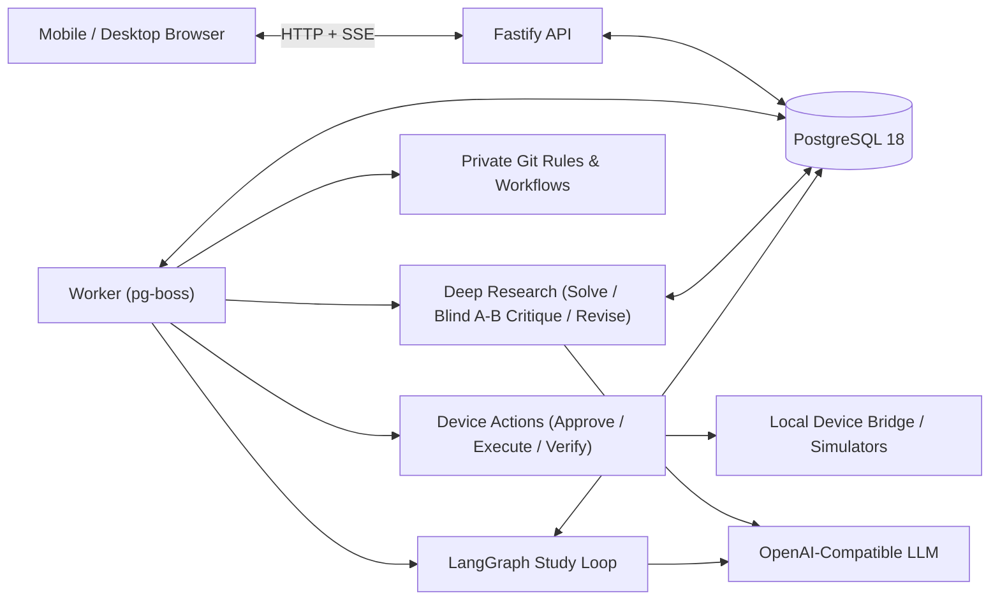

# HTTP API & Runtime Architecture

Reference for the `/api/v2` HTTP/SSE interface, background execution topology, and runtime boundaries of `yeux-assitant`.

## Authentication & Request Conventions

Browser clients authenticate via `/api/v2/auth/login` and receive an `HttpOnly` session cookie. CLI scripts use `Authorization: Bearer <token>` (read from `private/access-token`, distinct from the admin password); external agents use scoped `yeux_agent_*` tokens at `/api/agent/v1/*` and `/api/agent/mcp` (see [agents.md](agents.md)). Mutating requests carry an `Idempotency-Key` header, and edits include explicit entity version numbers.

| Capability | Primary Endpoints |
| --- | --- |
| Admin session | `POST /api/v2/auth/login` · `GET /api/v2/auth/session` · `POST /api/v2/auth/logout` |
| Today overview | `GET /api/v2/today/overview` |
| Study goals | `GET /api/v2/goals/list` · `POST /api/v2/goals` · `PATCH /api/v2/goals/:id` |
| Session & attempt history | `GET /api/v2/sessions/list` · `GET /api/v2/goals/:id/attempts/list` |
| Deep research | `POST /api/v2/sessions` (with `research`) · `GET /api/v2/sessions/:id/research/export` |
| Feedback & cancellation | `POST /api/v2/sessions/:id/feedback` · `POST /api/v2/runs/:id/cancel` |
| Sources | `GET /api/v2/sources` · `POST /api/v2/sources` · `PATCH /api/v2/sources/:id` |
| Archive & search | `PATCH /api/v2/sources/:id/archive` · `GET /api/v2/search?q=<query>&course=<id>` |
| Versioned originals | `GET /api/v2/sources/:id?version=1` · `GET /api/v2/sources/:id/original?version=1` |
| Local device bridge | `POST /api/device/v1/poll` · `POST /api/device/v1/calls/:id/start` · `POST /api/device/v1/calls/:id/result` |
| Device commands | `GET /api/v2/devices` · `POST /api/v2/devices/:id/commands` · `POST /api/v2/device-commands/:id/decision` |
| Private Git workspace | `GET /api/v2/workspace` · `POST /api/v2/workspace/scan` · `POST /api/v2/workspace/commit` |
| Health & diagnostics | `GET /api/v2/status` · `GET /readyz` |
| Live event stream | `GET /api/v2/events?after=<eventId>` (authenticated SSE woken by `pg_notify`) |

Full request/response schemas live in [`packages/contracts/src/index.ts`](../packages/contracts/src/index.ts) and route handlers in [`apps/api/src/routes`](../apps/api/src/routes).

## Runtime Topology

## Runtime Boundaries

- **No bundled credentials or course data**: Model endpoints, mail credentials, imported documents, PostgreSQL volumes, and admin hashes stay under local gitignored directories (`private/`). Without a model configured, source excerpts and manual self-assessment remain usable.
- **Document ingestion**: Direct browser upload accepts UTF-8 Markdown and plain text; HTML, PDF, and legacy Office documents are extracted locally via `pnpm courses:import` / `scripts/prepare-courses.py` (see [integrations.md](integrations.md)). Complex figures and formulas should still be checked against originals.
- **Mail, errands & devices**: Outgoing email replies and external/device actions always stop for explicit user confirmation before execution (see [usage.md](usage.md) and [devices.md](devices.md)).
- **Network exposure**: Binds to `127.0.0.1` by default and runs only while the host is awake; remote mobile access uses an explicit tunnel (`pnpm tunnel`) or a self-managed HTTPS VPS deployment ([server.md](server.md)).
