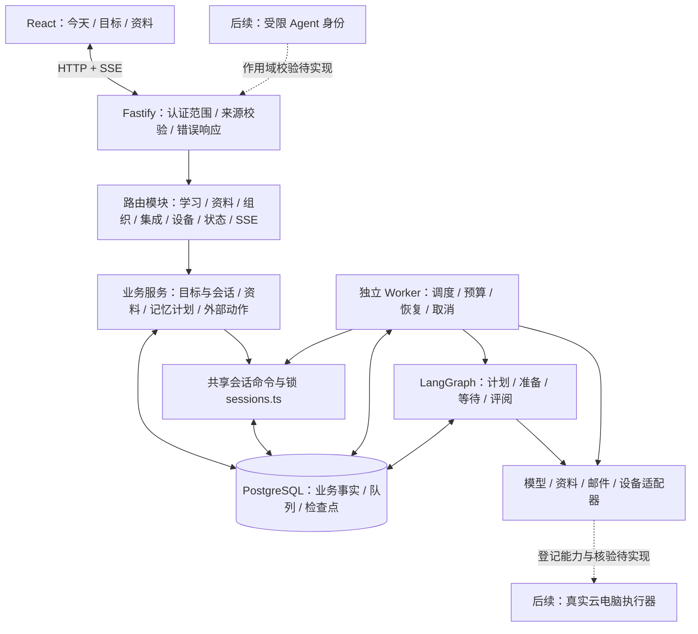

# 项目审计与架构决策 · 2026-10-04

**结论：项目已具备可用的个人学习闭环，工程可靠性明显好于普通实验原型；当前适合“单人、本机或私有云、由本人控制”的使用方式。它尚未达到通用个人 Agent 平台的成熟度。** 最大缺口是受限 Agent 身份、真实教学效果的持续验收、故障可见性和长期数据增长后的维护成本。

当前最合适的架构是 **模块化单体 + 独立 Worker + PostgreSQL**。保留 React、Fastify、LangGraph 和 pg-boss，明确接口、业务、执行与外部适配器的边界。重构应围绕可验证的行为展开，每一批都保留现有数据和运行保障。

本报告针对实际独立应用仓库 `yeux-assitant` 的未提交工作区，不把课程资料仓当成应用仓，不执行 Git 同步。审计包含公开源码、部署脚本、迁移、测试、历史质量记录和本机容器状态。真实个人资料、邮件和模型密钥没有用于测试。

## 1. 当前到底完成了什么

| 方面 | 已实现的事实 | 完成度边界 |
| --- | --- | --- |
| 学习闭环 | 建目标、关联资料、版本化计划、准备练习、作答/自评、调整下一步及复习时间 | 有可复现的流程验证；模型讲解和语义评阅需要单独评测 |
| 后台执行 | 队列持久化、两个执行位置、同目标串行、子进程、超时、取消、执行代次校验、重启恢复 | 后台必须实际运行；fork 不是运行不可信代码的权限沙箱 |
| 学习事实 | 作答、自评、模型估计分别记录；已交付练习绑定资料版本；本人确认目标完成 | 不能让外部 Agent 的代答冒充本人学习证据 |
| 资料 | 文本导入、同文提醒、更新、归档、课程筛选、关键词检索、历史原文/原件与引用 | 浏览器上传只支持 Markdown/文本；复杂文档走离线提取 |
| 长期记录 | 目标、会话、作答有分页；偏好可编辑和确认；历史可导出 | 资料目录和部分会话详情仍全量读取；未做多年规模容量验收 |
| 认证 | 管理员密码、scrypt 哈希、HttpOnly Cookie、会话撤销、登录限流 | Cookie 和 CLI Bearer 都是管理员权限，没有受限 Agent 身份 |
| 外部动作 | 邮件精确草稿审批；设备登记、确认、执行、核验与未知结果处理 | 邮件真实往来关联未完整验收；设备目前只有模拟灯 |
| 运维 | 独立服务器 Compose、备份哈希、合成完整恢复、启动诊断和本地验证命令 | Muse 云电脑未实际部署；没有真实云端持续运行或恢复验收 |
| 界面 | 今天/目标/资料主导航、草稿恢复、手机布局、浅深色、键盘与焦点基础支持 | 后台异常此前可见性不足；页面连接正常不等于所有任务正常 |

代码依据：[学习流程](../packages/core/src/learning.ts)、[执行监督](../packages/core/src/runtime.ts)、[资料生命周期](../packages/core/src/sources.ts)、[认证](../packages/core/src/auth.ts)、[邮件](../packages/core/src/mail.ts)、[设备](../packages/core/src/devices/service.ts)。

## 2. 主要问题及影响

P1 表示影响正确使用或阻挡已提出的下一阶段需求；P2 表示影响维护成本、长期规模或故障处理。本表是工程优先级，不是安全漏洞等级。

| 编号 | 优先级 | 证据与影响 | 本轮结果 / 后续动作 |
| --- | --- | --- | --- |
| A01 | P1 | 原 `/healthz` 只返回进程是否关闭；数据库失联时仍可能显示健康。服务器 Compose 也使用它判断可用性 | 新增 `/readyz` 检查数据库，故障返回 503；`/healthz` 保留存活语义；服务器探针改用 readiness |
| A02 | P1 | Worker 将资料扫描、导出、调度错误写入 `app.health`，页面只读取 Worker 心跳，用户无法定位“后台活着但功能失败” | 新增受认证 `/api/v2/status`；设置页显示检查状态和处理入口，首页仅在有异常时提示；不返回原始错误或私密路径 |
| A03 | P1 | 首页查询没有定期刷新；没有新业务事件时，后台停止后的旧状态可能一直保留 | 首页每 20 秒更新运行概览；输入草稿保持；后台停止时只显示主要原因，避免重复警告 |
| A04 | P1 | [API 认证](../apps/api/src/server.ts) 仅区分“已认证/未认证”；[云端说明](server.md) 也明确无受限身份 | 尚未实现。先建立 Agent 主体、可撤销 token、scope 和动作来源，才能给云端 Agent 开放写权限；不把现有管理员 Bearer 当成受限 token |
| A05 | P1 | [质量记录](../quality/README.md) 的历史全量评测为 12/15 自动判定一致，含一次超时；之后修改过案例和提示词 | 修订版本尚未全量复验。历史一致率不是当前教学准确率，更不是学习效果。需复跑固定案例并人工核对反馈与证据 |
| A06 | P2 | 原 55 个显式路由集中于 `server.ts`；运行、调度、邮件依赖 API 门面的 `application.ts` 取会话锁和创建任务 | 路由分成学习、资料、组织、集成、设备、事件、状态模块；共享执行命令移入 `sessions.ts`，后台不再依赖 Application 门面 |
| A07 | P2 | [Store](../packages/storage/src/index.ts) 的 `Row = Record<string, any>`；多数业务 SQL 直接返回松散字段 | 未全面改写。先为每个模块的 DTO、查询投影和状态迁移补具体类型；Drizzle 当前主要负责事务和参数绑定，并没有实现完整类型化表模型 |
| A08 | P2 | [Sources.list](../packages/core/src/sources.ts) 返回全部摘要；[资料页](../apps/web/src/library.tsx) 下载后再筛选分页 | 下一批采用服务端资料分页、课程统计和按 ID 取已选项。必须保留跨页选择和归档关联，不能只给接口加 LIMIT 后悄悄丢资料 |
| A09 | P2 | [ArtifactExporter.tick](../packages/core/src/scheduler.ts) 每轮读取所有生成正文，进程中保存不断增长的 Set；维护任务约每 10 秒触发 | 长期增长风险已确认，未测出真实生产延迟。改为有界批次与持久导出回执；写文件后、记回执前中断须能恢复，不覆盖用户修改 |
| A10 | P2 | 资料扫描、导出、设备维护同属串行 maintenance；队列/连接错误监听不提供运维关联信息，API 关闭常规日志 | 本轮只解决面向使用者的组件诊断。后续补脱敏错误码、request/run ID 和有界任务耗时，避免记录正文、Cookie、模型 key |
| A11 | P2 | 多个 TSX/业务文件把大量逻辑压在单行；查询、校验、状态迁移交织，新增行为需要同时理解多个职责 | 新增模块采用可阅读结构，并加入依赖边界检查；Application 内部的目标/会话命令与查询仍可按实际改动逐步拆分。本轮没有宣称完成全部领域重构 |
| A12 | P2 | 原验证入口忽略 Docker 清理失败，测试通过但容器残留时可能仍退出 0 | `verify`、`verify:e2e`、`verify:server` 清理失败改为失败状态并打印目标名称；测试报告与清理状态分别核对 |
| A13 | P2 | 本机与服务器部署方式不同，原设置页却统一写“手动启动”“保存在本机” | 改为描述实际行为和“部署设备”；本机启动策略仍为手动，服务器仍采用独立实例规则 |
| A14 | P2 | Dockerfile 的最终镜像保留构建环境和开发依赖；API 的版本字段是接口版本，缺少明确构建来源 | 后续建立生产运行镜像与构建标识，在可恢复发布流程中验证；本轮没有无依据升级依赖或推送新版本 |
| A15 | P2 | 旧审计文件记录了当时“尚未实现”的能力，而后续已有实现 | 保留旧报告作为历史；README、开发说明及 SPEC 指向本报告，不用历史报告判断当前完成度 |

此外：当前没有多用户、离线手机推送、真实桌面执行器，也没有浏览器内 PDF/PPT 导入完整流程。这些是明确未交付的能力，不是已有功能的实现错误。ehall 继续暂缓。

## 3. 架构方案比较

比较标准为单人使用、维护成本、故障恢复、学习证据可信度、未来集成成本和迁移风险。这里不给缺少实测依据的“架构评分”。

| 方案 | 收益 | 代价与适用条件 | 决策 |
| --- | --- | --- | --- |
| **模块化单体 + 独立 Worker + PostgreSQL** | 单个数据事务可同时保存业务事实和入队；保留已验证恢复逻辑；模块可独立替换 | 需要持续约束模块依赖；无法任意水平扩多个 Worker，当前设计只允许一个监督进程 | **当前采用** |
| Next.js 统一网页和 API，另留 Worker | 页面与接口开发入口集中 | 长期任务仍需要独立进程；现有 Fastify/SSE/认证需再迁移，未解决真实痛点 | 目前收益不足 |
| 按资料、学习、设备拆微服务 | 不同团队可独立发布和扩容，权限隔离更细 | 增加分布式事务、消息一致性、跨服务诊断与部署成本；个人规模难以抵消这些成本 | 等到独立部署/团队或实测负载需要时再评估 |
| 把核心流程整体交给 Agent 平台框架 | 更快接入某些工具或工作流组件 | 要迁移现有回执、取消、审批、学习证据规则；框架不能替代领域设计和真实验收 | 适合新实验，不作为当前全面重写方案 |

上述判断是结合本仓约束的工程决策。Fastify 的封装范围能让认证钩子由子路由继承；本轮用这一机制固定接口边界。[Fastify 文档](https://fastify.dev/docs/latest/Reference/Encapsulation/)

pg-boss 的事务适配支持业务记录与任务创建同事务；因此当前不需要额外引入 Redis 队列或自建跨库 outbox。[pg-boss 文档](https://pgboss.io/api/adapters)

LangGraph 的持久执行仍要求正确处理重放与副作用。本项目的幂等回执、学习记录和执行代次校验应继续保留，检查点本身不能替代它们。[LangGraph 文档](https://docs.langchain.com/oss/javascript/langgraph/durable-execution)

## 4. 推荐结构及已经落地的部分

图中虚线是后续能力。当前没有新增 Agent 执行权限、真实设备驱动或云端安装。

**依赖方向**：Web 只能使用自身模块和共享契约；契约不依赖业务或存储；存储不依赖业务；业务不导入运行入口。后台使用 `sessions.ts` 中的创建、入队和加锁原语，不再反向依赖 HTTP 门面。`pnpm check:architecture` 检查当前本地 TS 模块依赖和运行时 import 环，不改变框架或增加运行依赖。

**接口边界**：登录与存活/就绪探针在公开范围，业务路由全部注册在统一认证的 Fastify 范围。新增接口必须从该范围接入。认证不再依赖原始 URL 的字符串前缀。本轮将其作为边界改进，未宣称旧实现存在已证明的绕过漏洞。

**数据边界**：PostgreSQL 业务表是学习事实来源；检查点只服务执行恢复。原件和配置仍在私密文件目录，备份必须同时覆盖数据库和文件。没有数据库迁移，也没有改写既有学习记录。

**运行边界**：pg-boss 决定何时执行，LangGraph 决定流程位置，业务回执保证重放不重复提交。一个目标最多一个待反馈步骤。等待本人作答时不持续消耗模型调用。邮件/设备的现实副作用继续单独审批和核验。

## 5. 各层技术选取的结论

- **React + Vite + TanStack Query**：适合当前浏览器工具。服务端状态由 Query 管理、草稿由会话存储管理，职责清晰。保留已有延迟加载和 CSS Modules；无需为统一外观再增加另一套组件体系。本轮修正了后台状态过期、手机按钮换行和异常入口位置。
- **Fastify + Zod**：继续使用。输入校验已普遍存在，响应契约仍不完整。新状态接口同时使用共享 schema 和服务端响应校验，后续按模块迁移，不一次重写所有 DTO。
- **PostgreSQL 18 + Drizzle/pg**：当前队列、并发锁、事务与版本数据依赖 PostgreSQL，退回 SQLite 的迁移收益有限。重点补业务查询类型、真实规模索引和有界读取，而非更换数据库。不要仅因为用了 Drizzle 就宣称查询结果已经类型安全。
- **LangGraph + pg-boss**：分别用于流程恢复和任务调度，保留。学习图目前清楚但固定，尚未成为任意工具执行系统。增加工具之前先完成主体与权限设计。
- **Node + Compose**：适合个人本机和支持 Docker 的私有云。宿主本轮测试使用 Node 26.7.0，容器固定 Node 24；不能把宿主版本说成 Node 24 验证。服务器的非 root/只读设置仍保留，本机没有安装常驻服务。

## 6. 下一阶段的详细顺序与验收门槛

### 第一批：本轮工程优化

路由按职责拆分 → 共享会话原语 → 架构依赖门禁 → 就绪检查 → 面向使用者的后台诊断 → 前端状态刷新 → 隔离回归 → 一致备份 → 应用并核对。执行结果见下节和 SPEC I5。

### 第二批：开放给 Agent 之前

1. 增加 `Principal`（本人/Agent）、token 哈希、过期和撤销，写命令记录发起者。
2. 初始 scope 只允许读取目标/资料、创建待办和准备草稿。提交本人作答、自评、确认记忆、完成目标、批准发送/设备、修改凭据默认拒绝。
3. 在受认证路由范围集中映射权限；领域命令对人类确认语义再做检查，CLI 不能绕开。
4. 在设置的次级入口创建/撤销权限，凭据仅创建时显示一次；审批界面显示发起者和确切内容。
5. 验收：受限身份直接调用敏感 API 得到 403，撤销立即生效，重试不能改变主体归属，Agent 草稿不计入本人学习证据。

在该批完成前，现有网页管理员登录只能按全权管理员理解。Muse 的 Agent 操作网页与本助手内的 Agent 控制云电脑，是两种不同接入。

### 第三批：长期学习数据与资料规模

1. 增加资料分页契约和独立课程统计，保留按 ID 获取已选项；覆盖跨页筛选、归档、编辑、刷新并发。
2. 生成内容按批次导出并保存持久回执；每轮有明确工作上限，失败不能阻断其他资料。
3. 用 1,000/10,000 份合成资料和长期会话建立基准，记录查询计划、响应字节数、耗时和内存后再加索引。
4. 验收：任何记录都能访问；一次目录响应最多一页；重新启动后导出不漏不重、不覆盖本地修改；界面选择不因分页而变化。

### 第四批：教学效果和云端真实运行

1. 使用修订后的 15 个合成学习案例，明确触发真实模型评测；报告错误通过、错误拒绝、证据不足、超时和响应延迟。
2. 人工核对每条反馈与来源。出题质量另建案例，不能只测评阅 JSON 格式。
3. 登录目标云电脑后运行只读环境探测，再安装独立实例；创建云端账号，不上传本机 private。
4. 验收：真实云电脑重启/休眠后的任务和数据保留；受限 Agent 仅执行已授权范围；从云端备份恢复到新实例；TLS 入口按实际部署核验。

依赖用户云端登录、平台能力和实际模型效果的步骤保留待验收，不能用本轮本地模拟结果替代。

## 7. 以后增加功能的固定路径

以“浏览器导入 PDF”为例：先定义上传任务、文件限制和用户可见结果；在 contracts 增加请求/进度/失败契约；在资料模块保存原件和导入记录；Worker 调受限提取适配器，保留原件 hash、页码和提取版本；页面复用资料入口显示进度和失败；加入合成文档、异常中断、重复导入和旧引用回归。

以“操作云电脑文件”为例：先定义准确设备、允许目录和固定操作，不开放任意 Shell；在设备适配器登记能力；使用当前的预览、确认、执行、独立核验及未知结果流程；权限由独立 Agent 主体控制。只有真实环境证明取消、超时及读回有效，才标为真实接入完成。

每次只新增真实需要的边界。新的格式通常需要适配器，新的业务状态需要领域服务，新的部署隔离需求才需要另一个服务进程。

## 8. 验证结果与覆盖限制

本轮记录：

- 架构边界与运行时 import 环检查通过；已有 55 个显式接口全部保留，新增 `/readyz` 和 `/api/v2/status`。
- 类型检查和生产构建通过；新增状态接口有请求认证与响应 schema。构建有第三方 Zod 注释优化提示，没有编译失败。
- **325 项后端测试通过、无数据库跳过**，使用真实隔离 PostgreSQL。包含幂等、取消、重启、资料版本、审批和新增诊断。
- **184 项桌面/手机浏览器回归通过**；最终提示位置和手机按钮调整后追加 **6 项相关回归通过**。截图人工检查，保留原来的三项主导航和 macOS 风格。
- **2 项真实 API/Worker/PostgreSQL 浏览器闭环通过**。合成恢复核对 **28 张 app 表、158 行、8 个备份文件**，旧版本引用、原件字节和待核实审批一致；恢复核对阶段没有启动 Worker。
- 数据库故障的 readiness 返回分支采用注入失败验证；没有破坏正式数据库做故障测试。
- 安全部分完成了三份源码勘察和输入/文件/SQL/Markdown 的合成验证；未确认可利用漏洞。认证协议及外部动作的深入子审计被工具安全过滤中止，未进行 CVE 扫描、真实云端渗透或完整安全验收。相关局限保留在私有安全审计记录中，不能表述为“安全全通过”。

本轮未重新调用真实模型、发送邮件、操作真实设备或修改本人学习进度。自动化测试证明限定场景下的工程行为，不能证明长期使用效果或教学判断全部正确。

### 本机交付核对

已完成本机更新，入口为 `http://127.0.0.1:8766/`；“更多 → 设置 → 运行状态”可查看后台诊断。首页异常入口会优先展示运行状态。

- 更新前的一致备份校验通过：10 个文件，完整解码 PostgreSQL 归档；备份仍在私密目录。
- 停写窗口比较更新前后 23 张 app 表（30 行）及 5 个账号/运行配置文件的内容摘要，一致。认证、心跳和 SSE 派生状态表另行排除，不宣称整个数据库字节不变。
- API 与 Worker 使用同一新镜像，继续保持 `restart=no`。`/readyz` 正常；匿名访问诊断 API 返回 401；5 个后台组件的最近检查正常。
- Node 24 服务器容器独立验收通过，覆盖登录、准备任务、重启恢复、备份、明确 HTTPS 来源、回环绑定、非 root 与只读根文件系统；测试容器及卷已移除。未在 Muse 安装，也未验证真实 TLS 证书。
- 证据保存在本项目 `private/audit-20261004/`：测试日志、合成恢复报告、截图、切换日志、数据摘要及安全覆盖记录。原文件备份在其 `source-before/` 下。

以上状态只针对本轮明确实施的改进；A04/A05 及长期规模、真实集成等后续项仍按验收表推进。代码和文档已保存，尚未提交或推送 Git。

## 审计后的 VPS 迭代

用户已取消 Muse 云电脑作为托管目标，改为自有 VPS，外部 Agent 作为客户端。原报告中独立 Agent 权限的缺口已完成首版修复：独立哈希凭据、到期/撤销、权限、配额、事务审计与共享 HTTP/MCP 工具入口。页面新增“设置 → 管理连接”。首次本机切换发现启动等待未覆盖数据库迁移，已补就绪健康检查并完成最终数据核对。

实现取舍、验证证据及后续资源级权限方案见 [SPEC](../SPEC.md#vps-与外部-agent-接入2026-10-04)，操作方法见 [VPS 部署](server.md) 和 [Agent 接入](agents.md)。这次验证不等于完整安全渗透测试、真实教学质量验收或目标 VPS 公网验收；Muse 连接器仍取决于平台入口和审核。
