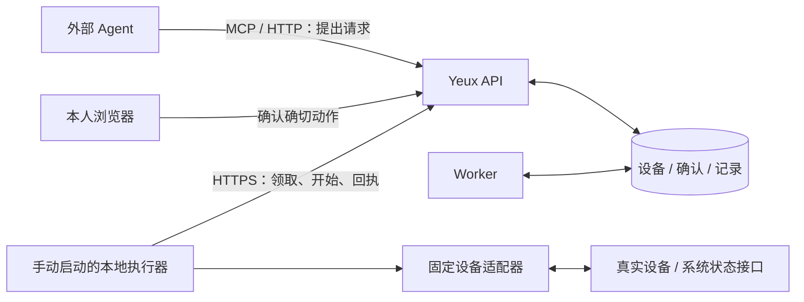

# 真实设备接入

目标是完成“登记设备 → Agent 或本人提出操作 → 本人确认 → 真实执行 → 独立读回”的闭环。现有模拟灯用于体验流程；新增本地执行器和 `macos.audio` 代码适配器。协议测试通过不等于实机验收，实际验收状态以 [SPEC](../SPEC.md#d4a--通用本地连接与首个物理适配器2026-10-04) 为准。



VPS 只需 HTTPS 入口。本地执行器主动连接，不开放入站监听，不将管理员令牌、SSH 或 Docker socket 交给 Agent。设备名称由本人填写，凭据绑定逻辑设备 ID；必须在预期控制的电脑安装该配置，首版不采集硬件序列号或做远程硬件证明。

## 当前支持的操作

| 适配器 | 实际行为 | 验证与局限 |
| --- | --- | --- |
| `simulation.lamp` | 修改独立模拟状态 | 始终标为演示，没有真实电器调用 |
| `macos.audio` | 在执行器所在 Mac 设置当前默认音频输出的系统音量，0–50%，保持静音设置 | 分别调用 macOS `get volume settings` 读取前后音量与静音状态；不播放声音、不切换输出设备；读回证明系统设置，不能证明扬声器实际发声 |

固定程序为 `/usr/bin/osascript`，脚本随代码发布，输入只以校验后的整数参数传入；网络请求不能提供脚本、路径、URL 或命令。需要在 Mac 宿主机而非容器内运行。部分外接数字音频设备不允许调节系统音量，这时必须报失败或待核实，不伪造成功。

## 手动连接

1. 管理员登录后打开 **更多 → 设备控制 → 连接 Mac**，填写名称，生成配置。
2. 将一次性配置保存到目标 Mac 的本项目 `private/device.json`。配置包含设备专用令牌，不能放入聊天或 Git。执行器会将文件权限设为仅本人可读写；令牌有效期默认 30 天。
3. 在目标 Mac 的项目目录安装锁定依赖，然后启动：

   ```sh
   pnpm install --frozen-lockfile
   pnpm device:run --config private/device.json
   ```

4. 保持终端运行；页面显示“执行器在线”后，选择音量并在操作记录中确认。连接在线只证明通信正常，首次实际操作仍需本人验收。
5. Ctrl+C 停止执行器；设备页面可暂停、停用或撤销连接。没有安装登录服务。关闭网页不取消已确认动作，电脑睡眠时没有新动作执行。

配置的 `server` 是助手来源地址：本机可用 `http://127.0.0.1:8766`，远程必须为 HTTPS。不能含用户名、密码、子路径或查询串；客户端不跟随重定向。配置中的 `deviceId`、`adapter` 和令牌需要来自同一次创建。

配置响应丢失时，重试只返回原设备 ID，不能重新获取秘密；从页面撤销并创建新连接。到期后按同样方式创建新连接，不直接改数据库。撤销不会自动重放、恢复或撤回已经影响现实设备的操作。

## 让外部 Agent 使用

在 **设置 → 管理连接** 为客户端勾选“读取设备与操作记录”和“提出设备操作”。原有 Agent 不会自动增加权限，需要按需要新建连接。当前设备读取与提出请求权限覆盖全部已登记设备，不提供逐台设备 ACL；所有请求仍须本人确切确认。

| 工具 | 行为 |
| --- | --- |
| `list_devices` | 读取设备 ID、配置版本、登记能力、最近观测、执行器在线状态 |
| `request_device_action` | 提供 `deviceId`、`revision`、`capability`、`arguments`、`requestKey`，仅创建 `pending` 请求 |
| `get_device_command` | 提供返回的请求 `id` 查询状态与回执 |

本人在 `/#/devices?command=<请求ID>` 核对设备和参数后确认。Agent 无批准、核实、配对、撤销或任意脚本工具。请求与额度、幂等回执和成功审计同事务提交；重复请求复用 `requestKey`，不重复扣额度。

## 故障与恢复

- 每条动作审批有效 5 分钟；Worker 执行预算 20 秒。每次本地调用先领取、再请求一次开始许可，许可最多 5 秒；本地按请求耗时扣减期限，固定进程超时终止并等待退出。
- 前状态、写入、后状态是三次独立调用。提交成功回执不能代替后状态；音量或静音状态不符合预期时进入待核实。
- 本地写入前在 `private/device-state/<deviceId>/` 持久保存命令编号。重复领取同一命令不能再次执行。此目录须保留；不要为“重试”删除它。
- 发送后断线、Worker 恢复或回执丢失进入 `uncertain`，不重放写入。回执可以原样重传，但不能改写已完成回执或用迟到回执覆盖取消。
- 暂停、取消、撤销会阻止新的开始许可。已经取得许可的短调用可能完成，因此界面显示待核实，不能声称现实动作已撤回。Worker 等待未完成许可到期才释放正常执行位置；进程被强杀时，恢复后仍保持待核实。
- 执行器单进程锁为该状态目录中的 `executor.lock`。异常退出后先确认记录的 PID 对应执行器已停止，再删除这一锁文件并启动；保留所有命令编号文件。不能跨目录复制配置并同时运行多份执行器。
- 显示离线时检查终端、网络、HTTPS 来源和有效期；显示待核实时先查看实际设备状态，再在页面记录结果。日志不输出凭据或服务端原始错误。

这是一套有界派发和核验机制，不承诺跨网络与任意硬件的 exactly-once，也不提供现场急停保证。

## 接入其他设备

保持 API、确认流程、Agent 权限、数据库与界面不变，增加经审查的能力契约、服务端适配器和本地驱动。服务端声明严格参数、版本、摘要和可验证的后置条件；本地实现真实协议与超时。凭据仍留在对应设备侧。

- 智能灯、插座：按实际网关或厂商的服务调用与状态读取实现，不能只修改“状态对象”。
- 开发板：根据固件提供 HTTP、串口或 MQTT 驱动，并核对物理反馈。
- 打印机：另建打印任务编号与异步状态，不能把“加入打印队列”套用为本流程的完成条件。
- 运动、门锁、加热等设备：另定具体权限和现场保护，不自动加入通用配置。

每个新增适配器需独立完成身份核对、一次真实状态变化、读回、重复投递、断线、超时、取消及恢复验收，并留下设备/系统版本和证据。现有协议测试与 Mac 适配器不能替代其他硬件的实机验收。

## ehall 模拟事务

本轮 `browser.ehall` 只登记 `lab1-simulation` v1，使用合成课表和模拟在读证明。它不访问学校域名、不使用学校账号。真实事务配置、附件上传和本人资料自动填充尚待账号探查后实现及验收。

1. 在助手“更多 → 设备”点击“连接模拟 ehall”，把仅显示一次的配置保存为 `private/ehall-bridge.json`。
2. 在宿主机项目目录运行 `pnpm ehall:simulate`。模拟站点仅监听 `127.0.0.1:8777`。
3. 另开终端运行 `pnpm device:run --config private/ehall-bridge.json`。本机需安装 Chrome；执行器不会下载浏览器或安装常驻服务。
4. 在打开的 Chrome 中点击“模拟登录 → 进入模拟账号”。回到设备页刷新，执行“检查模拟登录”或“查询模拟课表”。查询读回后可在资料库找到合成课表。
5. 填写示例申请人和用途，点击“准备表单”并确认。准备完成后核对字段、来源、后果和截图；勾选核对项，再点击“生成提交确认”，最后点击“确认提交模拟申请”。
6. 成功时显示“待审核（模拟）”。结果不明时先核实模拟站点申请记录，再填写核实结果，不能直接重发。

准备与提交使用同一设备、同一已确认字段和准备回执。页面修改、配置版本变化、截图摘要不匹配都会阻止旧确认。查询/提交最多 60 秒、准备最多 120 秒；每次本机执行许可最多 30 秒。取消不保证请求未抵达站点，迟到结果不覆盖取消状态。超时会关闭页面，需手动重启执行器；旧命令不会重放。音量操作仍保持原有 20 秒总体期限和 5 秒本机许可。

截图保存在 `private/ehall-evidence/`，经已认证接口读取，并包含在备份中。模拟浏览器资料在配置旁的 `ehall-profile/`；不要将其加入 Git。使用结束分别按 Ctrl+C 关闭两个终端。

软件验证使用隔离 PostgreSQL、真实浏览器和合成站点；不能据此宣称已在真实 ehall 或物理设备上验收。
