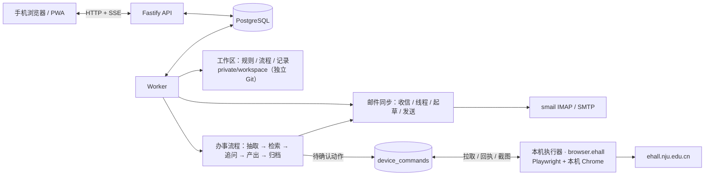
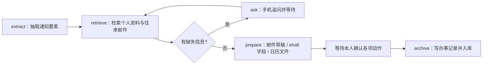

# Lab1 题面对齐方案 · 2026-10-04

> 状态：**分阶段实施中**。当前完成范围和验证证据见 [SPEC 的 Lab1 对齐记录](../SPEC.md#lab1-对齐--2026-10-05)，其余条目仍是计划。依据：官方题面 <https://jyywiki.cn/GSE/2026/lab1.md>（2026-10-04 实时抓取，与课程仓 `gse/official/lab1.html` 快照正文一致）、本仓 [SPEC](../SPEC.md)、[2026-10-04 审计](audit-2026-10-04.md) 和当日源码。
>
> 本文规定要改什么、怎么改、怎么验收。实施仍按 SPEC §0 的循环推进：发现缺口 → 确定行为与边界 → 小步实现 → 隔离自检 → 应用并核对。每个阶段的证据写回 SPEC，本文不追加运行记录。

## 0. 差距摘要

以下为 2026-10-04 的实施前快照；当前已完成项、模拟与真实验收边界见 SPEC 的当期记录。

| 题面要求 | 现状 | 对应阶段 |
| --- | --- | --- |
| 个人数据库 | 索引、检索、扫描更新、带版本的引用均已实现。删除文件后不撤索引；引用只定位到最长 1800 字的分块；现行实例只有 1 份资料 | P6 |
| smail | 轮询、去重、确切审批已实现。未配置账号；不关联往来；纯 HTML 邮件被隔离；回复不带线程头；首次只读最后 20 封 | P2 |
| ehall | 没有代码 | P4 |
| 手机联动 | 网页可用、有后台 Worker。实例只绑定 `127.0.0.1`；没有推送；工作类任务不能追问 | P3、P5 |
| 能力组合 | 学习闭环完整。没有跨邮件、ehall 的流程 | P5 |
| 纠正与流程进 Git | 规则只在 `app.memories`；没有“成功流程 → 能力”；应用仓库自 09-26 后未提交 | P0、P1 |

## 1. 完成定义（Lab1 验收矩阵）

模拟验收（CI 可复现）与真实验收（本人账号、本人手机）分开记录。只有“真实验收”列全部有证据，README 才声明 Lab1 五项能力完成。真实验收证据统一放在忽略目录 `private/lab1-acceptance/<编号>/`。

| 编号 | 题面原句（摘） | 模拟验收 | 真实验收 |
| --- | --- | --- | --- |
| R1 | 能索引、检索你的资料，并随资料变化更新索引，回答时能定位到原文 | 工作区文件新增、修改、删除、改名后，1 个维护周期内检索结果随之变化；打开引用后高亮确切字符范围 | 工作区放入 ≥20 份本人资料；修改其中一份后提问，回答引用新版本并能跳到原句 |
| R2 | 持续获取新邮件、关联历史往来、结合个人资料拟好回复草稿；编辑后直接发送；重复检查不重复处理或发送 | 模拟 IMAP（含“已发送”文件夹）：线程归并、纯 HTML 邮件、重启后重复轮询、并发轮询、发送回执丢失 | 本人 smail：新邮件 2 个轮询周期内出现；线程含本人此前发出的邮件；草稿引用个人资料；手机改稿后确认发送，对方客户端显示为同一会话；重启 Worker 再轮询，不新增任务、不重发 |
| R3 | 在 ehall 查询信息，完成至少一种事务的材料准备和表单填写；提交前展示关键字段及后果，由你确认；退课、撤销不能自行决定 | 本地模拟 ehall 站点：查询、预填、预览、确认后提交、读回状态；页面上的“退课”“撤销”按钮和接口被代码拦截 | 本人账号：1 次查询结果入库；1 种事务完成材料准备和表单填写，手机上预览关键字段与后果；是否提交由本人决定并记录 |
| R4 | 方便地从手机发起任务、查看进度、编辑草稿和确认操作；不依赖桌面对话窗口 | 390px / 375px 浏览器回归覆盖上述四类操作 | 手机不在电脑旁完成：发起、看进度、改稿、确认邮件、确认 ehall、回答追问；电脑只运行服务，截图存证 |
| R5 | 共享上下文、跨工具完成任务；至少一条愿意反复使用的完整流程 | “通知 → 办事”流程在模拟邮件和模拟 ehall 上端到端通过 | 用一份真实通知完整走一次，结果归档进个人数据库并可检索 |
| R6 | 成功流程和纠正保存为可阅读、可修改的脚本、技能或记忆，用 Git 管理实现和规则；新会话能用 | 规则文件提交后，新会话对另一份通知应用该规则；手工改文件后下一次运行生效 | 在会话 A 把“报名截止时间不是活动开始时间”保存为一次提交；会话 B 用另一份通知正确区分；一条流程保存为文件后被再次运行 |

## 2. 需要本人决定的事项

推荐项即本方案的默认设计。决定后写进 SPEC。

| 编号 | 问题 | 选项 | 推荐 |
| --- | --- | --- | --- |
| Q1 | 规则和流程放在哪个 Git 仓库 | A. `private/workspace/` 本地独立仓库，可选私有远程；B. 本应用仓库；C. 课程仓 cloud-3be | **A**。本应用仓库在 GitHub 上是 **PUBLIC**，规则会含个人信息，不能放 B；C 会把个人助手数据混入课程资料 |
| Q2 | 手机访问路径 | A. 局域网（`ASSISTANT_BIND=0.0.0.0`）；B. Tailscale 私网 + HTTPS；C. 自有 VPS | 宿舍或家庭 Wi-Fi 先用 A 完成验收；需要离开局域网再选 B。B 要安装带登录项的客户端，与现行“不安装登录服务”的约定冲突，需本人先修改约定 |
| Q3 | ehall 办哪一种事务 | 由 P4.0 探查本人账号可见的事项后决定 | 优先：提交后仍需人工审核、本人可在“我的申请”撤回、与选课/退课/缴费/学籍变更无关的事项 |
| Q4 | smail 认证 | 客户端专用密码或授权码；确认邮箱设置中已开启 IMAP/SMTP | 本人在邮箱设置中生成，直接填进助手设置页，不经过聊天 |
| Q5 | 自动起草范围 | A. 所有新邮件；B. 直接发给本人且非群发的邮件；C. 只起草命中流程的邮件 | **B**，另设每日自动起草上限 20 封 |
| Q6 | 是否统一代码格式 | 引入 Prettier 一次性格式化 | 是，单独提交（P0.4） |
| Q7 | 现行实例是否重新导入 26 份课程资料 | 是 / 否 | 是（P6），导入前先备份 |
| Q8 | 现有改动的提交粒度 | 按领域拆 4–5 个提交 / 合成一个提交 | 按领域拆分；推送前本人确认 |

已确认（2026-10-05）：Q1 使用私密独立工作区；Q2 后续自有 VPS，当前仅本机访问；Q3 本轮先完成模拟开发，真实账号与事务探查稍后验收。Q6 采用统一格式；Q7 按既有授权接入的 GSE、数据库、软件工程资料包恢复导入。Q8 现有交叉实现合并为可独立验证的基线提交，文档及格式分别提交，未推送。邮箱真实授权仍由本人直接填设置，不在聊天提供。

## 3. 总体设计

保留“模块化单体 + 独立 Worker + PostgreSQL”（审计 §3 的结论不变），新增工作区、邮件同步、办事流程三块业务，以及一个本机 ehall 执行器。



以下约束沿用现有工程，各阶段不再重复：
- 写命令与幂等回执在同一事务；外部网络和模型调用不放进业务事务；编辑带版本号。
- 原件、生成内容、本人输入、模型估计分开保存。
- 对外动作一律走：确切内容确认 → 持久记录 executing → 独立读回 → 结果不明时由本人核实，不重放。
- 测试只用名称以 `_test` 结尾的独立库。
- 正式实例变更前先 `pnpm backup`，再用 `backup:check --docker` 核对。

新增代码的位置：

| 模块 | 位置 | 说明 |
| --- | --- | --- |
| 工作区 | `packages/core/src/workspace/`：`repo.ts`（Git 封装）、`rules.ts`、`flows.ts`、`records.ts` | Git 只通过固定参数的 `execFile` 调用 |
| 邮件 | 把现有 `packages/core/src/mail.ts` 拆成 `mail/sync.ts`、`mail/thread.ts`、`mail/body.ts`、`mail/draft.ts`、`mail/send.ts` | 先做纯拆分并保持行为不变，单独提交，再扩展功能 |
| 办事流程 | `packages/core/src/errands.ts`、`packages/contracts/src/errands.ts` | LangGraph 图，复用 `RunSupervisor` 和检查点 |
| ehall | 服务端适配器 `packages/core/src/devices/ehall.ts`；本机驱动 `apps/device-bridge/src/ehall/`；事务配置 `ehall-profiles/*.json` | 复用设备桥协议，不新建第二套执行器 |
| 前端 | `apps/web/src/errands.tsx`、`mail.tsx`、`workspace.tsx`、`ehall-card.tsx`、`questions.tsx` | 主导航仍为“今天 / 目标 / 资料”，新页面放在次级入口 |

`scripts/check-architecture.mjs` 的 `allowed()` 目前对 `apps/web` 以外的应用不设限制。新增一条规则：`apps/device-bridge/` 只能依赖自身和 `packages/contracts/`，与现有执行器的实际依赖一致。

## 4. P0 · 版本管理、范围冻结与可读性

### P0.1 提交应用仓库的现有工作

现状：`main` 只有 `24d4b86`（2026-09-26）。工作区有 40 个修改、89 个未跟踪文件；I2–I5、D0–D4a、VPS 与 Agent 接入的改动全部未入库。

步骤：
1. 运行 `git status --porcelain --ignored`，确认 `private/`、`dist/`、`node_modules/` 都被忽略。
2. 检查未跟踪文件中的敏感信息：
   ```bash
   git ls-files -o --exclude-standard -z | xargs -0 grep -nE \
     'yeux_(device|agent)_[a-f0-9]{32,}|api_key"\s*:\s*"[^"]+|BEGIN [A-Z ]*PRIVATE KEY|@smail\.nju\.edu\.cn'
   ```
   命中项逐条处理。文档里出现 `private/...` 路径名不算泄露，泄露指的是这些路径下的内容。
3. 运行 `pnpm verify`（类型、构建、架构、数据库测试，无跳过）通过后再提交。
4. 按 Q8 拆分：① 资料生命周期、分页与评阅依据（I2–I4）；② 设备动作与本机执行器（D0–D4a）；③ 服务器版与外部 Agent（S1、V1–V5）；④ 路由拆分与运行诊断（I5）；⑤ 文档与审计。若文件交叉导致单个提交无法独立通过 typecheck，就合并相邻提交，不为拆分而改代码。
5. 推送前由本人确认。推送后观察 `.github/workflows/verify.yml` 首次运行；失败按日志修复，不跳过步骤。

验收：`git status` 只剩本人有意保留的改动；CI 首次运行结果写入 SPEC。

### P0.2 课程仓快照（cloud-3be）

- `gse/lab/lab1/README.md`、`SPEC.md`、`AGENTS.md` 中指向 `/Users/zfu/Documents/develop/yeux-assitant/...` 的绝对路径，改为 `https://github.com/zzzfu411/yeux-assitant/blob/main/...`，这样在 Windows 和 GitHub 上都能打开。
- `gse/lab/lab1/` 的实现目前全部未跟踪。本人要求同步课程仓时，按课程仓根目录 `AGENTS.md` 的流程，只暂存 `gse/lab/lab1` 下未被忽略的文件，以 `study: archive GSE lab1 early implementation` 提交。`private/`、`dist/`、`node_modules/` 已被 `gse/.gitignore` 忽略。
- 不改 `学习清单.md`，Lab1 进度由本人勾选。

### P0.3 范围冻结

Lab1 的 R1–R6 完成真实验收前，暂停以下工作：D4a.4 实机音量、D5 学习场景联动、V5 Hermes/Muse 接入、真实 VPS 部署（Q2 选 C 时除外）、审计 A07–A10。代码保留，SPEC 中的状态改为“暂停（Lab1 优先）”。新想法先记入 SPEC 待办，不插队。

### P0.4 代码可读性（Q6）

题面 §3 指出，难读的代码会让 Agent 反复阅读和试错。当前 `packages/core` 与 `apps` 中有 149 行超过 300 字符（审计 A11）。

- 新增开发依赖 `prettier`。`.prettierrc` 设为 `{"printWidth":120,"singleQuote":true,"semi":true,"trailingComma":"all"}`；`.prettierignore` 排除 `dist/`、`private/`、`pnpm-lock.yaml`、`packages/storage/migrations/`。
- 一次性运行 `prettier --write 'apps/**/*.{ts,tsx}' 'packages/**/*.ts' 'scripts/**/*.{ts,mjs}' 'tests/**/*.ts'`，单独提交 `style: format sources with prettier`，并把提交号写进 `.git-blame-ignore-revs`。
- `package.json` 增加 `format:check`；`scripts/verify.mjs` 和 CI 加入这一步。
- 时机：P0.1 之后、P1 之前，避免和功能改动混在同一个 diff。格式化后跑完整的 `pnpm verify` 和浏览器回归。

## 5. P1 · 规则与流程进 Git（R6）

### P1.1 工作区仓库

`private/workspace/` 是独立的 Git 仓库（Q1-A）。它由本应用创建，不推送到任何远程；本人另行添加私有远程是本人的决定。

```
private/workspace/
  .git/
  README.md                       目录约定，初始化时写入
  rules/<scope>/<slug>.md         已确认规则，一条一个文件
  flows/<id>.md                   可复用流程
  profile/*.md                    本人信息（学号、院系等），ehall 填表时使用
  records/YYYY/MM-DD-<slug>.md    办事记录（P5 归档）
  notes/**/*.md                   本人笔记，同时作为资料扫描根目录
```

- **初始化**：`initializeData()`（`packages/core/src/config.ts`）发现 `private/workspace` 不存在时，创建目录（权限 0700）并 `git init -b main`，写入 `README.md` 和 `.gitattributes`（`* text=auto eol=lf`），初始提交 `workspace: initialize`。目录已存在时只检查它是不是 Git 仓库、工作树是否干净，不做任何改动。
- **Git 调用**：新增 `workspace/repo.ts`，只暴露 `status()`、`commitFiles(paths, message, trailers)`、`log(path, limit)`、`show(commit, path)`、`findCommitByTrailer(key)`。具体约束：
  - 一律使用 `execFile('git', [...固定参数])`，`cwd` 固定为工作区。
  - 环境变量设 `GIT_CONFIG_NOSYSTEM=1`、`GIT_CONFIG_GLOBAL=/dev/null`、`GIT_TERMINAL_PROMPT=0`。
  - 每条命令前加 `-c safe.directory=<工作区> -c user.name=yeux-assistant -c user.email=assistant@localhost -c commit.gpgsign=false`。
  - 路径参数放在 `--` 之后，并校验路径位于工作区内、不是符号链接。
  - 超时 10 秒；超时按失败处理并报告，不自动重试提交。
- **串行化**：所有工作区写入先取 PostgreSQL advisory lock（新常量，`847392030`，避开现有学习并发锁）。出现残留的 `.git/index.lock` 时，doctor 报告并说明处理方法；不按文件年龄自动删除锁；手工 Git 进程可能仍在工作，须先核实进程再由本人处理。
- **镜像**：`Dockerfile` 增加 `RUN apt-get update && apt-get install -y --no-install-recommends git && rm -rf /var/lib/apt/lists/*`。服务器版的只读根文件系统不受影响，因为 Git 只写挂载的 `private/`。
- **备份**：`scripts/backup.mjs` 和 `backup-integrity.mjs` 把 `private/workspace`（含 `.git`）纳入清单；`backup:check` 额外对备份副本运行 `git fsck --no-dangling`。
- **doctor**：新增“工作区”检查项：是否为 Git 仓库、能否读取 HEAD、未提交改动数、是否有残留锁。

### P1.2 规则文件格式与事实来源

规则以文件为准，`app.memories` 降为索引和历史缓存。

```markdown
---
key: notice.deadline-vs-start
scope: correction
enabled: true
created: 2026-10-05
origin: session/6f1c…        # 来自哪次会话的纠正，可省略
---
报名截止时间与活动开始时间分别记录。通知只写“截止”时，不得推断为活动开始时间。
```

- **scope 取值**：现有 `preference | fact | correction | all | study | work | manage`，新增 `mail | errand`。`packages/contracts/src/index.ts` 中的 `MemoryInput` 同步修改。
- **文件名**：`rules/<scope>/<slug>.md`。slug 由 key 生成，只含 ASCII 小写字母、数字和 `.-_`；key 含其他字符时，取 `<slug 前缀>-<sha256(key) 前 8 位>`。key 以 front matter 为准。两个文件声明同一个 key 时视为冲突，两者都不生效，并通知本人。
- **只有本人确认的规则写成文件**。模型提出、尚未确认的规则仍只存在 `app.memories`（`confirmed=false`），继续以 `unconfirmedNotes` 进入上下文、允许被裁剪，与现状一致。
- **迁移 `0009.sql`**：
  - `app.memories` 增加 `path text UNIQUE`、`file_digest text`、`commit_sha text`、`origin text NOT NULL DEFAULT 'web'`（取值 `web | file_edit | import`）；
  - `app.memory_versions` 增加 `commit_sha text`；
  - 新表 `app.rule_usage(run_id text, key text, version integer, commit_sha text, PRIMARY KEY(run_id, key))`；
  - 新表 `app.flows`（见 P1.7）。
- **一次性导入**：`pnpm workspace:import-rules -- --dry-run | --apply`，把现有 `confirmed=true` 的规则写成文件，提交 `workspace: import existing rules`，并在 DB 中回填 `path`、`file_digest`、`commit_sha`。干跑模式只列出将要写入的文件。

### P1.3 写入路径（网页保存、确认、停用）

修改 `Application.saveMemory`（`packages/core/src/application.ts:228`）：
1. 校验输入和版本，生成文件内容并计算 digest。
2. 持工作区锁，依次：原子写入文件（临时文件 + rename）→ `git add -- <path>` → `git commit -m "rule: <key> v<n>" --trailer "Yeux-Command: <sha256(Idempotency-Key)>"`。“停用”就是把 `enabled` 改为 `false` 后提交；不提供删除，只提供停用。
3. 在业务事务里通过 `once()` 写入 `app.memories` 和 `memory_versions`（带 `commit_sha`）。
4. **崩溃恢复**：用同一个 Idempotency-Key 重试时，先 `findCommitByTrailer`，已有提交就只补写 DB。扫描器（P1.4）也会把“文件 digest 与 DB 不一致”修复为一个新版本。同一个键配不同内容仍返回 409。

先写文件、后写 DB，是为了保证“DB 里生效的规则一定已经进了 Git”。

### P1.4 读取路径（手工编辑后生效）

在 `workspace/rules.ts` 新增 `scan()`，挂到 Worker 的 `maintenance` 任务上（`packages/core/src/runtime.ts`，与 `knowledge.scan()` 并列）：
- 先按 mtime + size 快速跳过未变文件。有变化时读文件，解析 front matter（只接受上述字段，有未知字段就拒绝），校验 scope 和长度。
- 文件有效：在 DB 中生成新版本，`origin='file_edit'`；`commit_sha` 取该文件最近一次提交，文件尚未提交则为 null。
- 文件无效或冲突：上一个有效版本继续生效，并发通知“规则文件格式错误：<path>”。
- 文件被删除：规则停用并通知，不删除 DB 中的历史。
- 未提交的改动：设置页“工作区”显示 `git status` 摘要和“提交这些修改”按钮，由本人填写说明后提交。**不自动提交本人的手工改动。**

### P1.5 规则如何作用于新会话

现有机制保留：已确认规则作为 `confirmedUserRules` 必定进入上下文（`packages/core/src/model.ts:11`），超出上限时明确停止。在此基础上补充三点：
- **按范围匹配**：`learning.ts:56` 的查询改为 `scope IN ('all','preference','fact','correction', <会话类型>, <附加范围>)`。邮件草稿附加 `mail`，办事流程附加 `errand`。
- **使用记录**：每次调用模型前，把实际放进上下文的规则写入 `app.rule_usage`。会话页“参考资料”旁边增加“本次遵循的规则”，显示 key、版本、提交号前 7 位，可展开查看文件内容。
- **代码兜底**：日期类字段在 P5.3 用结构化抽取加引文校验，不只靠模型记住规则。

### P1.6 从纠正中学习

- **已有入口**：“更多操作 → 记住一条纠正”（`apps/web/src/learning.tsx:159`）。保存后走 P1.3。
- **新增“从修改中总结”**：本人编辑模型草稿并保存（`/sessions/:id/draft`）后，如果改动超过阈值（字符差超过 20 且不只是空白），草稿区显示“从这次修改总结规则”。点击后，后台调用一次模型，输入原稿、终稿和差异，输出 `{key, scope, content, rationale}`（新 Zod 契约 `ModelRuleProposal`），存为 `confirmed=false` 的提议。本人在编辑器里修改并确认后，才写成文件。这次模型调用计入该会话的预算，不会自动触发。
- **新增“纠正追问”**：工作类会话的跟进反馈（`followup`）中，本人勾选“这是一条以后也适用的纠正”时，同样生成提议。

### P1.7 流程文件（把成功尝试变成随时可用的能力）

```markdown
---
id: notice-to-errand
title: 通知办事
version: 1
trigger:
  manual: true
  mail:                       # 可省略；命中后只创建待处理任务，不发送任何内容
    from: ["*@nju.edu.cn"]
    subject_any: ["通知", "报名", "申请"]
steps: [extract_notice, retrieve, ask_user, draft_mail, ehall_prepare, archive]
ehall_profile: <profile-id>   # 可省略
---
补充说明：材料优先从 profile/ 和最近一学期的 records/ 查找；邮件落款使用本人姓名。
```

- `steps` 只能取 P5 注册表中的步骤。正文作为流程级规则注入上下文，地位等同已确认规则，参与超额检查。
- **校验器强制的安全下限**：含 `draft_mail` 的流程必然需要发送确认；含 `ehall_prepare` 的流程必然需要提交确认。流程文件不能关闭确认、提高预算上限或加入未注册步骤；违反任何一条，整份流程不生效并通知本人。
- **“保存为流程”**：已完成的办事会话页提供这个按钮。它按该会话实际执行过的步骤和触发来源生成草稿文件，本人编辑后提交。
- 首页新增“常用流程”，列出已启用的流程，点击后用当前输入运行。邮件触发见 P2.6。
- 迁移 0009 同时新增 `app.flows(id text PRIMARY KEY, path text UNIQUE, version integer, digest text, commit_sha text, enabled boolean, definition jsonb, updated_at timestamptz)`，由扫描器维护。

### P1 测试

- `tests/workspace.test.ts`（临时目录 + 真实 Git）：初始化幂等；提交带 trailer；同键重放不重复提交；在“已提交、未落库”时崩溃后能恢复；越界路径和符号链接被拒绝；残留锁处理；超时。
- `tests/rules.test.ts`（PG）：格式错误时保留旧版；同 key 冲突；删除文件即停用；手工编辑生成 `file_edit` 版本；`rule_usage` 正确记录。
- `tests/flows.test.ts`：未注册步骤、删掉确认、提高预算三种写法均被拒绝。
- 质量案例：在 `quality/learning-cases.json` 旁新增 `quality/rule-cases.json`，含 3 份不同通知（只写报名截止 / 截止与开始都写 / 只写开始）。规则开启与关闭分别评测，报告抽取字段是否区分正确。
- e2e（手机宽度）：记住纠正 → 新任务显示“本次遵循的规则”。

## 6. P2 · smail 完整接入（R2）

### P2.1 设置与连接测试

- 设置页新增“邮箱”分区，包含：邮箱地址、客户端专用密码（只写不回显，留空表示保留原值）、IMAP/SMTP 主机与端口、是否启用轮询、轮询间隔（≥60 秒）、首次历史同步范围（默认最近 90 天且最多 500 封）、自动起草策略（Q5）、每日自动起草上限。
- 后端：`config.ts` 增加 `MailSettingsInput` 和 `Settings.saveMail()`，复用现有的原子写入与回执账本；`PublicSettings` 增加 `mail_user`、`poll_mail` 等非敏感字段。
- 默认主机沿用 `imap.exmail.qq.com:993` 和 `smtp.exmail.qq.com:465`（`mail.ts:55,66`）。接入前按 smail 官方帮助核对主机、端口，以及是否必须使用客户端专用密码，结果写进 `docs/integrations.md`。
- **“测试连接”**：IMAP 登录 → `LIST` 识别带 `\Sent` 标记的已发送文件夹 → `EXAMINE INBOX`（只读）→ 登出；SMTP 只调用 `transport.verify()`，不发信。逐项返回结果，不回显密码或服务器原始错误。

### P2.2 数据模型（迁移 0010）

```sql
CREATE TABLE app.mail_threads(
  id text PRIMARY KEY, account text NOT NULL, subject_key text NOT NULL,
  participants text[] NOT NULL, last_message_at timestamptz NOT NULL,
  session_id text REFERENCES app.sessions(id), created_at timestamptz NOT NULL DEFAULT now());
CREATE TABLE app.mail_messages(
  id text PRIMARY KEY, account text NOT NULL, folder text NOT NULL, uidvalidity text NOT NULL, uid bigint NOT NULL,
  message_id text, in_reply_to text, references_ids text[] NOT NULL DEFAULT '{}',
  thread_id text NOT NULL REFERENCES app.mail_threads(id),
  direction text NOT NULL CHECK(direction IN ('in','out')),
  from_addr text NOT NULL, to_addrs text[] NOT NULL, cc_addrs text[] NOT NULL DEFAULT '{}', reply_to text,
  subject text NOT NULL, sent_at timestamptz, body_text text NOT NULL,
  body_origin text NOT NULL CHECK(body_origin IN ('plain','html')),
  raw_digest text NOT NULL, bulk boolean NOT NULL DEFAULT false, triage text NOT NULL DEFAULT 'new',
  source_id text, session_id text, created_at timestamptz NOT NULL DEFAULT now(),
  UNIQUE(account, folder, uidvalidity, uid));
CREATE UNIQUE INDEX mail_message_id ON app.mail_messages(account, message_id) WHERE message_id IS NOT NULL;
CREATE INDEX mail_thread_time ON app.mail_messages(thread_id, sent_at);
```

- `app.settings` 中现有的 `mail-source:*` 去重键和 `mail:<user>:<uidvalidity>` 水位，迁移时保留不删。新代码先查 `mail_messages`，查不到再查旧键，保证升级后不会重复导入。
- 邮件原文 `.eml` 保存到 `private/mail-raw/<sha256>.eml`（权限 0600，按摘要命名、不可变）。`initializeData()` 负责创建该目录，`pnpm backup` 将其纳入备份。

### P2.3 收信

- **文件夹**：INBOX 和识别到的已发送文件夹，各自维护独立水位 `mail:<account>:<folder>:<uidvalidity>`。
- **首次同步**：按 P2.1 的范围从新到旧回填历史。回填只写 `mail_messages`、`mail_threads` 和资料，不创建任务、不调用模型。之后增量同步，每批 50 封。这一条替换 `mail.ts:244`“首次只取最后 20 封”的逻辑。
- **正文**：优先取 `text/plain`。只有 HTML 时，用新依赖 `html-to-text` 转成纯文本（固定 `wordwrap:false`、忽略图片、链接保留为“文字 (URL)”），并标记 `body_origin='html'`。两者都没有或超出上限时才隔离，隔离逻辑和提示保持现状。这一条去掉了 `mail.ts:250` 对纯 HTML 邮件的一刀切隔离。
- **附件**：只记录文件名、类型、大小和摘要，原件随 `.eml` 保留，不自动索引。邮件页提供“作为资料导入”：文本类直接导入，PDF/Office 按离线提取说明处理。
- **群发识别**：邮件带 `List-Id`、`List-Unsubscribe` 或 `Precedence: bulk|list` 头，或本人不在 To/Cc 中时，标记 `bulk=true`。
- **UIDVALIDITY 变化**：新水位从 0 开始，但每封邮件先按 `(account, message_id)` 去重，因此不会重复建任务。

### P2.4 线程归并（`mail/thread.ts`，纯函数）

1. `in_reply_to` 或 `references_ids` 中任一项命中已有的 `message_id` → 并入该线程。
2. 否则，同时满足以下条件则并入：`subject_key` 相同（反复去掉 `re:`、`fw:`、`fwd:`、`回复：`、`答复：`、`转发：` 等前缀，兼容全角与半角冒号，压缩空白，转小写）；参与者有交集；时间相差 60 天以内。
3. 否则新建线程。

**迟到的父邮件**：回填时可能先遇到回复、后遇到原信。插入原信后，检查是否已有以它为父的线程，有则合并两个线程：保留较早的线程 ID，并用事件记录这次合并。

### P2.5 起草

- **进入起草的条件**（满足任一）：增量收到的新邮件，`direction='in'`，符合 Q5 策略，且当日自动起草数未超上限；本人在邮件页点“起草回复”；命中流程触发（P2.6）。
- **任务**：继续使用 `kind='work'` 会话（通过 `sessions.ts` 的 `createSession` 创建），会话和线程互相关联（`mail_threads.session_id`）。同一线程已有未结束的回复会话时，新来信追加为该会话的新输入，不另建会话。
- **上下文**：
  - 线程中最近 6 封邮件，从新到旧，按 `boundedContext` 裁剪并保留裁剪记录；
  - 个人资料检索结果，查询词取主题和正文关键词；
  - `scope` 含 `mail` 的已确认规则；
  - `profile/` 中本人姓名等落款信息。
- **模型输出**：新契约 `ModelMailDraft`：`{subject, body, cc: string[], sourceIds: string[], questions: string[]}`。`questions` 非空时，会话进入 `waiting_feedback`，本人在手机上回答后再起草（复用 P5 的追问组件）。
- 草稿写入 `sessions.content`，也就是现有审批绑定的字段。收件人默认取原信的 `Reply-To`，没有则取 `From`；任何新增收件人都必须由本人在编辑框里填写。

### P2.6 流程触发

新邮件命中某个已启用流程的 `trigger.mail` 时，为该流程创建一个办事会话（P5）。会话第一步只做抽取和追问，不发送、不提交。同一封邮件只触发一次，以 `mail_messages.id` 去重。

### P2.7 发送（扩展 `mail/send.ts`）

- 快照契约（`mail.ts:17`）新增 `inReplyTo`、`references`、`cc`，digest 覆盖全部字段。升级前创建的旧审批按现有逻辑失效，需重新确认。
- `sendMail` 增加 `inReplyTo`、`references`（原信的 references 加上原信 Message-ID，最多 20 个）和 `cc`。主题没有 `Re:` 前缀时补上 `Re: `：`mail.ts:104` 改为从线程生成主题，不再直接用会话标题。
- SMTP 接受后，把发出的邮件以 `direction='out'` 写入 `mail_messages` 并挂到线程上。之后从已发送文件夹同步到同一 Message-ID 时，靠唯一索引去重。**不主动 IMAP APPEND**，避免服务器本身也自动保存已发送邮件时出现两份。
- 其余保持不变：持久记录 executing、写回执、结果不明由本人核实、不重发。

### P2.8 界面

- **“更多 → 邮件”**（新页面 `apps/web/src/mail.tsx`）：线程列表分为未处理、草稿待确认、已回复、群发四类。线程详情按时间显示往来和附件信息，提供“起草回复”“作为资料导入”“标记无需处理”。
- **会话页草稿区**：显示收件人、抄送、主题（含 `Re:`）、引用资料、本次遵循的规则。确认面板展示将要发送的完整内容，以及“回复的是哪一封”。
- **首页待办**：增加“待确认的邮件 N”。

### P2 测试与真实验收

- `tests/mail-thread.test.ts`：前缀剥离；References 链；迟到父信合并；主题相同但参与者不同时不合并。
- `tests/mail-sync.test.ts`（PG + 内存 IMAP 适配器，把现有 `ReadonlyInbox` 扩展为多文件夹）覆盖：
  - 纯 HTML 邮件能导入；群发邮件不起草；自动起草上限生效；
  - UIDVALIDITY 变化后不重复；两个轮询并发不重复；
  - 写入邮件后、更新水位前崩溃，再次运行不重复；
  - 旧版 `mail-source:*` 键在升级后仍能防重复。
- `tests/mail.test.ts` 补充：回复头和主题正确；cc 纳入 digest；发出的邮件与已发送文件夹去重。
- **真实验收**（本人执行，证据存 `private/lab1-acceptance/R2/`）：
  1. 测试连接全部通过。
  2. 历史回填后，任选一个本人参与过的往来，线程里同时有收到和发出的邮件。
  3. 用本人的另一个邮箱给 smail 发一封提问邮件，2 个轮询周期内出现草稿，草稿引用了个人资料。
  4. 在手机上修改草稿并确认发送；另一个邮箱收到的回复与原信显示为同一会话。
  5. 执行 `pnpm stop && pnpm start`，等待两次轮询：任务数、审批数、已发送数都不变。

## 7. P3 · 手机端（R4）

### P3.1 访问路径（Q2）

- **A 局域网**：在 `private/runtime.env` 设置 `ASSISTANT_BIND=0.0.0.0`，`pnpm start` 打印局域网地址。校园网可能隔离同一网络内的设备，以手机实际能否访问为准。明文 HTTP 只适用于可信局域网，文档中写明这一点。
- **B Tailscale**：电脑和手机登录同一个 tailnet，运行 `tailscale serve --https=443 http://127.0.0.1:8766`，并设 `ASSISTANT_PUBLIC_ORIGIN=https://<机器名>.<tailnet>.ts.net`，现有的精确来源校验和 Secure Cookie 随之生效。安装客户端会增加登录项，本人修改 AGENTS 约定后才执行。
- **C VPS**：沿用 [docs/server.md](server.md)。ehall 执行器仍须在本机运行（依赖校园登录态），通过设备桥拉取任务。
- `scripts/doctor.mjs` 增加三项检查：当前绑定地址；局域网地址是否可达的提示；`ASSISTANT_PUBLIC_ORIGIN` 与实际访问来源是否一致。

### P3.2 PWA

- 新增 `apps/web/public/manifest.webmanifest`：`name`、`short_name`、`start_url: "/#/today"`、`display: "standalone"`，主题色与 [docs/brand.md](brand.md) 一致；图标 192 和 512 两种尺寸，由现有 `sardina-secretary.png` 生成后提交。
- `apps/web/index.html` 增加 manifest、`apple-touch-icon` 和 `apple-mobile-web-app-capable`。
- 不注册会缓存私密数据的 Service Worker。Web Push 需要 HTTPS 和 Service Worker，等 Q2 选定 B 或 C 之后再评估。

### P3.3 手机通知

新增通知通道 `packages/core/src/notify-channels.ts`，由 Worker 每 5 分钟合并发送一次：
- **默认通道“发给本人邮箱”**：通过已配置的 SMTP 给本人（或本人指定的另一个地址）发一封邮件，主题为“助手有 N 项待处理”，正文只有各类别的计数和链接，不含邮件正文、资料或草稿。由手机邮件 App 负责提醒。
- **触发类别**：待确认发送、待确认 ehall 提交、待回答的追问、待核实的不明结果、ehall 需要重新登录。
- **频率**：每类 30 分钟内最多一封；夜间（默认 23:00–8:00，可设置）不发。通知同时写入 `app.notifications`，用 dedupe_key 去重。
- 这类通知收件人固定为本人、使用固定模板、不含用户内容，因此不需要逐封审批。设置页开关默认关闭，由本人开启。

### P3.4 手机交互补齐

- 追问组件（P5）、邮件页（P2.8）、ehall 预览卡（P4）都按 44px 点击区域实现，375px 宽度下无横向溢出。
- “今天”页把待确认项（邮件、ehall、追问、待核实）放在最前面，最多显示三项，其余放进次级入口。

### P3 测试与真实验收

- Playwright 手机项目新增用例：发起办事、查看进度、编辑并确认邮件、确认 ehall、回答追问、从通知链接直达对应记录。
- **真实验收**：手机在另一个房间（不使用电脑上的浏览器）完成上述六项；电脑只运行服务，不打开任何对话窗口。截图存 `private/lab1-acceptance/R4/`。
- 文档写明：电脑休眠或服务停止时不执行任务；需要持续运行时选 Q2-C，或由本人保持电脑唤醒。

## 8. P4 · ehall（R3）

### P4.0 探查（本人在场，只读）

1. 本人在本机 Chrome 中经统一身份认证登录 ehall，并确认校外访问是否需要 VPN。
2. 列出本人账号可见的服务，选定 1 个查询项（如课表、成绩、学籍信息）和 1 种事务（Q3）。选择标准：提交后仍需人工审核；本人可以在“我的申请”中撤回；不涉及选课、退课、缴费、学籍变更。
3. 用 Playwright `codegen` 录制目标页面，只浏览、不提交。记录：入口 URL、iframe 结构、各字段（标签、类型、是否必填、选项）、附件要求、提交按钮、提交后的状态列表、页面上的后果说明文字。HAR 只保存到 `private/ehall-discovery/`，用来确定查询接口和需要拦截的接口。
4. 产出：`ehall-profiles/<id>.json`（不含个人数据，可以提交）和一份私密的探查记录。**探查过程中不提交任何表单。**

### P4.1 事务配置文件

```json
{
  "id": "example-certificate",
  "version": "1",
  "title": "（按探查结果填写）",
  "entryUrl": "https://ehall.nju.edu.cn/…",
  "allowedUrlPatterns": ["^https://ehall\\.nju\\.edu\\.cn/…", "^https://authserver\\.nju\\.edu\\.cn/authserver/login"],
  "query": { "id": "timetable", "url": "…", "extract": { "rows": "…", "columns": { "课程": "…", "时间": "…" } } },
  "form": {
    "fields": [
      { "id": "reason", "label": "申请理由", "selector": "…", "type": "textarea", "required": true, "maxLength": 300, "fill": "model" },
      { "id": "studentId", "label": "学号", "selector": "…", "type": "text", "required": true, "fill": "profile:student_id" }
    ],
    "attachments": [{ "id": "proof", "label": "证明材料", "selector": "…", "accept": [".pdf"], "maxBytes": 5242880 }],
    "submit": { "selector": "…", "text": "提交" },
    "consequences": "（照抄页面说明，并补充：撤回需本人在“我的申请”中操作）"
  },
  "status": { "url": "…", "rowSelector": "…", "match": ["事项名称", "提交时间"], "stateColumn": "状态" },
  "forbiddenTexts": ["退课", "撤销", "撤回", "删除", "取消申请", "放弃", "注销"],
  "forbiddenRequestPatterns": ["(?i)withdraw", "(?i)cancel", "(?i)delete", "(?i)tuike"]
}
```

- `fill` 为 `profile:<key>` 的字段，由执行器直接从 `private/workspace/profile/` 读取填写，**不发给模型**。
- `fill` 为 `"model"` 的字段，由模型在 P5 中按契约提出。每个值都必须注明来源：通知引文、本人回答或资料引用。
- 选择器失效时整份配置停用，提示本人重新探查并提升 `version`；旧审批随版本变化失效。

### P4.2 本机驱动 `apps/device-bridge/src/ehall/`

- **运行**：`pnpm device:run --config private/ehall-bridge.json`，手动启动、手动停止，与现有音量执行器相同，不安装服务。`scripts/device-bridge.ts` 按配置中的 `adapter` 选择驱动，并把 `macos.audio` 专用的平台检查移到音量驱动内部。
- **驱动接口**：现有 `LocalDevice`（`apps/device-bridge/src/audio.ts:4`）的 `read()` 固定返回音量状态。改为泛型 `LocalDevice<Input, State, Data>`，增加可选的 `evidence()`（返回截图）；`client.ts` 的拉取循环保持不变。
- **依赖**：新增运行依赖 `playwright`，只由执行器使用；以 `channel: 'chrome'` 调用本机 Chrome，不另行下载浏览器。
- **浏览器**：`launchPersistentContext('private/ehall-profile', { headless: false })`，目录权限 0700。登录由本人在这个窗口中完成；执行器不读取、不保存密码，也不处理验证码。
- **守卫**（用代码实现，不依赖提示词）：
  - `page.route('**/*')`：URL 不匹配 `allowedUrlPatterns` 的导航和请求一律中止（静态资源按配置放行）；匹配 `forbiddenRequestPatterns` 的请求一律中止，并以 `blocked` 结束本次动作。
  - 只对配置中列出的选择器执行 `fill`、`setInputFiles`、`click`。点击前读取元素的可见文本，命中 `forbiddenTexts` 就立即中止。
  - 不提供通用点击、脚本执行或打开任意 URL 的能力。模型的输出只能是字段值。
  - 同一时刻只运行一个 ehall 动作。期限：查询 60 秒、准备 120 秒、提交 60 秒；到期关闭页面，按所处阶段判定为 `not_applied` 或 `unknown`。
  - 准备阶段永远不点击提交选择器。如果页面会自动保存，在探查记录中注明，并把“准备”也设为需要确认的动作。

### P4.3 服务端适配（泛化设备桥）

现有设备桥只支持音量：`BridgeAdapterId = z.enum(['macos.audio'])`；`BridgeCall.capability` 是字面量 `audio.volume.set`；`packages/core/src/devices/bridge.ts` 写死了 `adapterVersion === '1'`。需要做以下修改：

- **契约** `packages/contracts/src/device-bridge.ts`：
  - `BridgeAdapterId` 增加 `browser.ehall`；
  - `BridgeCall` 改为按适配器区分的判别联合；
  - `BridgeResult` 成功分支增加 `data`（按能力定义的 Zod 结构：查询结果行、字段读回、截图摘要）；失败分支的 `effect` 增加 `blocked` 和 `login_required`。
- **桥接逻辑**：`bridge.ts` 的版本校验改为按适配器注册的版本；`device_commands` 的期限按能力取值，替代统一的 20 秒。
- **截图上传**：新增 `POST /api/device/v1/calls/:id/evidence`。使用设备凭据认证；单文件不超过 2 MB；只接受 PNG；文件摘要必须与回执中的 `screenshotDigest` 一致。文件保存到 `private/ehall-evidence/<commandId>/<digest>.png`。迁移 0013 新增表 `app.action_evidence(command_id, kind, path, digest, bytes, created_at)`。
- **服务端适配器** `devices/ehall.ts`，提供四项能力：
  - `ehall.session.check`：只读，检查登录状态；
  - `ehall.query`：只读查询；
  - `ehall.form.prepare`：需要确认；
  - `ehall.form.submit`：需要确认。

  `summary()` 生成确认摘要，内容包括：事务名称；每个字段的“标签：值（来源）”；附件的文件名和摘要；后果说明。
- **提交确认的 digest** 绑定：配置 id 与版本、全部字段值、附件摘要、准备阶段的截图摘要与字段读回。提交前，执行器先重新读回字段；与 digest 中的读回不一致就不点提交，以 `not_applied` 结束。
- **读回核验**：提交后打开状态列表，按 `match` 找到新记录并读取状态。找到即为 `succeeded`，附带状态文本和截图；找不到即为 `uncertain`，由本人核实，不重放。

### P4.4 查询结果入库

`ehall.query` 的结果写成一份资料：标题为“ehall · <查询名> · <日期>”，正文为 Markdown 表格；`metadata` 记录来源 URL 模式、配置版本、执行时间和截图摘要。每次查询生成新版本，旧版本保留。可选择同时写入 `private/workspace/records/`。

### P4.5 界面

- **办事会话中的“ehall 表单”卡片**：字段表（标签、值、来源）、附件、后果说明、准备阶段截图；按钮为“准备表单”“确认提交”“放弃”。“确认提交”需要二次确认，并提示“提交后不能由助手撤回”。
- **设置 → 管理连接**：显示 ehall 执行器是否在线，以及最近一次 `session.check` 得到的登录状态。
- **登录失效**时通过 P3.3 通知：“请在电脑上打开执行器窗口，重新登录 ehall”。

### P4 测试与真实验收

- `tests/fixtures/ehall/`：本地静态站点，模拟登录跳转、iframe 表单、附件上传、提交、状态列表，并故意放置“退课”“撤销申请”按钮及对应接口。
- `tests/ehall-bridge.test.ts`（执行器 + 模拟站点 + 隔离 PG）覆盖：
  - 越界 URL 被拦截；带禁用文字的按钮不被点击；禁用接口被中止；
  - 准备阶段不提交；读回不一致时不提交；
  - 超时按阶段判定；登录失效；重复投递不重放；取消后迟到的回执不覆盖新状态。
- `tests/e2e/ehall.spec.ts`：手机宽度下预览字段和截图、确认提交、处理待核实。
- **真实验收**（本人在场）：
  - `session.check` 通过；
  - 1 次查询结果入库；
  - 1 种事务完成准备，并在手机上看到完整预览；
  - 是否真正提交由本人决定：提交则须读回到状态；不提交则记录“停在确认前”。

  证据存 `private/lab1-acceptance/R3/`。

## 9. P5 · 能力组合：通知办事流程（R5）

### P5.1 会话类型与数据（迁移 0012）

- `kind` 增加 `errand`。`LearningSession`、`CreateSession`、`ScheduleInput` 中的 enum 同步修改，前端显示为“办事”。
- `app.sessions` 增加 `parent_session_id text REFERENCES app.sessions(id)`、`flow_id text`、`flow_version integer`。
- 新表 `app.errand_facts(session_id text, version integer, facts jsonb NOT NULL, digest text NOT NULL, created_at timestamptz, PRIMARY KEY(session_id, version))`。
- 新表 `app.session_questions(id text PRIMARY KEY, session_id text NOT NULL REFERENCES app.sessions(id), run_id text NOT NULL, question text NOT NULL, answer text, answered_at timestamptz)`。本人的回答属于本人输入，不进入学习评估。

### P5.2 流程图（`packages/core/src/errands.ts`）



- ask 和等待确认都用 LangGraph 的 `interrupt` 实现，复用 `RunSupervisor`、检查点，以及单次运行“最多 5 次模型调用 / 180 秒”的预算。本人每次回答或确认都会开启一次新运行，所以整个流程的调用总数可以超过 5 次，而单次运行不超限。
- 步骤注册表：`extract_notice`、`retrieve`、`ask_user`、`draft_mail`、`ehall_prepare`、`calendar`、`archive`。流程文件只能从中选用。

### P5.3 抽取与日期兜底

- **模型输出 `NoticeFacts`**：`{title, organizer, eventStart, eventEnd, registrationDeadline, submissionDeadline, location, materials[], actions[], unknowns[]}`。
  - 每个时间字段的结构为 `{value: ISO 日期时间或 null, quote: string, kind: 'start' | 'end' | 'deadline'}`；
  - `materials[]` 和 `actions[]` 的每一项都带 `quote`。
- **代码校验**：
  - `quote` 必须是通知原文的子串；
  - 从 `quote` 中解析出的日期必须与 `value` 一致；
  - 名为 `*Deadline` 的字段，其 `quote` 必须包含“截止 / 之前 / 前 / deadline / due”之一；`eventStart` 的 `quote` 不能只含截止类词语。

  校验不通过的字段置空并加入 `unknowns`，不猜测。
- 缺年份、时区或地点时进入 `unknowns`，由 ask 步骤追问（与旧版 `memory.md` 中“缺信息不猜测”的规则一致）。
- 这层校验与 P1 的规则互补：规则让模型尽量做对，校验保证模型做错时错误不会写进事实。

### P5.4 产出

- **邮件**：创建一个子会话（`parent_session_id` 指向办事会话，`kind='work'`），起草走 P2.5，发送确认走 P2.7。现有审批逻辑无需改动。
- **ehall**：按流程中的 `ehall_profile` 生成一个 `ehall.form.prepare` 待确认动作（P4）。
- **日历**（可选步骤）：生成 `.ics` 文件，活动开始和报名截止分别作为两个事件，截止事件的标题前缀为“截止：”。手机下载后用系统日历导入，不访问任何日历账户。
- 每类产出在办事会话页各占一张卡片，状态互相独立。

### P5.5 归档

所有动作都已结束（完成、被拒绝或本人标记放弃）后：
- 写入 `private/workspace/records/YYYY/MM-DD-<slug>.md`，内容包括：通知原文链接（资料 ID 与版本）、抽取出的要素及引文、本人回答、邮件 Message-ID 与回执、ehall 回执与截图摘要、未完成项。生成内容和事实分节标注。
- 以 `record: <标题>` 提交。扫描器把它作为资料索引，`metadata.kind='record'`；检索结果中显示为“办事记录”，不会被当作原始通知。

### P5.6 入口

- 首页“办理通知”：粘贴通知文本，或选择一封邮件、一份资料；再选择流程（默认 `notice-to-errand`）。
- 邮件触发（P2.6）。
- 定时计划选择流程（为 `schedules` 增加 `flow_id`），等实际需要时再做。

### P5 测试与真实验收

- `tests/errands.test.ts`（PG + 本地模型夹具）覆盖：
  - 抽取校验：把截止时间误作开始时间时会被拦下；
  - 追问等待与恢复；取消后旧结果不覆盖新状态；
  - 子会话的发送确认；ehall 动作生成；
  - 归档文件写入与提交；重复运行不重复归档。
- `tests/e2e/errand.spec.ts`：手机宽度下走完整个流程（模拟邮件、模拟 ehall）。
- **真实验收**：用一份真实通知（来自邮件或粘贴）完整走一次，产出至少两类动作（如回信 + ehall，或回信 + 日历），办事记录入库并可检索。

## 10. P6 · 个人数据库补强（R1）

| 项目 | 现状 | 修改 |
| --- | --- | --- |
| 删除与改名 | `Knowledge.scan()`（`knowledge.ts:99`）只遍历现存文件 | 迁移 0011 增加 `app.sources.missing_at timestamptz`。扫描结束后比对本轮看到的非托管文件，缺失的设置 `missing_at` 并退出检索（`retrieve` 增加条件 `s.missing_at IS NULL`）；文件重新出现时清除标记。改名按“旧路径缺失 + 新路径新增”处理；内容摘要相同时，资料页提示“可能是改名” |
| 扫描根目录 | 只有 `private/documents` | 增加 `private/workspace/notes`、`profile`、`records`。`profile` 下的资料只在办事和邮件流程中检索 |
| 定位原文 | 引用链接到资料版本，显示整块摘录（最长 1800 字）；资料页不跳转到对应位置 | 引用链接增加 `&start=&end=` 参数，`SourcePage` 滚动到该范围并高亮。邮件和办事类回答要求模型给出不超过 200 字的逐字短引文，由服务端在分块内定位并换算成绝对偏移，界面显示短引文 |
| 读写可见性 | 引用和产物分散在会话页各处 | 会话页增加“本次运行”折叠区：提供给模型的资料（ID、版本、范围）、遵循的规则（P1.5）、写入的文件（records 和 rules 的路径与提交号） |
| 现行实例资料 | 只有 1 份（SPEC，2026-10-03） | Q7：`pnpm backup` → `pnpm courses:import -- --bundle <课程仓 lab1 的 bundle.json> --dry-run` → 核对 → `--apply`。本人另把个人资料放进 `private/workspace/notes` |

测试：`tests/source-lifecycle.test.ts` 增加删除、恢复、改名三种情况；e2e 增加引用高亮。

## 11. P7 · 收尾验收与文档

- SPEC 新增“L · Lab1 对齐”章节，记录 L0–L7 的状态和证据路径。README 的“当前边界”按真实验收结果改写，只写有真实证据的能力。
- 新增 `docs/ehall.md`，内容包括探查、执行器运行、登录、守卫、核实。`docs/usage.md` 增加办事、邮件、规则与流程的使用说明；`docs/integrations.md` 更新 smail 设置。
- 新增演示脚本 `docs/lab1-demo.md`：从手机完成一次“通知 → 追问 → 回信 + ehall 预览 → 确认 → 归档”的操作步骤和截图位置。
- 课程仓 `gse/lab/lab1/README.md` 只更新指向链接；`学习清单.md` 由本人勾选。

## 12. 迁移汇总

| 迁移 | 阶段 | 内容 | 回退影响 |
| --- | --- | --- | --- |
| 0009 | P1 | `memories` 新增列、`memory_versions.commit_sha`、`rule_usage`、`flows` | 旧代码忽略新增的列和表；规则文件留在工作区 |
| 0010 | P2 | `mail_threads`、`mail_messages` | 旧代码继续使用 settings 中的旧去重键；新表保留 |
| 0011 | P6 | `sources.missing_at` | 旧代码忽略该列，缺失文件仍可被检索 |
| 0012 | P5 | `sessions` 新增列、`errand_facts`、`session_questions` | 旧前端不认识 `errand` 会话；回退前先结束进行中的办事会话 |
| 0013 | P4 | `action_evidence` | 旧代码忽略 |

每次迁移的步骤：在隔离库中连续执行两次，验证幂等 → `pnpm backup` 并运行 `backup:check --docker` → 应用到正式实例 → 比对既有业务表的行数和内容摘要（沿用 SPEC 中停写窗口的核对方法）。

## 13. 新增测试汇总

| 文件 | 类型 | 阶段 |
| --- | --- | --- |
| `tests/workspace.test.ts` | 真实 Git + 临时目录 | P1 |
| `tests/rules.test.ts`、`tests/flows.test.ts` | PG | P1 |
| `quality/rule-cases.json` + `pnpm quality --live` | 真实模型（需明确触发） | P1 |
| `tests/mail-thread.test.ts` | 纯函数 | P2 |
| `tests/mail-sync.test.ts`，补充 `tests/mail.test.ts` | PG + 内存 IMAP/SMTP | P2 |
| `tests/e2e/mail.spec.ts` | Playwright 桌面 + 手机 | P2、P3 |
| `tests/ehall-bridge.test.ts` + `tests/fixtures/ehall/` | 执行器 + 模拟站点 + PG | P4 |
| `tests/e2e/ehall.spec.ts` | Playwright | P4 |
| `tests/errands.test.ts`、`tests/e2e/errand.spec.ts` | PG + 模型夹具，Playwright | P5 |
| `tests/source-lifecycle.test.ts` 补充 | PG | P6 |

所有新增的 PG 测试都纳入 `pnpm verify`，未配置数据库时明确失败，不能静默跳过。CI 新增两个步骤：`format:check`，以及 Playwright 的 `mail`、`ehall`、`errand` 三个规格。

## 14. 顺序与工作量（粗估）

| 顺序 | 阶段 | 依赖 | 粗估 |
| --- | --- | --- | --- |
| 1 | P0 提交、冻结、格式化 | Q6、Q8 | 0.5–1 天 |
| 2 | P1 规则与流程进 Git | Q1 | 3 天 |
| 3 | P2 smail | Q4、Q5；本人账号 | 4 天 |
| 4 | P4.0 ehall 探查（可与 P2 并行） | 本人在场 | 0.5 天 |
| 5 | P3 手机端 | Q2；P2（邮件通知通道） | 1–2 天 |
| 6 | P6 个人数据库补强 | Q7 | 1.5 天 |
| 7 | P5 办事流程（先只接邮件步骤） | P1、P2 | 3 天 |
| 8 | P4 ehall 执行器与适配器 | P4.0 | 4–6 天（取决于探查结果） |
| 9 | P5 接入 ehall 步骤 | P4 | 1 天 |
| 10 | P7 收尾验收与文档 | 全部 | 1 天 |

粗估按一个人配合 Agent 工作计算，不含等待本人提供账号和在场的时间。

## 15. 风险与对策

| 风险 | 对策 |
| --- | --- |
| ehall 页面改版，或使用 iframe、动态加载 | 配置文件带版本；读回不一致立即停止；提示重新探查 |
| ehall 在校外需要 VPN | 探查时确认；执行器只在能访问时运行，登录失效会发通知 |
| 学校对自动化操作有规定 | 只操作本人数据，低频，所有写操作由本人确认；如有限制，退到“只查询和预填”，不提交 |
| smail 未开启 IMAP 或需要客户端专用密码 | “测试连接”逐项给出提示 |
| 自动起草产生模型费用 | Q5 策略加每日上限；群发邮件不起草 |
| 容器内 Git 的权限或锁问题 | 固定参数和环境变量；doctor 检查；残留锁按规则处理 |
| 规则文件被误改导致行为变化 | 格式校验，保留上一个有效版本；使用记录可追溯到具体提交 |
| 个人信息误入公开仓库 | 工作区是 `private/` 下的独立仓库；P0.1 的提交前检查；`profile/` 永不进入应用仓库 |
| 范围再次蔓延 | P0.3 的冻结清单；新想法先进 SPEC 待办 |

## 16. 本方案不做的事

- 不代替本人登录 ehall、不保存 ehall 密码、不处理验证码；不实现退课、撤销、缴费、选课相关能力。
- 不向模型开放通用浏览器自动化、Shell 或任意 URL。
- 不自动提交本人对工作区文件的手工改动，不向任何远程推送工作区。
- 不勾选课程学习清单，不自动同步课程仓。
- 不把模拟验收写成真实接入完成。
