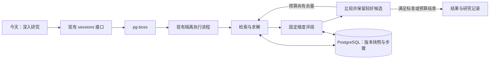

# Lab2 · 深入研究

[官方题面](https://jyywiki.cn/GSE/2026/lab2.md)要求在个人资料库之上增加 `effort`，通过探索、评阅与修改改善答案，并对比实际效果。本实现保留现有学习流程，增加独立的研究任务。

## 使用

1. 手动启动助手，进入“今天 → 深入研究”。
2. 填写问题与输出要求；可展开“研究资料”限定来源。不选时检索可用资料库（最多 100 份，更多时需手动选择）。
3. 在投入卡片中选择档位（卡片上的小方块是调用上限），点击“开始研究”。未连接模型时按钮不可用，并提示先去设置。
4. 结果页顶部显示采用了第几版及停止原因；答案下方的“研究记录”展示调用 / 用时 / token、实际执行步骤（含未完成的评阅）和候选版本时间线（每版四个维度的评分条、评阅依据与被移除的引文），也可下载 JSON 工作记录。

| 投入 | 执行方式 | 调用 / 时间上限 |
| --- | --- | --- |
| 直接 `direct` | 生成一次，作为基线 | 1 次 / 150 秒 |
| 标准 `low` | 求解 → 评阅 → 修改 → 再评阅 | 4 次 / 420 秒 |
| 深入 `high` | 求解、探索另一方向，再改进较好版本并检查反例；每个候选分别评阅 | 8 次 / 840 秒 |

时间上限于 2026-10-13 由 90/240/480 秒放宽（迁移 `0015`）：真实 `grok-4.7` 单次调用约 40–110 秒，标准档在 240 秒内无法走完 4 次调用。调用次数上限不变，费用仍由调用数约束；已有运行保留创建时的上限。

研究的单次请求最多等待 180 秒，并受本轮剩余时间限制；预留最多 5 秒保存已评阅答案，软停止不能延长硬截止时间。普通学习请求仍为 90 秒。所有模型请求默认流式返回（`stream: true`，用量取自最后一块）：经 Cloudflare 等代理的服务会在首字节超过 100 秒时返回 HTTP 524，流式返回在模型开始生成时即有数据，长回答不再被截断；服务拒绝流式字段（HTTP 400 / 422，未生成内容）时自动改用普通请求一次，只计一次调用。上限包括失败调用与自动恢复；达到标准可提前结束，深入档至少比较两份候选。服务停止期间不工作，恢复后沿用原截止时间与调用数。手动重试和提交修改意见会建立新的一轮预算。网页可关闭，后台任务仍然运行；“停止”会取消本轮并保留已保存的候选。

结果变差时保留旧版本；相同评分也保留旧版本。尚未评阅的新候选不会替换已评阅答案。直接档明确标为未评阅。超时或取消后，已保存的结果与候选仍可查看，但未收到完整响应的步骤不能算完成。

## 独立评阅模型

“设置 → 模型连接 → 独立评阅模型（深入研究）”可填写另一个兼容 Chat Completions 的地址与模型，例如另一家厂商的模型。填写后，求解仍用主模型，评阅改用该模型，减少同一模型重复自己的错误（题面所举 Humanize 的做法）。两项都留空则由主模型自评。

- 与主模型同一服务地址时可不填评阅密钥，沿用主密钥；更换到其他地址必须重新填写，旧密钥不会被发往新的服务。
- 密钥不回显、不进浏览器草稿；“测试已保存的连接”会依次测试主模型与评阅模型。
- 研究开始时记录评阅模型名称；运行中修改任一模型配置会按原有规则停止本轮，不在一次比较中途换模型。
- `pnpm research:eval` 同样读取配置中的评阅模型，并在 `report.json` 记录 `reviewModel`。

## 实现与数据



- `packages/contracts/src/research.ts`：投入、预算、答案、评阅和研究记录契约。
- `packages/core/src/research/engine.ts`：可独立测试的求解 / 评阅状态转换与选择策略。
- `packages/core/src/research/service.ts`：固定资料版本、检索、每步持久化、取消检查与最终交付。
- 迁移 `0014`：会话研究选项、每轮预算和 `app.research_workspaces`。原学习任务继续使用 5 次 / 180 秒。迁移 `0015` 把运行时间上限的约束放宽到 900 秒。
- 复用现有 Worker 的两路并发、子进程硬超时、运行代数校验和幂等创建，不增加常驻服务或另一套任务队列。
- 研究状态以 PostgreSQL 业务记录为准；学习图继续由 LangGraph 管理。研究是一个有界状态循环，无需在两种检查点中维护同一份候选。

开始时固定资料 ID、版本、摘要和规则。每轮在这些版本中检索，评阅可提出新的关键词；优先提供待核对引文，再补充不同资料中的片段。上下文限制为 24,000 字符；候选无法完整放入上下文时拒绝评阅，不默默只读一部分。

引文核对：模型给出的短引文先逐字匹配，失败时再忽略空白、全角/半角与弯引号差异匹配；保存的永远是原文中的确切片段与字符范围。找不到的引文不再让整份候选作废（以前会浪费一次付费调用），而是从候选中移除、记入 `droppedCitations` 并在页面列出，评阅时程序也会告诉评阅模型有几条已被移除，证据维度按剩余引文评分。

结构容错：模型回复外包一段说明文字或代码块时，提取其中第一个完整 JSON 对象；多余字段被丢弃，列表超长时截断，分数如 `3.0`/`"3"` 规整到 0–4。缺少必填项（如没有分数或正文）仍判为无效，不替模型补内容。正文超过 6000 字时在段落处截断并在“尚待核实”中注明。

工作区保留每份候选、父版本、引导策略、模型评阅、采用原因和资料版本。已采用的答案进入现有内容版本与文件导出；完整研究过程可从页面导出 JSON，数据库备份包含研究表。全部是私密应用数据，不提交 Git。

### 接口

复用管理员认证和写请求幂等键：

```http
POST /api/v2/sessions
Idempotency-Key: <本次请求的唯一标识>
Content-Type: application/json

{
  "kind": "work",
  "prompt": "比较两种方案，给出原文依据、反例和建议。",
  "research": { "effort": "high", "sourceIds": ["source-id"] }
}
```

- `GET /api/v2/sessions/:id`：现有详情增加 `research`，含最新研究记录与调用消耗。
- `GET /api/v2/sessions/:id/research/export`：下载问题和完整研究记录，不含模型密钥。
- `POST /api/v2/runs/:id/cancel`：停止当前执行。
- `POST /api/v2/sessions/:id/feedback`：按原档位处理修改意见。
- 现有 SSE 推送研究进展；页面定时读取详情用于恢复进度显示。

## 效果评估

固定案例见 `quality/research-cases.json`，包含隔离级别、需求规格和架构选型。评价标准在运行前保存。只有合成题目和材料会传给模型；标准答案检查线索不进入求解上下文。

```bash
pnpm research:eval  # 预演：不读密钥、不联网、不启动 Docker

# 需要已经手动启动 Docker；每次选一个案例，三档合计最多 13 次调用。
pnpm research:eval --live --config private/config.json --case isolation
```

macOS 若 Docker socket 未在当前 context 中配置，可为上条命令前置 `DOCKER_HOST=unix://$HOME/.colima/default/docker.sock`。脚本不会启动 Colima，会创建并清理自己的 PostgreSQL 测试容器，拒绝外部数据库环境变量；不连接实际助手数据库。

输出保存在 `private/research-eval-*/`：

- `report.json`：固定输入摘要、模型、三档结果、时间、实际调用数和服务端报告的 token。未报告或中断调用标为用量不完整，不推测费用。
- `blind.json`：移除投入与消耗标签、随机排列答案，供本人按预设标准比较；完成后再看档位映射。

未交付的情况也记录。发生失败则停止后续档位，不自动换模型、加预算或重复请求。需要补测时，可显式限定档位和剩余总预算，例如：

```bash
pnpm research:eval --live --config private/config.json --case isolation --effort low --effort high --max-calls 10
```

`--max-calls` 只能设为 1–13；覆盖这一命令的所有档位与失败调用，不能突破各档原上限。脚本不会自动合并跨命令预算；补测前须从整组授权额度中扣除已用次数。中途修订了提示词或超时策略时，报告应明确标注，不能当作同一实现的重复实验。

关键词出现仅是检查线索，不是语义正确率。

### 2026-10-13 的实际结果

使用现有 `grok-4.7` 对合成隔离级别案例作了累计 13 次请求的探索性对比。直接档完成；标准档早期版本触及 240 秒硬截止；深入补测遇到 HTTP 524，保留已评阅版本。最终版在剩余 2 次调用内完成求解与评阅，耗时 101 秒、9,365 token。这只覆盖两步，不能当作完整四次修改的真实验收，也没有证明更多投入提升质量。

据此增加了截止前保存时间、保留具体错误，并修正“未逐字出现即否定推断”的评阅倾向。中途实现变化及失败均保留在 `private/lab2-20261013/evaluation/`。整组 10 次请求返回用量、3 次未知；已报告 58,691 token，不推算未知费用。`lab2-blind.json` 和单独的 `lab2-blind-key.json` 供本人按标准评阅。

## 边界

未设置独立评阅模型时，评阅与求解使用同一个模型，可能共享错误；设置后仍只是另一个模型的意见。程序能核对引文来自哪一版原文，不能证明它足以支持结论。评分是模型判断，更多调用不保证更准确；没有证据时不能自动判为满足标准。

本轮检索本地资料，不自动搜索网页、不执行答案中的代码、不操作设备或邮箱。框架测试通过不等于真实模型质量提高；真实对比记录与人工核查结果应分别记录。
