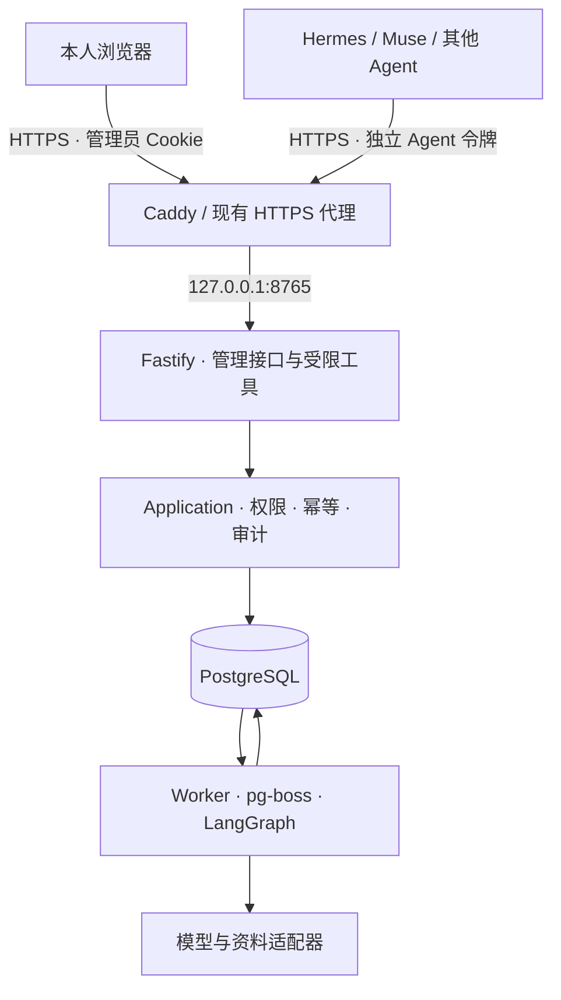

# 自有 VPS 部署

服务器负责持久运行 Yeux；Hermes、Muse 等作为外部客户端。当前 Mac 实例继续独立使用。Muse 云电脑不再作为部署目标。



## 环境与发布包

使用已有 Linux VPS，准备 Node.js 24+、Docker Engine 和 Compose 插件。仓库依赖与构建在 Node 24 容器内完成，宿主机不必安装 pnpm。先在 VPS 项目目录执行 `node scripts/server-probe.mjs`，核对系统、磁盘与 Docker。不要直接在容器里安装 Hermes、挂载 Docker socket 或开放数据库端口。

本机执行 `pnpm server:pack`，生成 `private/server-release/yeux-assistant-server-<版本>.tar.gz`。包内只有代码、公开文档和 SHA-256 清单，没有账号、模型密钥、学习资料、数据库或备份。核对包的 SHA-256 后上传到自己 VPS 的项目目录，解压并核对 `release-manifest.json`；不要覆盖现有数据目录。

## 建立独立实例

在 VPS 的项目目录：

```sh
node scripts/server-control.mjs init
node scripts/server-control.mjs check
node scripts/server-control.mjs start
node scripts/server-control.mjs admin
```

`init` 创建 `private/server/runtime.env`、随机数据库密码和数据目录 UID/GID，不改写已有文件。`admin` 由本人设置服务器账号，终端隐藏密码。也可以固定 `ASSISTANT_SERVER_DATA_DIR` 为其他绝对路径；所有后续命令必须使用相同值。

API 默认只发布 `127.0.0.1:8765`；数据库没有宿主机发布端口。服务器容器使用非 root 用户、只读根目录和 `unless-stopped`，宿主机与 Docker 恢复后继续运行。本机 Mac Compose 仍保持手动启动。

第一次可通过 SSH 隧道核对：

```sh
ssh -N -L 8765:127.0.0.1:8765 你的SSH别名
```

此时在**本机浏览器**打开 `http://127.0.0.1:8765`。如果本机端口已占用，先处理端口冲突；不要静默连接另一个助手实例。完成 HTTPS 配置后使用域名登录。

## HTTPS 入口

推荐在 VPS 宿主机使用 Caddy 或已有反向代理。若已有代理，不再运行第二个占用 80/443 的实例。

1. 使实际域名 A/AAAA 记录指向 VPS；没有可用 IPv6 时不要留下错误的 AAAA。
2. 将 `private/server/runtime.env` 的 `ASSISTANT_PUBLIC_ORIGIN` 改为 `https://你的域名`，保留原数据库密码、UID/GID 与其他设置。
3. 将 `deploy/Caddyfile.example` 中的保留示例域名换为实际域名，保持反向代理目标 `127.0.0.1:8765`（如修改应用端口，相应修改代理）。先用 `caddy validate --config <文件> --adapter caddyfile` 验证，再合并到现有 Caddy 配置。
4. 防火墙只需开放实际使用的 SSH 端口与 HTTPS 所需 80/443。5432、8765 保持不对公网开放。
5. 运行 `node scripts/server-control.mjs start` 应用来源配置；由当前服务器管理方式重新加载代理。

Caddy 会按域名配置自动管理 HTTPS；实际签发取决于 DNS 和端口可达性。样例关闭响应缓冲以支持浏览器 SSE。设置 `ASSISTANT_PUBLIC_ORIGIN` 本身不会创建 TLS 证书。应用按配置签发 Secure Cookie，并精确匹配浏览器 Origin，不信任客户端伪造的转发头。

来源：[Caddy 自动 HTTPS](https://caddyserver.com/docs/automatic-https)、[反向代理](https://caddyserver.com/docs/caddyfile/directives/reverse_proxy)。

## Agent 接入

用本人账号进入 **设置 → 管理连接**，分别为 Hermes、Muse 创建凭据。按照 [Agent 接入](agents.md) 配置远程 MCP 或 HTTP。建议先验证只读，再按需开放创建。Agent 不需要 SSH 权限、管理员账号或 `private/access-token`。

工具支持阅读、检索、建目标、准备任务，以及授权后的设备读取与操作提议；不提供批准设备、任意操作系统指令、浏览器、邮件发送或学习回答代填。真实设备通过主动连接 VPS 的本地执行器接入，仍需本人确认和状态核验；部署到 VPS 不会自动获得宿主硬件权限。当前 Mac 音量代码适配器尚待实机验收，详见 [设备接入](devices.md)。

## 日常运行、备份与更新

```sh
node scripts/server-control.mjs status
node scripts/server-control.mjs backup
node scripts/server-control.mjs stop
node scripts/server-control.mjs start
```

备份暂停该实例的 API/Worker，生成 PostgreSQL 与私密文件的一致快照，再恢复原来运行的服务。按 [恢复说明](restore.md) 在独立实例演练恢复，核对清单和数据关联后再处理正式实例。备份含账号配置、凭据哈希和学习资料，只保存到本人控制的受保护位置。

更新前保存当前发布包，并执行完整备份。**构建前给正在运行的旧镜像加上具名回退标签并用 `docker image inspect` 核实存在**，再记录 API/Worker 镜像 ID；仅记录 ID 不能保证重新构建后仍能创建旧容器。现有脚本绑定项目目录和数据路径，应在原项目目录更新代码，保留 `private/`；若要改部署路径，需要先制定迁移方案。不要使用 `docker compose down -v`。发布时等待 `/readyz` 健康检查通过，再验证迁移、登录、后台状态、已存在目标和引用、Agent 只读与撤销。容器进入 running 不代表迁移已经完成。

回退时先停止新版写入并保存新版完整备份。优先使用与当前数据库迁移兼容的旧镜像；需要回退数据库时，恢复到独立数据目录与卷进行核对，单独保留升级后新增记录，不能用旧备份覆盖而丢失它们。恢复旧备份还可能恢复已撤销的 Agent 状态，切换前须重新核对并撤销旧凭据。

## 验收与当前边界

| 检查 | 通过标准 |
|---|---|
| 入口 | 实际 HTTPS 证书有效；HTTP 重定向；应用与数据库没有公网监听 |
| 身份 | 匿名业务请求拒绝；本人登录正常；Agent 令牌不可调用管理员接口 |
| 学习 | 创建合成目标、等待材料、本人回答后继续；重启后状态保留 |
| Agent | MCP 握手、工具发现、只读、幂等创建、状态查询和撤销全部通过 |
| 数据 | 备份哈希核对和独立恢复成功；旧引用与原件一致 |
| 运维 | 宿主机重启恢复、磁盘空间、备份位置与保留周期有实际核对记录 |

`pnpm verify:server` 使用合成数据验证独立容器；`pnpm test` 的 Agent 用例使用真实 PostgreSQL 与官方 MCP 客户端。它们不能代替你的 VPS 公网验收，也不代表 Hermes/Muse 账号已经连接。现阶段尚未提供 VPS 地址、域名和连接信息，未部署远程实例或上传个人数据。
